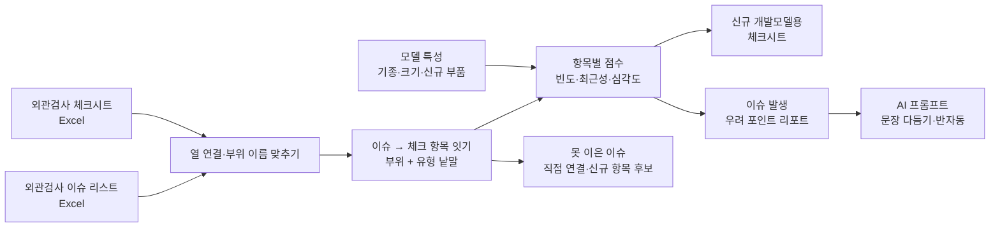

# 개발장비 외관평가 Agent — 프로젝트 기획서

| 항목 | 내용 |
|---|---|
| 리포 | data10-04 |
| 제출자 | 이은학 |
| 직무·소속 | 선행품질파트 (회사명 생략) |
| 과정 | 현장 데이터 디지털화 전문가과정 2차수 |
| 작성일 | 2026-10-20 |
| 문서 상태 | 초안 v0.1 — 수강생 제출 자료 기반 |

---

## 1. 추진 배경과 현안

- 개발장비(개발 단계의 신규 모델)는 외관검사 체크시트로 외관 품질을 확인합니다.
- 그런데 체크시트 항목이 **실제로 이슈가 자주 난 곳을 반영하지 못하고** 있습니다. 모든 항목을 같은 무게로 보게 되어, 자주 터지는 곳과 거의 문제가 없는 곳의 구분이 없습니다.
- 과거 개발모델의 외관검사 이슈 리스트는 따로 쌓여 있어, 체크시트를 고칠 때 이슈 리스트를 하나씩 대조해야 하는 것으로 보입니다(가정).
- 새 개발모델이 나오면 그 모델의 특성(기종·크기·신규 부품 등)에 맞춰 **어디를 더 꼼꼼히 볼지**를 담당자 경험으로 정하고 있는 것으로 보입니다(가정).

## 2. 목표

### 2.1 최종 목표

- 외관검사 이슈 리스트를 체크시트 항목에 이어, **항목마다 실제 이슈 발생 빈도**를 보이게 합니다.
- 개발모델의 특성에 따라 **체크시트를 최적화**합니다 — 위험한 항목을 앞으로(중점), 이슈가 없는 항목은 생략 후보로, 체크시트에 없던 이슈는 신규 항목 후보로.
- 신규 개발모델의 **이슈 발생 우려 포인트**를 근거 숫자와 함께 산출합니다.

### 2.2 1차 개발 목표

1차는 **지금 가진 엑셀 두 가지(체크시트·이슈 리스트)만으로 바로 쓸 수 있는 브라우저 도구**에 집중합니다.

- 체크시트·이슈 리스트 엑셀 가져오기(열 연결 화면)
- 이슈 → 체크 항목 잇기(부위 이름 맞추기 + 유형 낱말 사전), 못 이은 이슈는 직접 연결
- 항목별 빈도·최근성·심각도 점수, 모델 특성으로 거르기
- 신규 개발모델용 체크시트(엑셀·인쇄)
- 우려 포인트 리포트, 문장 다듬기는 AI 프롬프트(반자동)

## 3. 보유 데이터

| 데이터 | 형태 | 규모·주기 | 비고(민감도 등) |
|---|---|---|---|
| 개발장비 외관검사 체크시트 | Excel로 가정 | 미상 | 한 줄 = 점검 항목 하나로 가정. 부위·점검 항목·검사 방법·판정 기준 칸이 있을 것으로 가정 |
| 개발장비 외관검사 이슈 리스트 | Excel로 가정 | 미상(여러 개발모델 누적으로 가정) | 한 줄 = 이슈 하나로 가정. 모델·부위·이슈 내용·발생일이 있을 것으로 가정. 개발 중 모델 이름은 사내 정보 — 외부 반출 주의 |
| 개발모델 특성 | 미상 | — | 기종·크기·신규 부품 여부를 어디서 관리하는지 확인 필요(10장) |

제출 원문에 첨부 파일은 없습니다. 열 구성·건수는 자료를 받은 뒤 확정합니다. 받은 자료는 회사 자료라 리포에 넣지 않고, 1단계는 같은 모양의 **가상 데이터**(모델 X-100 등)로 만듭니다.

## 4. 해결 방안 개요

| 단계 | 내용 |
|---|---|
| 수집 | 외관검사 체크시트, 외관검사 이슈 리스트, 개발모델 특성 |
| 정리 | 열 연결로 공통 항목에 맞추고, 부위 이름 흔들림(CAB·캐빈·캡, C/W·카운터웨이트 등)을 대표 이름으로 맞춤 |
| 잇기 | 같은 부위 + 같은 점검 유형(도장·실링·간섭 등 — 이슈 내용의 낱말로 찾음)이면 그 체크 항목에 이음. 못 이은 이슈는 직접 고르거나 신규 항목 후보로 |
| 분석 | 항목별 이슈 빈도·최근성·심각도 가중 점수, 모델 특성별 비교, 여러 모델에서 되풀이된 항목 |
| 산출물 | 신규 개발모델용 체크시트(중점·일반·생략 후보·신규 후보), 우려 포인트 리포트, AI 의견(반자동) |

**핵심 열쇠는 체크시트 항목과 이슈를 잇는 공통 키입니다.** 지금은 「부위 이름 + 점검 유형」을 키로 가정했습니다. 이슈 리스트에 체크 항목 번호가 이미 적혀 있다면 그 번호로 바로 잇는 것이 가장 정확합니다(10장에서 확인).

## 5. 주요 기능

| 기능 | 설명 | 우선순위 |
|---|---|---|
| 체크시트 가져오기·편집 | 체크시트 Excel 을 읽어 부위·점검 항목·검사 방법·판정 기준·점검 유형으로 정리. 열 이름이 달라도 열 연결 화면에서 이음. 유형 칸이 없으면 항목 글로 추정. 화면에서 더하기·고치기·지우기 | MVP |
| 이슈 리스트 가져오기 | 모델·발생일·부위·이슈 내용·심각도·유형·조치 열을 연결. 같은 이슈는 다시 넣어도 한 건. 같은 통합문서의 「모델 정보」 시트도 읽음 | MVP |
| 이슈 → 체크 항목 잇기 | 부위 이름 사전 + 유형 낱말 사전으로 자동 연결. 못 이은 이슈(체크시트에 없는 부위·그 부위에 없는 유형·유형 못 찾음)는 목록으로 보여 직접 연결 | MVP |
| 신규 항목 후보 | 체크시트에 없는 이슈를 (부위·유형)으로 묶어 보여 주고, 확인하면 체크시트에 항목으로 더함 | MVP |
| 항목별 위험 점수 | 빈도·최근성(반감기)·심각도(상·중·하 무게) 가중 점수. 가중치는 설정에서 조정. 기종·크기·신규 부품으로 걸러 보기 | MVP |
| 신규 개발모델용 체크시트 | 신규 모델 특성(기종·크기·신규 부품·신규 부품 부위)을 넣으면, 닮은 모델의 이슈를 더 무겁게 반영해 위험 항목을 앞으로. 중점·일반·생략 후보·신규 후보로 나누고 Excel·인쇄로 내보냄 | MVP |
| 우려 포인트 리포트 | 상위 우려 포인트(근거 숫자), 신규 부품 유무별 비교, 되풀이 항목, 신규 항목 후보. 인쇄·Word·Excel | MVP |
| AI 문장 다듬기 | 계산된 사실만 담은 프롬프트를 복사해 사내 허용 AI 에 붙여 넣는 반자동. 모델 이름은 기본으로 별칭으로 가림. 선택: OpenAI 호환 서버로 자동 보내기 | MVP(반자동) |
| 외관검사 결과 입력 | 체크시트로 검사한 결과(OK/NG)를 도구에 입력해 이슈 리스트로 자동 누적 | 확장 |
| 사진 기반 이슈 기록 | 외관 이슈 사진을 이슈에 붙이고, 사진으로 부위·유형 분류 제안 | 확장 |
| 팀 공유 | 여러 담당자가 같은 체크시트·이슈를 함께 씀 | 확장 |

## 6. 기대 산출물

1. **외관평가 브라우저 도구** — 체크시트·이슈 리스트 가져오기, 잇기, 점수
2. **항목별 이슈 빈도 표** — 체크 항목마다 이슈 수·최근 발생·심각도·관련 모델
3. **신규 개발모델용 체크시트** — 중점·일반·생략 후보·신규 후보, Excel·인쇄
4. **이슈 발생 우려 포인트 리포트** — 근거 숫자 + AI 문장(반자동)
5. **체크시트 개정 후보 목록** — 체크시트에 없던 이슈 묶음

## 7. 기술 구성

| 과정 도구 | 이 프로젝트에서 쓰는 곳 |
|---|---|
| DAY1 암묵지 자산화·전략기획 | 「우려 포인트」를 정하는 담당자의 판단 기준, 개발모델을 나누는 기준, 생략해도 되는 항목의 기준을 꺼내 적기 |
| DAY2 코랩(Python)·바이브코딩 | 이슈 리스트 정리, 부위 이름 맞추기·유형 낱말 사전 시험, 점수 계산, 브라우저 도구 제작 — 1단계의 중심 |
| DAY3 멀티모달 비정형 정보화 | 외관 이슈 사진·검사 메모를 표로 바꾸기 (2단계) |
| DAY4 RAG (Dify, NotebookLM) | 외관 판정 기준서·과거 개선 보고서를 근거로 한 질의 (2~3단계) |
| DAY5 Make 자동화 | 새 이슈 등록 시 체크시트 담당자 알림, 정기 리포트 발송 (확장, 보안 허용 시) |
| 생성형 AI | 우려 포인트 문장화, 검사 시 확인할 점 정리 (1단계는 프롬프트 반자동) |

**개발 형태(권장)**

- 1단계는 **설치 없이 브라우저에서 도는 정적 웹 도구**로 만듭니다. Excel 을 브라우저 안에서만 읽고 계산하므로 **개발 중 모델 정보가 외부로 나가지 않습니다.** 잇기·점수·체크시트 최적화는 규칙 계산이라 AI 서비스가 필요 없습니다.
- 우려 포인트 문장은 도구가 AI 를 직접 부르지 않고 **프롬프트만 만들어 복사**하게 합니다. 모델 이름은 「모델1」 같은 별칭으로 바꿔 보냅니다. 사내 허용 AI 가 OpenAI 호환 API 를 열어 두었다면 설정에서 주소·모델·본인 키를 넣어 자동으로 보낼 수 있습니다(선택).
- 여러 사람이 함께 쓰려면 공유 저장소가 필요합니다. 1단계는 이 브라우저(localStorage)에 저장하고 JSON 백업으로 옮깁니다.

## 8. 개발 단계

### 1단계 — 지금 바로 개발 가능한 부분

체크시트와 이슈 리스트 **엑셀 두 가지만 있으면** 쓸 수 있는 기능을 먼저 만듭니다. 자료를 받기 전에는 가상 데이터로 만들고, 자료를 받으면 열 연결·부위 사전·유형 사전만 맞춥니다.

- ① 체크시트 마스터 가져오기·편집(부위·항목·검사 방법·판정 기준·점검 유형·필수)
- ② 이슈 리스트 가져오기(열 연결), 모델 정보 시트 함께 읽기
- ③ 이슈 → 체크 항목 잇기(부위 이름 맞추기 + 유형 낱말 사전), 못 이은 이슈 목록에서 직접 연결, 「체크시트에 없는 이슈」를 신규 항목 후보로 묶어 체크시트에 더하기
- ④ 항목별 발생 빈도·최근성·심각도 가중 점수(설정에서 가중치 조정), 모델 특성(기종·크기·신규 부품)으로 거르기
- ⑤ 신규 개발모델 특성을 넣으면 최적화된 체크시트(상위 위험 항목을 앞으로, 중점·일반·생략 후보, 신규 항목 후보 추가) — 엑셀·인쇄
- ⑥ 이슈 발생 우려 포인트 리포트(근거 숫자), AI 프롬프트로 문장화(모델 이름 별칭 가림)
- 시험용 가상 데이터(체크 항목 62개, 모델 8개, 이슈 146건)에는 일부러 **신규 부품 모델의 실링·간섭 이슈 증가, 모델을 가리지 않고 되풀이되는 도장 이슈, 체크시트에 없는 이슈(공구함·배터리커버·캡도어 녹)**, 여러 가지로 적은 부위 이름을 넣어, 잇기·점수·후보가 제대로 되는지 확인합니다.

### 2단계

- 실제 체크시트·이슈 리스트로 열 연결·부위 사전·유형 사전 보정
- 지금 쓰는 우려 포인트 판단 기준을 점수 규칙에 반영(가중치·생략 기준 확정)
- 이슈 리스트에 체크 항목 번호를 함께 적는 양식 제안(잇기 정확도 향상)
- 외관검사 결과(OK/NG) 입력 → 이슈 리스트 자동 누적

### 3단계

- 외관 이슈 사진 붙이기, 사진으로 부위·유형 분류 제안
- 판정 기준서·개선 보고서 기반 질의(RAG)
- 팀 공유 저장소, 사내 허용 AI 와 직접 연결

## 9. 기대 효과

- **체크시트에 실제 이슈가 반영됨** — 항목마다 이슈 빈도가 보여, 자주 터지는 곳을 먼저·꼼꼼히 봅니다.
- **신규 모델 검사 준비 시간 단축** — 모델 특성만 넣으면 그 모델용 체크시트 초안이 나옵니다.
- **체크시트 개정 근거 확보** — 체크시트에 없던 이슈가 묶음으로 드러나 항목 추가 근거가 됩니다.
- **우려 포인트 판단의 일관화** — 담당자 경험에 더해 같은 기준의 숫자로 설명할 수 있습니다.

제출 자료에는 정량 수치가 없어 이 문서도 수치를 적지 않습니다.

## 10. 확인 필요 사항

패들릿 답글로 아래 자료를 요청해 두었습니다. **가장 중요한 것은 체크시트 항목과 이슈를 잇는 공통 키(부위명 등)입니다.**

**샘플 데이터 (필수)**

1. 지금 쓰는 **외관검사 체크시트 양식**(항목 목록) — 부위·점검 항목·검사 방법·판정 기준 칸 구성, 항목에 번호가 있는지
2. **이슈 리스트 몇십 행** — 모델·부위·이슈 내용·발생일(+ 심각도·조치가 있으면 함께), 한 줄이 이슈 하나인지
3. 이슈 리스트의 부위 이름이 체크시트의 부위 이름과 같은 말로 적히는지, 이슈에 체크 항목 번호를 적는 칸이 있는지(**공통 키**)

**분류·판정 기준**

4. **개발모델을 나누는 기준** — 기종·크기(톤급)·신규 부품 여부 외에 쓰는 기준이 있는지, 모델 특성을 어디서 관리하는지
5. 지금 **우려 포인트를 정하는 판단 기준·우선순위 방식** — 빈도·최근성·심각도 가운데 무엇을 더 무겁게 보는지, 심각도 등급(상·중·하 등)이 있는지
6. 이슈가 없던 항목을 **생략해도 되는지** — 안전·법규 표시처럼 이슈가 없어도 빼면 안 되는 항목이 있는지

**보안·환경**

7. 개발 중 모델 이름·이슈 내용을 외부 AI(ChatGPT 등)에 올려도 되는지, 사내에서 허용된 AI 가 있는지
8. 도구를 혼자 쓰는지, 선행품질파트가 함께 쓰는지(공유 저장소 필요 여부)

## 부록. 제출 원문 요약

| 출처 | 파일·게시물 | 내용 |
|---|---|---|
| 패들릿 게시물 (2차수 접수) | 「개발장비 외관평가 Agent」 — `docs/source/패들릿_접수_원문.md` | 직무·소속(선행품질파트, 회사명 생략), 현안(외관검사 체크시트에 실제 이슈 발생 빈도 반영), 보유 데이터(외관검사 체크시트, 외관검사 이슈 리스트), 기대 산출물(개발모델에 따른 체크시트 최적화, 이슈 발생 우려 포인트 산출) |

첨부 파일은 제출되지 않았습니다.
