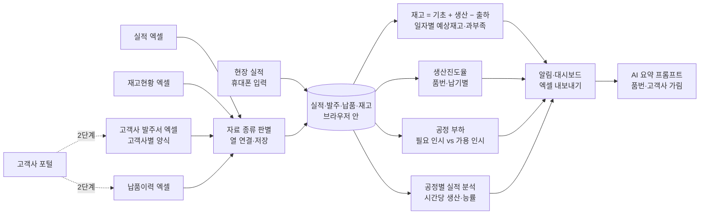

# 생산진도율 자동화 — 프로젝트 기획서

| 항목 | 내용 |
|---|---|
| 리포 | data10-05 |
| 제출자 | 박주헌 |
| 직무·소속 | 계획운영팀 (회사명 생략) |
| 과정 | 현장 데이터 디지털화 전문가과정 2차수 |
| 작성일 | 2026-10-20 (v0.2 2026-10-21) |
| 문서 상태 | v0.2 — 실제 재고 체크 양식·포털 발주서·수기 양식 사진 반영(11장) |

---

## 1. 추진 배경과 현안

- 계획운영팀은 고객사 발주에 맞춰 생산이 어디까지 왔는지(생산진도)를 매일 확인해야 합니다.
- 제출 글의 현안은 세 가지입니다.
  1. **현장 실적 전산 입력** — 현장 실적이 바로 전산에 들어오지 않습니다.
  2. **고객사 발주서·납품이력 자동 다운로드** — 고객사마다 발주서·납품이력을 따로 내려받아 모으고 있습니다.
  3. **출하 대비 재고현황 자동 산출** — 재고현황이 수기에서 엑셀로 옮겨지는 수준이라, 출하(납기)에 비해 재고가 모자라는지 바로 알기 어렵습니다.
- 이 세 가지가 이어지지 않아, 재고가 모자라거나 특정 공정에 일이 몰려도 미리 알기 어려운 상황으로 보입니다(가정).

## 2. 목표

### 2.1 최종 목표

- 현장 실적·고객사 발주·납품·재고가 한곳에 모여 **품번·납기별 생산진도율**이 자동으로 나오는 체계
- **재고 과부족 알림** — 납기별 출하를 빼 나가며 안전재고 아래로 내려가는 날을 미리 알림
- **공정별 근무 투입조정 알림** — 남은 발주를 납기까지 만들려면 공정마다 몇 사람·몇 시간이 필요한지
- **공정별 실적 분석** — 시간당 생산·능률·목표 대비
- 고객사 포털에서 발주서·납품이력을 자동으로 받아 오기(포털별 확인 후)

### 2.2 1차 개발 목표

1차는 **설치 없이 브라우저에서 도는 도구**로, 지금 있는 엑셀(재고현황·발주서)과 현장에서 휴대폰으로 넣는 실적만으로 바로 쓸 수 있게 합니다. 고객사 포털 자동 다운로드와 사내 전산 연동은 포털·전산 환경을 확인한 뒤 2단계에서 다룹니다.

## 3. 보유 데이터

| 데이터 | 형태 | 규모·주기 | 비고(민감도 등) |
|---|---|---|---|
| 재고 체크(재고현황) | 수기 양식 → 엑셀 통합문서, 날짜마다 시트 하나 | 근무일 아침(체크시간 기록, 금일 출하분 제외) · 모델 5개 안팎 | 모델 × 출하(누계)·완성·공정별 수량(도킹·가공·MT·사상·로봇)·가접(투입 누계). 안전재고 열 없음. 주차 집계 시트·빈 양식 시트가 섞여 있음 |
| 고객사 발주서 | 고객사 협력사 포털(SRM)에서 내려받은 엑셀 | 69열, 한 행 = 납입지시 1건(1대) | 자재코드(고객사 품번)·납기요청일시·납입지시수량·납품수량. 고객사 이름·품번 포함 — 외부 반출 주의 |
| 납품이력 | 따로 받지 않음 | — | 출하 누계는 재고 체크 양식에, 이미 나간 수량은 포털 발주서의 「납품수량」에 있음 |
| 현장 생산 실적 | 공정별 실적은 따로 적지 않음 | — | 재고 체크 두 번 사이의 차이로 공정별 실적을 계산(11장). 작업자수·작업시간 기록은 없음 |

1차(v0.1)는 견본 없이 가상 샘플로 만들었고, 2026-10-21 받은 실제 양식 3종으로 2차 반영했습니다(11장). 가상 샘플도 실제 양식과 같은 모양으로 다시 만들었습니다(값·품번·고객사는 가짜).

## 4. 해결 방안 개요

| 단계 | 내용 |
|---|---|
| 수집 | 현장 실적(휴대폰 입력 또는 엑셀), 재고현황·발주서·납품이력 엑셀 |
| 정리 | 머리행·자료 종류 자동 판별, 고객사별 열 이름을 표준 항목에 연결(한 번 맞추면 저장), 품번 표기 정리, 같은 행 두 번 세지 않기 |
| 분석 | 재고 = 기초재고 + 완성 공정 실적 − 납품, 납기별 예상재고, 진도율, 공정별 필요·가용 인시, 공정 능률 |
| 산출물 | 알림 목록·대시보드, 품번별 과부족 표, 발주별 진도율, 공정 투입조정 카드, 공정 실적 표·그래프, 분석 엑셀, AI 요약 |

## 5. 주요 기능

| 기능 | 설명 | 우선순위 |
|---|---|---|
| 현장 실적 입력 | 휴대폰 화면 — 일자·공정·품번·수량·작업자수·작업시간·비고. 공정은 큰 버튼, 품번은 목록에서 고르기. 마지막 값 기억 | MVP |
| 실적 엑셀 넣기 | 종이 실적을 사무실에서 한꺼번에. 「실적 표준 형식」 엑셀을 내려받아 같은 열로 쓰면 자동 연결 | MVP |
| 발주서·납품이력 여러 파일 가져오기 | 고객사별 양식이 달라도 자료 종류를 판별하고 열을 연결. 고객사 열이 없으면 파일 이름에서 고객사 추정. 연결은 머리행 모양별로 저장해 다음 달 같은 양식에 자동 적용 | MVP |
| 재고 과부족 | 재고 = 기초재고(재고현황 기준일) + 완성 공정 실적 − 납품. 납기별 미출하 발주를 빼 나가며 일자별 예상재고, 첫 부족일·결품 예상일, 부족수량 | MVP |
| 생산진도율 | 발주마다 (출하 완료 + 완성재고 충당) ÷ 발주수량. 완성재고는 납기 빠른 발주부터. 최근 평균 완성 실적으로 예상 충당일, 지연 우려 표시 | MVP |
| 공정 부하 · 근무 투입조정 알림 | 납기가 몰린 날마다 그날까지 필요한 인시(남은 발주 ÷ 시간당 능력)와 가용 인시(인원 × 근무시간 × 근무일) 비교. 「투입 늘리기(하루 몇 명)」「여유(지원 가능 인시)」 | MVP |
| 공정별 실적 분석 | 일자·주별 수량, 투입 인시, 시간당 생산(개/인시), 기준 대비 능률, 일 목표 대비 달성, 최근 능률 저하 알림 | MVP |
| 대시보드·엑셀 내보내기 | 알림 목록(긴급·경고·주의·정보), 요약 타일, 그래프, 분석 엑셀(11개 시트), 공유 글 복사 | MVP |
| AI 요약(반자동) | 계산된 사실만 담은 프롬프트. 품번·고객사는 별칭으로 가림(기본). 선택: 본인 키로 OpenAI 호환 서버에 자동 보내기 | MVP(반자동) |
| 고객사 포털 자동 다운로드 | 포털별로 로그인·내려받기 자동화 가능 여부 확인 후 | 확장 |
| 팀 공유 저장 | 실적 입력을 여러 사람이 함께 쓰는 공유 DB | 확장 |
| 메신저·메일 알림 | 긴급 알림을 정해진 시각에 담당자에게 보냄(Make) | 확장 |

## 6. 기대 산출물

1. **생산진도 도구(브라우저)** — 실적 입력, 엑셀 가져오기, 대시보드
2. **재고 과부족 알림** — 품번별 첫 부족일·결품 예상일·부족수량과 일자별 예상재고
3. **품번·납기별 생산진도율** — 발주마다 진도율·예상 충당일·지연 우려
4. **공정별 근무 투입조정 알림** — 투입 늘리기(하루 추가 인원)·여유(지원 가능 인시)
5. **공정별 실적 분석** — 시간당 생산·능률·목표 대비 표와 그래프
6. **분석 엑셀·공유 글·AI 요약 초안**

## 7. 기술 구성

| 과정 도구 | 이 프로젝트에서 쓰는 곳 |
|---|---|
| DAY1 암묵지 자산화·전략기획 | 계획운영팀이 「재고가 모자란다」「이 공정에 사람을 더 넣어야 한다」고 판단하는 기준(안전재고, 공정별 시간당 능력, 잔업 기준)을 꺼내 적기 |
| DAY2 코랩(Python)·바이브코딩 | 발주서 양식별 열 연결, 재고·진도율·부하 계산 로직, 브라우저 도구 제작 — 1단계의 중심 |
| DAY3 멀티모달 비정형 정보화 | 수기 재고현황·실적 일보 사진을 표로 옮기기(2단계, 양식을 받은 뒤) |
| DAY4 RAG (Dify, NotebookLM) | 공정 표준·작업표준서를 근거로 한 투입조정 질의(3단계, 필요 시) |
| DAY5 Make 자동화 | 고객사 포털 메일·파일 수집, 긴급 알림 발송(2단계, 보안 허용 시) |
| 생성형 AI | 알림·부하 결과 요약과 투입조정 제안 초안(1단계는 반자동) |

**개발 형태(권장)**

- 1단계는 **설치 없이 브라우저에서 도는 정적 웹 도구**입니다. 엑셀을 브라우저 안에서만 읽고 계산하므로 **고객사·품번·수량이 외부로 나가지 않습니다.** 휴대폰으로도 열 수 있어 현장 입력에 씁니다.
- 자료는 그 브라우저에 저장됩니다. 현장 휴대폰과 사무실 PC 가 같은 자료를 보려면 공유 저장소가 필요해, 1단계에서는 「실적 표준 형식」 엑셀로 옮기고 2단계에서 공유 DB 로 넘어갑니다.
- AI 는 도구가 직접 부르지 않는 것이 기본입니다(프롬프트 복사 → 회사가 허용한 AI). 본인 키·사내 서버 주소를 넣은 경우에만 자동 보내기를 씁니다. 키는 리포에 없습니다.

## 8. 개발 단계

### 1단계 — 지금 바로 개발 가능한 부분

견본 엑셀을 받기 전에도 쓸 수 있도록 **엑셀 업로드 + 휴대폰 실적 입력** 방식으로 만듭니다. 견본을 받으면 열 연결만 맞춥니다.

- (a) **현장 실적 입력** — 휴대폰 화면(일자·공정·품번·수량·작업자수·작업시간), 이 브라우저에 저장. 엑셀로 한꺼번에 넣기도 가능
- (b) **발주서·납품이력 여러 파일 가져오기** — 자료 종류 자동 판별, 열 연결(저장·재사용), 고객사 열이 없으면 파일 이름에서 추정, 같은 발주는 새 값으로 바꾸고 같은 납품은 한 번만
- (c) **재고 = 기초재고 + 생산 − 출하** — 일자별 예상재고·과부족, 안전재고 알림(긴급·결품 예상·안전재고 미달)
- (d) **생산진도율** = (출하 완료 + 완성재고 충당) ÷ 발주수량, 품번·납기별, 예상 충당일
- (e) **공정별 실적 분석**(시간당 생산·능률·일 목표 대비)과 **근무 투입조정 알림**(남은 발주 기준 필요 인시 vs 가용 인시)
- (f) **대시보드 + 엑셀 내보내기**, 공유 글, AI 요약 프롬프트(품번·고객사 가림)
- 가상 샘플에는 일부러 **병목 공정 하나(로봇 — 잔업으로 버텨 왔고 최근 능률 저하)** 와 그 때문에 **다음 주 결품이 예상되는 모델 하나(SMP-K30B — 로봇 앞에 쌓이고 뒤 공정 재공이 바닥)** 를 넣어, 알림이 제대로 나오는지 확인합니다(2차에서 실제 양식 모양으로 바꿈).

**고객사 포털 자동 다운로드를 2단계로 미룬 이유** — 포털마다 로그인 방식(아이디·인증서·OTP)과 내려받기 화면이 다르고, 자동 로그인·스크래핑이 포털 이용 약관이나 회사 보안 규정에 맞는지 포털별로 확인해야 합니다. 엑셀 내려받기 버튼이 있는 포털은 「내려받은 파일을 폴더에 모으면 도구가 읽는」 방식부터, 메일로 발주서가 오는 고객사는 메일 첨부 수집(Make)부터 검토합니다.

**다른 수강생과 실적 공유를 위한 설계** — 같은 공장의 프레임 제작팀 과제(2차수 08번)도 공정별 실적·달성률 자료가 필요합니다. 그래서 실적은 처음부터 **「실적 표준 형식」(일자·공정·품번·수량·작업자수·작업시간·비고·입력경로)** 한 가지로 저장하고, 이 형식 그대로 엑셀로 내보내고 다시 읽을 수 있게 했습니다. 2단계에서 공유 DB 를 만들 때 이 형식을 표 하나로 옮기면 두 과제가 같은 실적을 함께 씁니다(공정 이름·품번 표기를 두 팀이 맞추는 일이 먼저 필요합니다).

**1단계 가정**

- 공정 순서의 마지막 공정 실적이 완성품(재고 증가)입니다. 모든 품번이 모든 공정을 거친다고 봅니다.
- 재고현황 기준일은 그날 아침(작업 시작 전) 재고입니다. 기준일부터의 완성 실적·납품으로 오늘 재고를 계산합니다.
- 예상재고에는 최근 10근무일 평균 완성 실적을 더합니다(끌 수 있음). 생산계획 양식이 있으면 2단계에서 계획으로 바꿉니다.
- 공정 재공은 「앞 공정 누적 − 완성 공정 누적」(재고 기준일 이후)으로 추정합니다.
- 가용 인시는 정규 근무 기준(인원 × 근무시간 × 근무일)입니다.
- 안전재고·시간당 능력·알림 기준값은 모두 시작값이며 설정에서 바꿉니다.

### 2단계

- 받은 견본으로 열 연결·품번 표기 맞추기, 알림 기준값을 계획운영팀 기준으로
- 고객사 포털별 자동 수집(가능한 포털부터), 메일 첨부 수집(Make)
- 실적 공유 DB — 실적 표준 형식 그대로, 프레임 제작팀과 공유
- 품번별 공정 경로·표준시간, 생산계획 대비 진도
- 긴급 알림 메신저·메일 발송

### 3단계

- 사내 전산(ERP·MES) 연동 — 전산 담당 부서와 연동 방식 확인 후
- 수기 일보 사진 → 표 자동 변환
- AI 투입조정 제안을 사내 허용 AI 와 직접 연결

## 9. 기대 효과

- **진도 확인 시간 단축** — 고객사별 파일을 열어 손으로 맞추지 않고 품번·납기별 진도율을 한 화면에서 봅니다.
- **결품 사전 대응** — 납기 전에 안전재고 아래로 내려가는 날을 미리 알아 생산 순서를 바꿀 수 있습니다.
- **인원 배치 근거** — 「어느 공정에 하루 몇 명이 더 필요한지」를 인시 숫자로 말할 수 있습니다.
- **실적 기록 표준화** — 현장 실적이 같은 형식으로 쌓여 다른 팀도 함께 쓸 수 있습니다.

제출 자료에는 정량 수치가 없어 이 문서도 수치를 적지 않습니다.

## 10. 확인 필요 사항

> 2026-10-21 받은 답(실제 양식 3종·알림 기준)으로 ①~④는 반영했습니다(11장). 아래 「남은 질문」 3개를 패들릿 답글로 다시 여쭙니다.

**받은 것 (반영 완료)**

1. ~~재고현황·발주서 엑셀 견본~~ — 재고 체크 통합문서(날짜별 시트)와 포털 납입지시 엑셀을 받아 그대로 읽게 했습니다.
2. ~~현장 실적 기록 방식~~ — 수기 재고 체크 양식(모델 × 출하·완성·공정별 수량)을 받아 휴대폰 입력 화면을 같은 칸 순서로 만들었습니다.
3. ~~자동 다운로드 대상~~ — 고객사 협력사 포털(SRM)의 엑셀 내려받기. 1단계는 내려받은 파일을 넣고, 자동 받기는 로그인 방식 확인 뒤(아래 6).
4. ~~알림 기준값~~ — 「고객사 월 물량 ÷ 근무일수 = 평균 일 출하대수, × 공정별 리드타임 = 공정별 안전재고」를 산식으로 넣었습니다.

**남은 질문 (다시 여쭙기)**

5. **발주 품번 ↔ 재고 모델 대응표** — 포털 발주서는 고객사 자재코드(품번), 재고 체크는 모델 단위라 둘을 잇는 표가 필요합니다. 품번마다 어느 모델인지, 좌·우처럼 **여러 품번이 모여 1대**가 되는지(세트), 1대에 몇 개씩 들어가는지 알려 주세요. 설정 화면 「발주 품번 → 재고 모델 연결」에 바로 넣을 수 있게 만들어 두었습니다.
6. **월 물량의 출처와 근무일수** — 받은 발주서는 이번 달 중 일부 납기만 들어 있어, 발주서 합계로는 월 물량이 적게 잡힙니다. 포털에서 **한 달 치 납입지시를 한 번에 받을 수 있는지**, 아니면 고객사가 **월 계획 물량을 따로** 주는지, 근무일수는 무엇을 기준으로 세는지(특근 포함 여부) 알려 주세요.
7. **공정별 리드타임 값과 안전재고의 뜻** — 공정마다 리드타임(일)과 완성재고(출하 대기) 리드타임을 알려 주세요. 도구는 「그 공정에 와 있는(기다리거나 작업 중인) 수량」을 공정 안전재고와 비교합니다. 이 뜻이 맞는지, 가접은 양식에 투입 누계만 있어 그 공정에 머무는 수량을 알 수 없는데 따로 적을 필요가 있는지도 여쭙니다.

**도구 맞추기 (이어서)**

8. 품번마다 거치는 공정이 다른지(공정 경로) — 지금은 모든 모델이 가접 → 로봇 → 사상 → MT → 가공 → 도킹을 거친다고 봅니다(양식 메모의 「일부 모델은 부착 전 가공」 같은 예외).
9. 생산계획(일자별 계획 수량) — 주차 집계 시트에 공정별 「실적·계획·차이」 칸이 있는데, 계획을 다른 곳에서 받는지
10. 포털 자동 받기 — 로그인 방식(아이디·인증서·OTP)과 회사의 자동화 허용 여부

**보안·환경**

11. 고객사·품번을 외부 AI 에 보내도 되는지, 사내에서 허용된 AI 가 있는지
12. 현장 휴대폰으로 사내 웹을 열 수 있는지, 여러 사람이 함께 입력해야 하는지(공유 저장 필요 여부)
13. 프레임 제작팀(08번)과 공정 이름·품번 표기를 맞춰 실적을 함께 써도 되는지

## 11. 2차 반영 (2026-10-21, 실제 자료)

받은 자료: 재고 체크 엑셀 통합문서, 포털에서 내려받은 고객사 발주서 엑셀, 수기 재고 체크 양식 사진. 실제 값·품번·고객사는 리포에 넣지 않고 내 PC 에서만 대조했습니다.

### 11.1 실제 양식 분석

| 자료 | 구조 | 도구가 읽는 법 |
|---|---|---|
| 재고 체크 통합문서 | 날짜마다 시트(이름 「2026.10.19」, 같은 날 「…1600」「…2」 같은 두 번째 시트도 있음). 2행 「체크시간」 칸에 날짜·시각, 4행 머리행 **모델 · 출하 · 완성 · 도킹 · 가공 · MT · 사상 · 로봇 · 가접**, 모델 5행, 「합계」 행. 최근 시트는 오른쪽에 전날 비교 표(모델 열이 한 번 더)가 붙음. 주차 집계 시트·빈 양식 시트가 섞여 있음 | 「모델·출하·완성」이 있는 행을 머리행으로 찾고, 오른쪽 비교 표는 첫 빈 칸에서 끊음. 날짜는 체크시간 칸 → 시트 이름 순. 같은 날 시트가 여럿이면 이른 시각 것. 빈 칸은 0, 「106완」「86중」 같은 옛 표기는 숫자만. 값이 모두 빈 시트·주차 시트는 건너뜀(건너뛴 이유를 화면에 표시) |
| (양식의 뜻) | 공정 열은 뒤 공정부터 적혀 있고, **가접 = 다른 칸을 모두 더한 투입 누계**, 출하 = 누계 | 흐름 = 가접 → 로봇 → 사상 → MT → 가공 → 도킹 → 완성 → 출하. 공정 P 를 끝낸 누계 = 출하 + 완성 + P 보다 뒤 공정 칸의 합 |
| 포털 발주서(SRM) | 머리행 1행, 69열, **한 행 = 납입지시 1건(1대)**. 날짜는 「납기요청일시」(문자 「2026-10-22 13:00:00」), 「납품예정일」 열은 모두 비어 있음. 「수주수량」은 같은 수주의 합계라 행마다 되풀이됨 | 품번 = 자재코드, 납기 = 납기요청일시, 수량 = **납입지시수량**, 발주번호·항번 = 납입지시번호·항번, 기납품수량 = 납품수량, 고객사 = 납품처. **값이 모두 빈 열은 연결하지 않음**(빈 「납품예정일」에 납기가 붙던 문제). 같은 발주번호·품번·납기 여러 행은 더해서 한 발주로 |

실제 파일로 확인한 결과(값은 적지 않음): 재고 체크 시트 97일분이 읽히고 12개 시트(빈 양식·주차 집계·같은 날 두 번째 시트·값 없는 시트)를 건너뜀, 발주서 136행이 오류 없이 모두 읽힘, 두 체크 차이로 공정 실적 약 1,300행이 만들어짐. 누계가 줄어든 곳(정정, 한 시트의 열 밀림)은 0 으로 두고 가져오기 화면에 목록으로 보여 줍니다.

### 11.2 반영한 기능

- **재고 체크 통합문서 한 번에 가져오기** — 모든 날짜 시트를 읽어 ① 최근 체크의 완성 = 재고, 공정 열 = 공정별 재공 ② 두 체크 차이 = 공정별 실적(그 사이 첫 날짜로, 같은 날 직접 넣은 실적이 있으면 그쪽을 씀). 설정의 공정을 양식 순서로 맞추는 선택지.
- **휴대폰 「재고 체크」 입력** — 수기 양식과 같은 칸 순서(출하(누계) · 완성 · 도킹 · 가공 · MT · 사상 · 로봇), 맨 앞 공정 칸(가접)은 나머지 합으로 자동, 합계 줄, 체크 날짜·시각, 「직전 체크 값으로 채우기」, 같은 모양 엑셀로 받기(다시 가져오기 가능). 기존 「공정 실적」 입력은 탭으로 남김.
- **안전재고 산식** — 평균 일 출하대수 = 월 물량(그 달 납기 발주 합계, 설정에서 직접 입력 가능) ÷ 근무일수(설정, 비우면 달력). 완성재고 안전재고 = 평균 × 완성 리드타임, 공정별 안전재고 = 평균 × 공정 리드타임(설정 공정 표). 지금 공정 재공과 비교해 「부족」「부족(절반 이하)」「많음」 판정, 부족이면 「앞 공정 투입을 먼저 늘리라」는 알림. 발주서가 한 달 일부만 있으면 「월 물량이 적게 잡혔을 수 있음」 알림.
- **발주 품번 → 재고 모델 연결** — 설정에서 「품번, 모델, 1대당 개수」. 여러 품번이 1대면 「세트」(가장 많이 필요한 품번 기준), 서로 다른 제품이면 「합계」. 연결 안 된 품번은 알림으로 알려 줌.
- **공정 부하의 재공** — 재고 체크가 있으면 추정 대신 체크의 뒤 공정 칸을 씁니다.
- **가상 샘플을 실제 양식 모양으로** — 재고 체크 통합문서(22일 + 빈 양식 + 주차 시트), 포털 납입지시 모양 발주서(69열, 433행), 실적 표준 형식. 값·모델·품번·고객사는 가짜.

### 11.3 2차 가정

- 공정 안전재고는 「그 공정에 와 있는(기다리거나 작업 중인) 수량」과 비교합니다. 가접은 양식에 투입 누계만 있어 판정하지 않습니다(「모름」).
- 두 체크 사이가 여러 날이면 그 사이 실적을 앞 날짜 하루에 몰아 적습니다(메모에 간격 표시).
- 월 물량은 기준일이 든 달의 납기 기준입니다(설정에서 달을 바꿀 수 있음).
