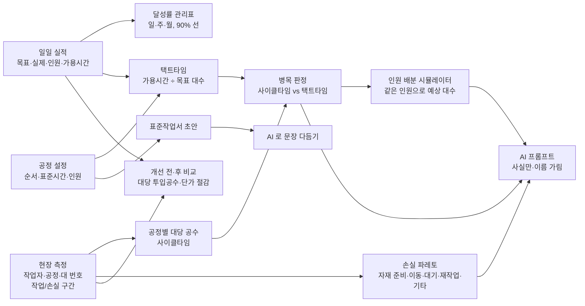

# 프레임 제작 생산성 개선 — 프로젝트 기획서

| 항목 | 내용 |
|---|---|
| 리포 | data10-08 |
| 제출자 | 박상선 |
| 직무·소속 | 제작팀 / 프레임 제작 (회사명 생략) |
| 과정 | 현장 데이터 디지털화 전문가과정 2차수 |
| 작성일 | 2026-10-20 |
| 문서 상태 | 초안 v0.1 — 수강생 제출 자료 기반 |

---

## 1. 추진 배경과 현안

- 일일 가용시간 안에서 **현재 인원으로** 프레임 제작 목표 실적 대수 대비 **달성률 90% 이상**을 확보해야 합니다.
- 이를 위해 작업별 소요시간과 생산 지연 요인을 파악하고, **인원 증원 없이** 작업 방법과 공정 운영을 개선하고자 합니다.
- 제출 원문에는 지금 달성률이 몇 %인지, 공정별 시간이 기록되어 있는지가 적혀 있지 않습니다. 「실제 보유 여부 확인 후 부족한 항목은 현장 측정으로 확보」라고 되어 있어, 공정별 작업시간·대기·재작업은 **현장 측정이 필요할 가능성이 큰 것으로 보입니다(가정).**

## 2. 목표

### 2.1 최종 목표 (제출 원문)

- **목표 1. 가용시간 대비 생산능력 분석** — 일일 실작업 가능시간과 공정별 소요시간을 확인하고, 목표 실적 대수에 필요한 대당 목표시간(택트타임)을 산출합니다. 실제 작업시간과 비교해 생산량을 제한하는 **병목공정**을 파악합니다.
- **목표 2. 작업 개선으로 달성률 90% 이상** — 자재 준비·이동·대기·재작업 등 **손실시간**을 줄이고 작업 순서와 인원별 업무 배분을 개선합니다. 개선된 작업 방법을 **표준화**해 현재 인원으로 품질·안전을 유지하면서 달성률 90% 이상을 확보합니다.

### 2.2 핵심 성과지표 (제출 원문)

| 지표 | 이 도구에서 재는 방법 |
|---|---|
| 현재 인원 유지 | 개선 전·후 기간의 평균 투입 인원 비교(개선 후 ≤ 개선 전) |
| 달성률 90% 이상 | 실제 생산 대수 합 ÷ 목표 실적 대수 합 (일·주·월, 90% 선) |
| 제작 단가 절감액·절감률 | 대당 투입공수 × 시간당 임률 + 대당 기타 원가 → 개선 전·후 차이 (원가 계산 방식은 10장에서 확인) |

### 2.3 1차 개발 목표

1차는 **일일 실적 표와 2~3일 현장 측정만 있으면** 쓸 수 있는 브라우저 도구로 만듭니다. 달성률 관리표, 공정별 작업시간·병목 분석, 손실 파레토, 인원 배분 시뮬레이션, 개선 전·후 비교와 단가 절감, 표준작업서 초안까지 한 도구에서 다룹니다. AI 는 계산한 사실만 담은 프롬프트로 개선안 문장과 표준작업서 문장을 다듬는 **반자동**으로 씁니다.

## 3. 보유 데이터

| 데이터 | 형태 | 규모·주기 | 비고 |
|---|---|---|---|
| 현재 투입 인원 | 미상 | 일 단위로 가정 | 일일 실적 표에 함께 적는 것으로 가정 |
| 일일 가용시간 | 미상 | 일 단위 | 휴식·회의를 뺀 「실작업 가능시간」인지 확인 필요(10장) |
| 목표 실적 대수 · 실제 생산 대수 | 엑셀 또는 일지로 가정 | 일 단위 | 최근 1~2주 자료 요청함 |
| 공정별 작업시간 | 없을 가능성(가정) | — | 없으면 현장 측정(2~3일) |
| 작업자별 업무 | 미상 | — | 측정표에 작업자·공정을 함께 적어 확보 |
| 자재·설비 대기시간 · 재작업 발생 내역 | 미상 | — | 측정표의 손실 유형(자재 준비·이동·대기·재작업·기타)과 메모로 확보 |
| 대당 투입공수 · 제작원가 내역 | 미상 | — | 회사 계산 방식 확인 필요. 원가는 민감 정보 — 리포에 넣지 않음 |

제출 원문에 첨부 파일은 없습니다. 이 리포의 샘플은 모두 **가상 값**(작업자A~I, 가짜 임률·원가)입니다.

## 4. 해결 방안 개요

| 단계 | 내용 |
|---|---|
| 수집 | 일일 실적(입력 화면 또는 엑셀), 공정 마스터, 현장 측정(휴대폰 스톱워치 또는 종이 측정표 → 옮겨 적기·엑셀) |
| 정리 | 엑셀 열 이름을 자동으로 찾고 못 찾은 칸은 직접 연결, 구분 표기(「자재」「대기시간」「리워크」 등)를 표준 유형으로 묶음, 같은 날짜·같은 구간 중복 제거 |
| 분석 | 달성률(합 ÷ 합), 택트타임, 공정별 대당 순작업 공수와 사이클타임, 병목·라인 밸런스, 손실 파레토, 인원 배분 시뮬레이션, 개선 전·후와 단가 |
| AI | 계산된 숫자·손실 메모만 넣은 프롬프트(작업자 이름은 별칭, 원가는 기본 제외) → 개선안 정리·표준작업서 문장 다듬기(복사·붙여 넣기, 선택: 설정한 AI 서버로 자동 보내기) |
| 산출물 | 달성률 관리표, 공정별 작업시간 분석표, 손실 분석, 인원 배분안, 개선 전·후 비교표·단가 절감 분석표, 표준작업서 초안, 개선 보고서 |

### 4.1 계산 정의 (이 도구 안에서의 뜻 — 회사 기준은 10장에서 확인)

| 용어 | 계산 |
|---|---|
| 달성률 | 실제 생산 대수 합 ÷ 목표 실적 대수 합 (주·월도 합으로 계산, 평균의 평균 아님) |
| 택트타임(분/대) | 가용시간 × 60 ÷ 목표 대수 |
| 대당 공수(인·분) | 측정 기간에 그 공정의 「작업」 구간 시간 합 ÷ 측정한 대 수 |
| 사이클타임(분/대) | 대당 공수 ÷ 그 공정 인원 (작업을 인원끼리 나눌 수 있다고 보는 단순 모델) |
| 병목공정 | 사이클타임이 가장 긴 공정. 택트타임보다 길면 목표 대수를 낼 수 없음 |
| 하루 최대 대수 | 가용시간 ÷ 병목 사이클타임 (손실이 없을 때의 상한) |
| 라인 밸런스 효율 | 사이클타임 합 ÷ (공정 수 × 가장 긴 사이클타임) |
| 대당 투입공수(인·시) | (투입 인원 × 가용시간)의 합 ÷ 실제 생산 대수 합 — 손실까지 들어간 실제 값 |
| 대당 제작원가 | 대당 투입공수 × 시간당 임률 + 대당 기타 원가 (모두 사용자가 넣는 값) |

병목 판정은 **손실을 뺀 순작업** 사이클타임으로 합니다. 「대기」는 병목 앞뒤 공정에서 병목 때문에 생기는 결과일 때가 많아, 손실 포함 값은 참고로만 보여 줍니다.

## 5. 주요 기능

| 기능 | 설명 | 우선순위 |
|---|---|---|
| 일일 실적 입력·엑셀 가져오기 | 날짜·목표·실제·인원·가용시간·비고. 엑셀은 열 자동 찾기 + 직접 연결, 같은 날짜는 새 값으로 | MVP |
| 달성률 관리표 | 일·주·월 묶기, 90% 선 그래프, 90% 이상 일수, 대당 투입공수, 엑셀·인쇄 | MVP |
| 공정 설정 | 공정 순서·표준 공수·담당 인원·작업 요점·품질/안전 주의 | MVP |
| 현장 측정 | 휴대폰 스톱워치(누를 때마다 구간 전환, 새로 고쳐도 이어짐), 손으로 한 행 넣기, 빈 측정표 인쇄·엑셀, 측정 엑셀 가져오기 | MVP |
| 병목 분석 | 공정별 대당 공수·사이클타임 vs 택트타임, 라인 밸런스 그래프, 측정/표준 기준 전환 | MVP |
| 손실 분석 | 손실 파레토, 공정별·작업자별 손실, 자주 적힌 사유 | MVP |
| 인원 배분 시뮬레이터 | 공정별 인원·공수 줄임(%)을 바꿔 예상 대수·달성률, 같은 총인원 자동 배분 제안 | MVP |
| 개선 전·후 비교 · 단가 절감 | 두 기간의 달성률·손실·대당 투입공수, 대당 제작원가·절감액·절감률·연간 절감 | MVP |
| 표준작업서 초안 | 공정 순서·시간·주의사항 표 → 인쇄/Word/엑셀, AI 로 문장 다듬기 | MVP |
| 개선 보고서 · AI | 사실만 담은 프롬프트(이름 가림·원가 선택), AI 답을 보고서에 넣어 인쇄/Word | MVP(반자동) |
| 팀 공유 저장소 | 여러 사람이 같은 실적·측정을 보기 | 확장 |
| 설비·자재 시스템 연동 | 대기 원인(설비 고장·자재 결품)을 시스템 기록과 잇기 | 확장 |
| 측정 자동화 | 작업 시작·종료를 바코드·버튼으로 남기기 | 확장 |

## 6. 기대 산출물

1. **달성률 관리표** — 가용시간 대비 목표 실적 대수와 실제 생산 대수, 일·주·월 달성률
2. **공정별 작업시간 분석표와 병목공정 개선안** — 사이클타임 vs 택트타임, 라인 밸런스
3. **작업 순서 및 인원 배분 개선안** — 시뮬레이터 결과와 AI 정리
4. **개선 전·후 생산량과 손실시간 비교표**
5. **제작 단가 절감 효과 분석표** — 개선 전·후 대당 투입공수와 제작원가, 대당 절감액·절감률
6. **표준작업서 초안** — 공정 순서·시간·작업 요점·품질/안전 주의

## 7. 기술 구성

| 과정 도구 | 이 프로젝트에서 쓰는 곳 |
|---|---|
| DAY1 암묵지 자산화·전략기획 | 숙련자가 아는 작업 요령·주의사항을 공정별로 꺼내 적기 → 표준작업서의 재료 |
| DAY2 코랩(Python)·바이브코딩 | 실적·측정 엑셀 정리, 사이클타임·병목·파레토 계산 시험, 브라우저 도구 제작 — 1단계의 중심 |
| DAY3 멀티모달 비정형 정보화 | 작업 사진·동영상으로 작업 순서 설명 만들기, 종이 측정표 사진에서 표 뽑기 (2단계) |
| DAY4 RAG (Dify, NotebookLM) | 기존 작업표준서·안전 지침을 근거로 표준작업서 문장 확인 (2단계) |
| DAY5 Make 자동화 | 일일 실적 입력 알림, 주간 달성률 보고 발송 (확장, 보안 허용 시) |
| 생성형 AI | 개선안 정리·표준작업서 문장 다듬기 (1단계는 프롬프트 생성 반자동) |

**개발 형태**

- 1단계는 **설치 없이 브라우저에서 도는 정적 웹 도구**입니다. 엑셀을 브라우저 안에서만 읽고 계산하므로 실적·원가가 외부로 나가지 않습니다. `index.html` 을 더블클릭(file://)해도 돕니다.
- AI 는 도구가 직접 부르지 않고 **프롬프트만 만들어 복사**하는 것이 기본입니다. 작업자 이름은 「작업자1」 같은 별칭으로 바꾸고(대응표는 이 PC 에만), 원가·절감액은 켤 때만 넣습니다. 회사가 허용한 OpenAI 호환 서버가 있으면 주소·모델·본인 키를 넣어 자동 보내기도 할 수 있습니다(키는 리포에 없음).

## 8. 개발 단계

### 1단계 — 지금 바로 개발 가능한 부분

일일 실적 표와 **2~3일 현장 측정**만 있으면 쓸 수 있는 기능을 먼저 만듭니다. 실제 자료를 받기 전에는 가상 샘플로 만들고, 자료를 받으면 열 연결과 계산 정의만 맞춥니다.

- 일일 실적 입력 화면(현장 실적 입력)과 엑셀 가져오기(열 자동 찾기·직접 연결·같은 날짜 갱신)
- 달성률 관리표 — 일·주·월, 90% 선, 엑셀·인쇄
- 공정 마스터 — 순서·표준시간·담당 인원·작업 요점·품질/안전 주의
- 현장 측정표 — 작업자별·공정별 시작/종료 + 손실 유형(자재 준비·이동·대기·재작업·기타). 휴대폰 스톱워치, 빈 측정표 인쇄·엑셀, 측정 엑셀 가져오기
- 공정별 작업시간 분석 + 병목 판정(사이클타임 vs 택트타임) + 라인 밸런스 그래프
- 손실시간 파레토, 공정별·작업자별 손실
- 인원 배분 시뮬레이터(공정별 인원·공수 줄임 → 예상 처리량·달성률, 같은 총인원 자동 배분)
- 개선 전·후 비교(기간 두 개) + 단가 절감 분석(대당 공수 × 시간당 임률 + 기타 원가, 모두 사용자 입력)
- 표준작업서 초안(공정 순서·시간·주의사항 표 → 인쇄/Word, AI 프롬프트로 문장 다듬기)
- 시험용 가상 샘플에는 일부러 **본용접이 병목**(택트 초과)이고 **「대기」 손실이 가장 큰** 개선 전 기간과, 인원 배분을 바꾼 뒤 달성률이 90%를 넘는 개선 후 기간을 넣어, 화면마다 판정이 제대로 나오는지 확인합니다.

### 2단계

- 실제 일일 실적·측정 자료로 열 연결·계산 정의 보정(가용시간·투입공수·원가 계산 방식)
- 공정별 「한 사람만 할 수 있는 작업」·선후 관계를 반영한 인원 배분(지금은 작업을 인원끼리 나눌 수 있다고 봄)
- 팀 공유 저장소(여러 사람이 같은 실적·측정을 보기)
- 기존 작업표준서·안전 지침을 근거로 표준작업서 문장 확인(RAG)
- 종이 측정표 사진에서 표 뽑기

### 3단계

- 작업 시작·종료를 바코드·버튼으로 자동 기록
- 설비·자재 시스템 기록과 대기 원인 연결
- 사내 허용 AI 와 직접 연결한 주간 개선 보고 자동화

## 9. 기대 효과

- **병목을 숫자로 확인** — 감으로 짐작하던 지연 공정을 사이클타임과 택트타임으로 비교해 어디를 먼저 고칠지 정합니다.
- **인원 증원 없이 배분으로 해결할 여지 확인** — 시뮬레이터로 같은 인원에서 낼 수 있는 대수를 미리 계산합니다.
- **손실시간을 유형별로 줄이기** — 파레토로 자재 준비·이동·대기·재작업 가운데 큰 것부터 다룹니다.
- **효과를 단가로 설명** — 개선 전·후 대당 투입공수와 제작원가 차이로 절감액·절감률을 보여 줍니다.
- **개선 방법을 표준으로 남기기** — 표준작업서 초안으로 바뀐 작업 방법을 정리합니다.

제출 자료에는 현재 달성률 등 정량 수치가 없어 이 문서도 효과 수치를 적지 않습니다.

## 10. 확인 필요 사항

> 1~4번은 접수 때 이미 요청했습니다. 답을 받으면 11장에 반영합니다.

**실적·공정 자료 (필수)**

1. 최근 1~2주 일일 실적 — 날짜·목표 대수·실제 대수·투입 인원·가용시간(엑셀이면 열 이름 그대로). 목표가 하루 단위인지, 주·월 목표를 나눈 것인지
2. 프레임 제작 공정 순서와 공정별 표준시간(있으면), 공정별 담당 인원
3. 대기·재작업 사유를 적어 둔 기록이 있는지(작업일지·불량 일지 등)
4. 대당 투입공수·제작원가를 회사에서 계산하는 방식 — 임률에 무엇이 들어가는지, 기타 원가(자재·소모품·경비) 범위
5. 공정별 시간 기록이 없으면 2~3일 현장 측정 — 이 도구의 스톱워치(휴대폰)와 빈 측정표(종이) 가운데 현장에서 쓸 수 있는 방법, 측정할 날·공정·대 수

**정의·판정 기준**

6. 「일일 가용시간」에 휴식·회의·청소·조회가 빠지는지(실작업 가능시간인지), 잔업이 있는 날은 어떻게 셀지
7. 공정마다 한 사람만 할 수 있는 작업(자격·숙련·설비 수)이 있는지 — 인원 배분 시뮬레이터의 「작업을 나눌 수 있다」는 가정이 맞는지
8. 프레임 종류(모델)가 여러 개인지 — 종류마다 공수가 다르면 대당 공수를 종류별로 나눠야 합니다
9. 「달성률 90%」를 하루마다 보는지, 주·월 합으로 보는지

**보안·환경**

10. 실적·작업자 이름·원가를 외부 AI(ChatGPT 등)에 넣어도 되는지, 사내에서 허용된 AI 가 있는지(이 도구는 이름을 가리고 원가를 빼는 것이 기본)
11. 도구를 혼자 쓰는지, 팀(조장·관리자)이 함께 보는지(공유 저장소 필요 여부)
