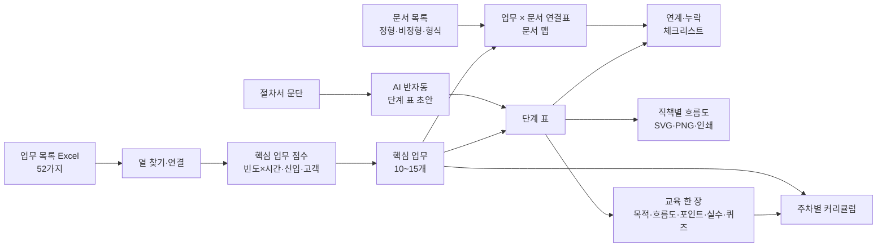

# 품질 업무 프로세스 문서 작성 및 신입사원 교육 자료 제작 — 프로젝트 기획서

| 항목 | 내용 |
|---|---|
| 리포 | data10-09 |
| 제출자 | 신나희 |
| 직무·소속 | 품질경영팀 (소속 회사명은 공개 리포에 두지 않음) |
| 과정 | 현장 데이터 디지털화 전문가과정 2차수 |
| 작성일 | 2026-10-20 |
| 문서 상태 | 초안 v0.1 — 수강생 제출 자료 기반 |

---

## 1. 추진 배경과 현안

- 몇 년 전 팀장 주도로 품질 업무를 **약 52가지**로 정리해 업무 주기 · 소요 시간 · 직책별 엑셀로 만들었습니다(제출 글).
- 그 업무 프로세스는 간소하고 글 위주라 **업무가 나열되어 있을 뿐**, 읽어서는 품질 업무를 이해하거나 실제로 수행하기 어렵습니다.
- 문서는 세 갈래로 흩어져 있습니다. ISO 규정 · 지침 기반의 **정형 문서**(품질매뉴얼 · 절차서), 개인이 만든 **비정형 자료**(업무지침서 · 신입사원 교육자료 PPT · 엑셀), 형식은 갖췄지만 실제로는 잘 쓰지 않는 **형식적 문서**(Flow Chart · 관리계획서 · PFMEA · 검사기준서).
- 그래서 어느 업무가 어느 문서를 근거로 하는지, 빠진 문서나 쓰이지 않는 문서가 무엇인지 한눈에 보기 어려운 것으로 보입니다(가정).

제출자의 기대는 업무 프로세스를 업데이트하고, 그 결과를 **신입사원 교육 자료**로까지 이어 쓰는 것입니다.

## 2. 목표

### 2.1 최종 목표

- 52가지 업무 가운데 **핵심 업무 10~15가지**를 근거를 갖고 고릅니다.
- 핵심 업무마다 **업무 흐름도**(누가 · 무엇을 · 어떤 문서로 · 어디서 갈리는지)를 만듭니다.
- 품질 문서를 정형 · 비정형 · 형식으로 나눈 **문서 목록과 맵**, 업무 ↔ 문서 **연계 · 누락 체크리스트**를 만듭니다.
- 흐름도와 문서를 바탕으로 **신입사원 교육 커리큘럼과 업무별 교육 자료**를 만듭니다.

### 2.2 1차 개발 목표

1차는 **업무 엑셀 하나만 있으면 바로 쓸 수 있는 브라우저 도구**에 집중합니다.

- 52가지 업무 엑셀 가져오기(열 이름이 조금 달라도 찾기)
- 핵심 업무 점수 매기기(빈도 × 소요 시간 · 신입 관련성 · 고객 영향, 가중치 조정)와 10~15개 선택
- 문서 목록 등록 · 업무 × 문서 연결표 · 누락 · 고아 문서 · 오래된 버전 체크리스트
- 단계 표 → 직책별 칸(swimlane) 흐름도 자동 그리기, 절차서 문단 → 단계 표 AI 반자동
- 주차별 커리큘럼과 업무별 「교육 한 장」(목적 · 흐름도 · 핵심 포인트 · 자주 하는 실수 · 확인 퀴즈 3문항)

## 3. 보유 데이터

| 데이터 | 형태 | 규모·주기 | 비고(민감도 등) |
|---|---|---|---|
| 품질 업무 목록 | Excel (제출 글) | 약 52가지 | 열: 업무명 · 업무 주기 · 소요 시간 · 직책(제출 글). 관련 문서 칸이 있는지는 미상 — 견본 요청 중(10장 ①) |
| 품질매뉴얼 · 절차서 | 정형 문서(ISO 규정 · 지침 기반) | 미상 | 회사 문서 — 리포에 넣지 않음 |
| 업무지침서 · 신입사원 교육자료 | 비정형(개인 작성 PPT · 엑셀) | 미상 | 견본 요청 중(10장 ④) |
| Flow Chart · 관리계획서 · PFMEA · 검사기준서 | 형식적 문서 | 미상 | 형식은 갖췄으나 실질 활용 가치는 낮음(제출 글) |
| 문서 목록(번호 · 개정 · 담당) | 미상 | 미상 | 따로 관리하는 목록이 있는지 확인 필요 |

제출 글에 첨부 파일은 없습니다. 회사 문서는 받아도 리포에 넣지 않고, 샘플은 일반적인 제조업 품질 업무로 새로 지은 **가상 값**으로 만듭니다(특정 규격의 조항 번호는 쓰지 않음).

## 4. 해결 방안 개요

| 단계 | 내용 |
|---|---|
| 수집 | 업무 목록 Excel, 문서 목록(Excel 또는 직접 입력), 절차서 문단(복사 · 붙여 넣기) |
| 정리 | 주기 · 소요 시간 글을 숫자로(「월 2~3회」「1시간 30분」「1일」), 문서 종류 나누기, 업무 ↔ 문서 잇기 |
| 분석 | 핵심 업무 점수, 연결표에서 누락 · 고아 문서 · 오래된 버전 · 흐름도에만 나오는 문서 찾기 |
| AI | 절차서 문단 → 단계 표, 단계 표 → 교육 한 장 초안 (1단계는 반자동 · 사실만) |
| 산출물 | 문서 목록 · 맵 · 체크리스트, 업무 흐름도, 커리큘럼 · 교육 한 장 |

## 5. 주요 기능

| 기능 | 설명 | 우선순위 |
|---|---|---|
| 업무 목록 가져오기 | 제목 줄 아래 머리행 자동 인식, 열 연결 화면, 병합 셀 「구분」 이어 쓰기, 같은 업무명 건너뛰기, 다시 가져와도 선택 · 흐름도 유지 | MVP |
| 핵심 업무 선정 | 점수(빈도 × 소요 시간 · 신입 관련성 · 고객 영향) 가중치 조정, 상위 N개 추천, 직접 고르기 · 순서, 10~15개 범위 점검 | MVP |
| 문서 목록 · 맵 | 정형 · 비정형 · 형식 · 버전 · 개정일 · 담당, 업무별 문서 맵, 업무 × 문서 연결표(누르면 잇기 · 끊기) | MVP |
| 연계 · 누락 체크리스트 | 문서 없는 핵심 업무, 정형 근거 없음, 고아 문서, 오래된 버전, 흐름도에만 나오는 문서, 목록에 없는 문서 이름 | MVP |
| 업무 흐름도 | 단계 표(순서 · 단계명 · 담당 · 입력/산출 문서 · 판단 분기) → 직책별 칸 흐름도, 글자 겹침 자동 점검, SVG · PNG · 인쇄 | MVP |
| AI 단계 표 초안 | 절차서 문단 → 단계 표 프롬프트, 답(표)을 읽어 반영 | MVP(반자동) |
| 신입 교육 | 난이도 · 순서로 주차 배치, 업무별 교육 한 장(인쇄 · Word), 흐름도 사실로 퀴즈 3문항 초안, AI 초안 | MVP |
| 실제 양식 반영 | 지금 쓰는 교육자료 · 업무지침서 양식에 맞춘 출력 | 확장 |
| 문서 원문 연결 | 절차서 조항 · 양식 파일을 단계에 붙이기(사내 문서 서버 링크) | 확장 |
| 팀 공유 · 학습 기록 | 여러 사람이 같은 자료를 고치고, 신입사원 퀴즈 결과를 남기기 | 확장 |

## 6. 기대 산출물

1. **문서 목록 및 맵** — 정형 · 비정형 · 형식별, 핵심 업무별 문서 맵, 업무 × 문서 연결표 (제출 글 기대 산출물 1)
2. **문서 간 연계 · 누락 확인 체크리스트** — 핵심 업무 우선 (제출 글 기대 산출물 1)
3. **업무 흐름도** — 핵심 업무 10~15가지, 직책별 칸 (제출 글 기대 산출물 2)
4. **신입사원 교육 커리큘럼 · 자료** — 주차별 배치, 업무별 교육 한 장 (제출 글 기대 산출물 3)

## 7. 기술 구성

| 과정 도구 | 이 프로젝트에서 쓰는 곳 |
|---|---|
| 암묵지 자산화·전략기획 | 핵심 업무를 고르는 기준, 단계마다의 판단 기준, 신입사원이 자주 하는 실수를 꺼내 적기 |
| 코랩(Python)·바이브코딩 | 업무 엑셀 정리, 점수 · 체크리스트 · 흐름도 배치 로직, 브라우저 도구 제작 — 1단계의 중심 |
| 멀티모달 비정형 정보화 | 개인 PPT 업무지침서 · 교육자료에서 단계 · 그림 뽑기 (2단계) |
| RAG | 품질매뉴얼 · 절차서를 근거로 「이 단계의 기준은?」 질의 · 교육 Q&A (2단계) |
| Make 자동화 | 문서 개정 주기 알림, 신입사원 주차별 교육 안내 (확장, 보안 허용 시) |
| 생성형 AI | 절차서 문단 → 단계 표, 단계 표 → 교육 한 장 초안 (1단계는 프롬프트 생성 반자동) |

**개발 형태(권장)**

- 1단계는 **설치 없이 브라우저에서 도는 정적 웹 도구**로 만듭니다. 엑셀을 브라우저 안에서만 읽고 계산하므로 **회사 문서가 외부로 나가지 않습니다.** 점수 · 체크리스트 · 흐름도 그리기는 규칙 계산이라 AI 서비스가 필요 없습니다.
- AI 는 도구가 직접 부르지 않고 **프롬프트만 만들어 복사**하는 것이 기본입니다. 프롬프트에는 「문단 · 단계 표에 없는 숫자 · 조항 번호 · 문서를 지어내지 말라」를 넣고, 답을 반영하기 전에 사람이 확인합니다. 본인 키로 OpenAI 호환 서버를 쓰는 「자동 보내기」는 선택입니다.
- 흐름도는 그림 편집기가 아니라 **단계 표에서 그립니다.** 표가 원본이라 절차서 개정 때 표만 고치면 그림 · 교육 자료가 같이 바뀌고, 엑셀로도 주고받을 수 있습니다.
- 점수는 고르는 것을 돕는 **참고값**입니다. 빈도 × 소요 시간은 연간 시간을 로그로 눌러, 매일 하는 업무가 다른 기준을 모두 덮지 않게 했습니다.

## 8. 개발 단계

### 1단계 — 지금 개발 가능한 부분

업무 목록 엑셀 견본을 받기 전에도 **제출 글의 항목(업무명 · 주기 · 소요 시간 · 직책)만으로** 돌아가는 기능을 먼저 만들고, 견본을 받으면 열 연결만 맞춥니다.

- 업무 목록 가져오기 — 머리행 자동 인식, 열 연결, 「월 2~3회」「1시간 30분」「1일」 같은 글 읽기
- 핵심 업무 점수 · 선택 — 가중치 조정, 상위 N개 추천, 10~15개 범위 점검
- 문서 목록 · 문서 맵 · 업무 × 문서 연결표 · 연계 · 누락 체크리스트
- 업무 흐름도 — 단계 표 → 직책별 칸 SVG, 판단(예/아니오) 분기, 되돌아가는 선, 글자 겹침 점검, SVG · PNG · 인쇄 · 단계 표 엑셀
- AI 반자동 — 절차서 문단 → 단계 표, 단계 표 → 교육 한 장
- 신입 교육 — 주차별 커리큘럼(난이도 · 순서), 교육 한 장(목적 · 흐름도 · 핵심 포인트 · 자주 하는 실수 · 확인 퀴즈 3문항), 인쇄 · Word
- 시험용 가상 데이터: 업무 52개, 문서 24개, 흐름도 · 교육 한 장 3개(수입검사 · 부적합품 처리 · 고객 클레임 대응). 체크리스트가 찾아야 할 것(목록에 없는 문서 · 고아 문서 · 오래된 버전 · 빈 버전)을 일부러 심어 두고, 실제로 찾는지 검사합니다.

### 2단계

- 받은 견본으로 열 연결 · 핵심 업무 기준 · 문서 목록 맞추기
- 핵심 업무 하나로 「흐름도 + 연계 문서 + 교육 한 장」 견본을 함께 다듬고, 나머지 업무에 같은 틀 적용
- 지금 쓰는 교육자료 · 업무지침서 양식에 맞춘 출력
- 절차서 · 매뉴얼을 근거로 한 질의(RAG)와 개인 PPT 지침서에서 단계 뽑기

### 3단계

- 팀 공유 저장소(여러 사람이 같은 흐름도 · 교육 자료를 고침)
- 신입사원 퀴즈 결과 · 학습 기록
- 문서 개정 주기 알림, 개정 시 영향을 받는 흐름도 · 교육 자료 표시

## 9. 기대 효과

- **업무를 「할 수 있게」 하는 자료** — 나열된 업무명이 아니라 누가 · 어떤 문서로 · 어디서 판단하는지 보이는 흐름도가 됩니다.
- **문서 정리의 출발점** — 근거가 없는 업무, 아무 업무에도 안 쓰이는 문서, 오래 개정하지 않은 문서가 목록으로 나와 정비 순서를 정할 수 있습니다.
- **신입사원 교육 시간 단축** — 핵심 업무부터 주차별로, 한 장짜리 자료와 확인 퀴즈로 익힙니다.
- **같은 틀의 반복** — 한 업무에서 만든 틀을 나머지 업무에 그대로 씁니다.

## 10. 확인 필요 사항

> 패들릿 댓글로 요청했습니다(docs/source/패들릿_접수_원문.md). 진행 범위: 핵심 업무 하나로 「흐름도 + 연계 문서 + 교육 한 장」 견본을 먼저 만들고, 나머지 업무에 같은 틀을 씁니다.

**샘플 데이터 (필수)**

1. 52가지 업무 엑셀(업무명 · 주기 · 소요 시간 · 직책) — 시트 모양, 「관련 문서」 칸이 있는지, 주기 · 소요 시간을 어떻게 적었는지

**분류·판정 기준**

2. 핵심 업무 10~15가지를 고른 기준이나 후보 — 이미 정해 둔 것이 있으면 도구의 점수보다 그 기준을 먼저 씁니다
3. 핵심 업무 2~3개의 근거 문서 — 품질매뉴얼 · 절차서의 해당 부분, 쓰는 양식(조항 번호는 받은 문서 그대로 씁니다)
4. 지금 쓰는 신입사원 교육자료와 업무지침서 견본 — 교육 한 장의 모양을 맞추기 위해
5. 신입사원이 첫 달에 막히는 업무 — 커리큘럼 순서와 「자주 하는 실수」 칸에 씁니다

**보안·환경 (견본을 받으며 함께 확인)**

- 절차서 문단을 외부 AI(ChatGPT 등)에 넣어도 되는지 — 도구는 기본으로 복사 · 붙여 넣기만 하고, 데이터는 브라우저 밖으로 보내지 않습니다.
- 혼자 쓰는지, 팀이 함께 고치는지(공유 저장소 필요 여부)

## 부록. 제출 원문 요약

- 현안: 52가지 품질 업무 엑셀(주기 · 소요 시간 · 직책)이 간소하고 글 위주라 이해 · 수행이 어려움 → 업무 프로세스 업데이트, 신입사원 교육 자료로 활용
- 데이터: 정형(품질매뉴얼 · 절차서), 비정형(업무지침서 · 신입사원 교육자료 PPT · 엑셀), 형식적 문서(Flow Chart · 관리계획서 · PFMEA · 검사기준서)
- 기대 산출물: 문서 목록 및 맵 · 연계 · 누락 체크리스트(핵심 업무 우선), 업무 흐름도(핵심 업무 10~15가지), 신입사원 교육 커리큘럼 · 자료
- 원문: [docs/source/패들릿_접수_원문.md](source/패들릿_접수_원문.md)
