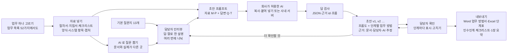

# 품질보증팀 업무 경험 수집 및 AI 기반 디지털 업무 자료화 — 프로젝트 기획서

| 항목 | 내용 |
|---|---|
| 리포 | data10-09 |
| 제출자 | 신나희 |
| 직무·소속 | 품질보증팀 (소속 회사명은 공개 리포에 두지 않음) |
| 과정 | 현장 데이터 디지털화 전문가과정 2차수 |
| 작성일 | 2026-10-20 (방향 수정 반영 2026-10-28) |
| 문서 상태 | v0.2 — 10-27 방향 수정 반영(1~4장 · 「방향 수정」 새로 씀, 5~10장은 1단계 기록) |

---

## 1. 추진 배경과 현안

- 품질보증팀의 업무 정보와 담당자의 **경험 · 판단 기준이 여러 문서와 구두 설명에 흩어져** 있습니다(10-27 수정 제출 글).
- 절차서 · 지침서에는 「무엇을 한다」는 있지만, 실제 순서 · 판단 기준 수치 · 예외 상황 · 자주 하는 실수 · 시스템 화면 같은 **암묵지는 담당자 머릿속과 말**에 있습니다.
- 그래서 **신규 담당자 · 업무 대체자가 업무 흐름과 수행 방법을 일관되게 익히기 어렵고**, 인수인계 때마다 같은 설명을 되풀이하게 됩니다.

제출자의 기대는 담당자의 경험을 **교육 · 인수인계용 디지털 자료로 전환**하는 것입니다. 처음 계획(52가지 업무 프로세스 정리와 신입사원 교육자료 제작)에서 방향을 바꾼 이유도 이것입니다(아래 「방향 수정」).

## 2. 목표

### 2.1 최종 목표

- 기존 업무자료와 담당자의 설명 · 경험을 모아, **업무 프로세스와 단계별 업무 방법 자료 초안을 AI 로 작성하는 도구를 시범 적용**합니다.
- 초안의 단계마다 **근거(문서 / 담당자 답변 / AI 추정)** 를 보이고, 담당자가 확인한 단계에 표시해 **믿을 수 있는 부분과 확인이 필요한 부분**을 나눕니다.
- 결과물을 신규 담당자 · 대체자 · 관련 담당자가 **숙지 · 공유 · 인수인계**에 바로 쓰도록 업무 방법서 · 단계표 · 인수인계 체크리스트 · 1장 요약으로 냅니다.

### 2.2 1차 개발 목표 (시범 적용)

업무 **하나**(예: 수입검사 부적합품 처리)로 「자료 → 담당자 인터뷰 → AI 초안 → 확인 → 내보내기」 한 바퀴가 돌아가는 브라우저 도구를 만듭니다.

- 자료 넣기: 붙여 넣기 · txt · docx · xlsx, 화면 캡처 · 사진(PDF 는 글자를 복사해 붙여 넣기)
- 담당자 인터뷰: 기본 질문지 13개(순서 · 판단 기준 · 예외 · 실수 · 주의 · 양식 · 시스템 화면 · 소요시간 · 넘기는 곳) + 자료를 읽고 AI 가 뽑는 질문(문서와 실제가 다른 곳), 여러 번에 나눠 답하기, 말로 한 설명 붙여 넣기
- 초안 만들기: 자료 + 답변을 묶은 프롬프트 → 회사가 허용한 AI → 답(JSON) 붙여 넣기 → 검사 · 근거 표시 → 흐름도 + 단계별 업무 방법서, 판(버전) 기록, 단계마다 「담당자 확인」
- 내보내기: Word 업무 방법서 · Excel 단계표 · 인수인계 체크리스트 · 1장 요약 · 흐름도 SVG/PNG · 인쇄

## 3. 보유 데이터

| 구분 | 데이터 | 형태 | 비고(민감도 등) |
|---|---|---|---|
| 정형 | 업무 절차서 · 지침서 | 문서(Word · PDF · 한글 등) | 회사 문서 — 리포에 넣지 않음. 도구는 브라우저 안에서만 읽음 |
| 정형 | 체크리스트 · 기록 양식 | 문서 · 엑셀 | 견본 요청 중(방향 수정 확인 ③) |
| 정형 | 시스템 입력 항목 · 업무 순서 자료 | 엑셀 · 화면 | 메뉴 위치 · 필수 칸 |
| 비정형 | 담당자의 설명과 경험, 실제 업무 사례 | 말 · 메모 · 녹취를 글로 | 인터뷰 답 · 말로 한 설명으로 받음 |
| 비정형 | 예외 상황 · 주의사항 | 말 · 메모 | 질문지의 예외 · 실수 · 주의 칸 |
| 비정형 | 화면 캡처 · 사진 | 이미지 | 브라우저에만 저장, AI 에는 그림 대신 설명만 보냄 |
| (1단계) | 품질 업무 목록 52가지 | 엑셀 | 업무를 고르는 목록 · 흐름도 도구로 계속 씀 |

샘플은 일반적인 제조업 품질보증 업무로 새로 지은 **가상 값**입니다(「수입검사 부적합품 처리」 절차서 · 체크리스트 · 시스템 입력 항목 · 화면 그림 · 담당자 답변 · AI 답, 문서번호 · 메뉴 · 수치 모두 가상).

## 4. 해결 방안 개요

| 단계 | 내용 |
|---|---|
| 수집 | 정형 자료(붙여 넣기 · txt · docx · xlsx), 캡처 · 사진, 담당자 인터뷰 답, 말로 한 설명 |
| 정리 | 자료마다 M1 · P1, 답마다 Q1, 설명마다 T1 번호 — 초안이 어디에 근거했는지 이 번호로 가리킴 |
| AI | 자료로 질문 뽑기, 자료 + 답변으로 업무 프로세스 · 단계별 방법 초안(JSON). 숫자 · 기준 · 문서 번호는 자료에 있는 것만, 없으면 「더 확인할 것」으로 |
| 검사 | 답이 망가졌는지(끊김 · 형식), 없는 근거 id, 흐름의 갈 곳 없는 판단 · 고리 → 고치거나 알림. 근거 없는 단계 · 칸은 「AI 추정」 |
| 확인 | 담당자가 단계마다 「확인」, 고치면 새 판(고친 칸은 추정 표시 해제), 바뀌지 않은 단계는 확인을 이어받음 |
| 산출물 | 업무 프로세스 흐름도, 단계별 업무 방법서, 단계표, 인수인계 체크리스트, 1장 요약 |

## 방향 수정 (2026-10-27)

| | 처음 (10-20) | 바뀐 방향 (10-27) |
|---|---|---|
| 과제명 | 품질 업무 프로세스 문서 작성 및 신입사원 교육 자료 제작 | **품질보증팀 업무 경험 수집 및 AI 기반 디지털 업무 자료화** |
| 하는 일 | 52가지 업무 정리, 문서 맵, 흐름도, 신입사원 교육자료 | 기존 업무자료 + 담당자 설명 · 경험(암묵지)으로 업무 프로세스와 업무 방법 자료 초안을 쓰는 **AI 도구 시범 적용** |
| 쓰는 사람 | 신입사원 | 신규 담당자 · 업무 대체자 · 관련 담당자(숙지 · 공유 · 인수인계) |
| 산출물 | 문서 맵 · 체크리스트 · 흐름도 · 교육 한 장 | 시범 적용 결과: 흐름도 · 단계별 업무 방법서(근거 · 확인 표시) · 단계표 · 인수인계 체크리스트 · 1장 요약 |

- 바꾼 이유(제출 글): 담당자의 경험을 교육 · 인수인계용 디지털 자료로 전환하는 데 집중하기 위해.
- 도구에서 바뀐 것: 첫 화면이 「① 업무 · 자료 넣기 → ② 담당자 인터뷰 → ③ 초안 만들기 → ④ 내보내기」가 되었습니다. 1단계 화면(업무 목록 52가지 · 핵심 업무 · 문서 맵 · 흐름도 · 신입 교육)은 지우지 않고 「기존 도구」 메뉴로 옮겨 **재료로 씁니다** — 업무 목록에서 자료화할 업무를 고르고, 1단계 흐름도를 「업무 순서 자료」로 넣고, 초안의 흐름을 1단계 흐름도 · 교육 한 장으로 다시 보낼 수 있습니다.
- 브라우저에 저장된 1단계 자료는 그대로 옮겨지고(처음 열 때 한 번 안내), 읽을 수 없는 자료는 지우지 않고 따로 남긴 뒤 새로 시작합니다.
- 아래 5~10장은 1단계(처음 방향)의 기록입니다. 그 기능은 「기존 도구」로 계속 씁니다.

**확인 목록 (방향 수정)**

1. 시범 적용할 업무 1개 — 예시로 「수입검사 부적합품 처리」를 넣었습니다. 실제로 먼저 해 볼 업무와 담당자(인터뷰할 분)를 알려 주세요.
2. 그 업무의 자료 견본 — 절차서 · 지침서의 해당 부분, 체크리스트 · 기록 양식, 시스템 입력 항목(가릴 것은 가린 뒤). 리포에는 넣지 않습니다.
3. 쓰는 AI — 회사가 허용한 AI(사내 LLM · 승인된 외부 서비스)가 무엇인지, 절차서 · 담당자 답변을 그 AI 에 넣어도 되는지. 사내 서버가 OpenAI 호환 주소를 열어 두었다면 설정에서 바로 보낼 수 있습니다.
4. 기본 질문지 13개가 현장에 맞는지 — 빼거나 더할 질문, 담당자에게 건네는 방식(인쇄 · 말로 묻기 · 녹취)
5. 결과물 모양 — 지금 쓰는 업무 방법서 · 인수인계 양식이 있으면 견본(Word 출력 모양을 맞춤). 「담당자 확인」은 누가 하는지(담당자 본인 · 팀장)
6. 근거 표시 기준 — 단계 단위로 문서 / 담당자 / AI 추정을 보이는 지금 방식으로 충분한지, 칸(판단 기준 · 소요시간 등) 단위까지 필요한지

## 5. 주요 기능 (1단계 — 처음 방향, 지금은 「기존 도구」)

| 기능 | 설명 | 우선순위 |
|---|---|---|
| 업무 목록 가져오기 | 제목 줄 아래 머리행 자동 인식, 열 연결 화면, 병합 셀 「구분」 이어 쓰기, 같은 업무명 건너뛰기, 다시 가져와도 선택 · 흐름도 유지 | MVP |
| 핵심 업무 선정 | 점수(빈도 × 소요 시간 · 신입 관련성 · 고객 영향) 가중치 조정, 상위 N개 추천, 직접 고르기 · 순서, 10~15개 범위 점검 | MVP |
| 문서 목록 · 맵 | 정형 · 비정형 · 형식 · 버전 · 개정일 · 담당, 업무별 문서 맵, 업무 × 문서 연결표(누르면 잇기 · 끊기) | MVP |
| 연계 · 누락 체크리스트 | 문서 없는 핵심 업무, 정형 근거 없음, 고아 문서, 오래된 버전, 흐름도에만 나오는 문서, 목록에 없는 문서 이름 | MVP |
| 업무 흐름도 | 단계 표(순서 · 단계명 · 담당 · 입력/산출 문서 · 판단 분기) → 직책별 칸 흐름도, 글자 겹침 자동 점검, SVG · PNG · 인쇄 | MVP |
| AI 단계 표 초안 | 절차서 문단 → 단계 표 프롬프트, 답(표)을 읽어 반영 | MVP(반자동) |
| 신입 교육 | 난이도 · 순서로 주차 배치, 업무별 교육 한 장(인쇄 · Word), 흐름도 사실로 퀴즈 3문항 초안, AI 초안 | MVP |
| 실제 양식 반영 | 지금 쓰는 교육자료 · 업무지침서 양식에 맞춘 출력 | 확장 |
| 문서 원문 연결 | 절차서 조항 · 양식 파일을 단계에 붙이기(사내 문서 서버 링크) | 확장 |
| 팀 공유 · 학습 기록 | 여러 사람이 같은 자료를 고치고, 신입사원 퀴즈 결과를 남기기 | 확장 |

## 6. 기대 산출물

1. **문서 목록 및 맵** — 정형 · 비정형 · 형식별, 핵심 업무별 문서 맵, 업무 × 문서 연결표 (제출 글 기대 산출물 1)
2. **문서 간 연계 · 누락 확인 체크리스트** — 핵심 업무 우선 (제출 글 기대 산출물 1)
3. **업무 흐름도** — 핵심 업무 10~15가지, 직책별 칸 (제출 글 기대 산출물 2)
4. **신입사원 교육 커리큘럼 · 자료** — 주차별 배치, 업무별 교육 한 장 (제출 글 기대 산출물 3)

## 7. 기술 구성

| 과정 도구 | 이 프로젝트에서 쓰는 곳 |
|---|---|
| 암묵지 자산화·전략기획 | 핵심 업무를 고르는 기준, 단계마다의 판단 기준, 신입사원이 자주 하는 실수를 꺼내 적기 |
| 코랩(Python)·바이브코딩 | 업무 엑셀 정리, 점수 · 체크리스트 · 흐름도 배치 로직, 브라우저 도구 제작 — 1단계의 중심 |
| 멀티모달 비정형 정보화 | 개인 PPT 업무지침서 · 교육자료에서 단계 · 그림 뽑기 (2단계) |
| RAG | 품질매뉴얼 · 절차서를 근거로 「이 단계의 기준은?」 질의 · 교육 Q&A (2단계) |
| Make 자동화 | 문서 개정 주기 알림, 신입사원 주차별 교육 안내 (확장, 보안 허용 시) |
| 생성형 AI | 절차서 문단 → 단계 표, 단계 표 → 교육 한 장 초안 (1단계는 프롬프트 생성 반자동) |

**개발 형태(권장)**

- 1단계는 **설치 없이 브라우저에서 도는 정적 웹 도구**로 만듭니다. 엑셀을 브라우저 안에서만 읽고 계산하므로 **회사 문서가 외부로 나가지 않습니다.** 점수 · 체크리스트 · 흐름도 그리기는 규칙 계산이라 AI 서비스가 필요 없습니다.
- AI 는 도구가 직접 부르지 않고 **프롬프트만 만들어 복사**하는 것이 기본입니다. 프롬프트에는 「문단 · 단계 표에 없는 숫자 · 조항 번호 · 문서를 지어내지 말라」를 넣고, 답을 반영하기 전에 사람이 확인합니다. 본인 키로 OpenAI 호환 서버를 쓰는 「자동 보내기」는 선택입니다.
- 흐름도는 그림 편집기가 아니라 **단계 표에서 그립니다.** 표가 원본이라 절차서 개정 때 표만 고치면 그림 · 교육 자료가 같이 바뀌고, 엑셀로도 주고받을 수 있습니다.
- 점수는 고르는 것을 돕는 **참고값**입니다. 빈도 × 소요 시간은 연간 시간을 로그로 눌러, 매일 하는 업무가 다른 기준을 모두 덮지 않게 했습니다.

## 8. 개발 단계

### 1단계 — 지금 개발 가능한 부분

업무 목록 엑셀 견본을 받기 전에도 **제출 글의 항목(업무명 · 주기 · 소요 시간 · 직책)만으로** 돌아가는 기능을 먼저 만들고, 견본을 받으면 열 연결만 맞춥니다.

- 업무 목록 가져오기 — 머리행 자동 인식, 열 연결, 「월 2~3회」「1시간 30분」「1일」 같은 글 읽기
- 핵심 업무 점수 · 선택 — 가중치 조정, 상위 N개 추천, 10~15개 범위 점검
- 문서 목록 · 문서 맵 · 업무 × 문서 연결표 · 연계 · 누락 체크리스트
- 업무 흐름도 — 단계 표 → 직책별 칸 SVG, 판단(예/아니오) 분기, 되돌아가는 선, 글자 겹침 점검, SVG · PNG · 인쇄 · 단계 표 엑셀
- AI 반자동 — 절차서 문단 → 단계 표, 단계 표 → 교육 한 장
- 신입 교육 — 주차별 커리큘럼(난이도 · 순서), 교육 한 장(목적 · 흐름도 · 핵심 포인트 · 자주 하는 실수 · 확인 퀴즈 3문항), 인쇄 · Word
- 시험용 가상 데이터: 업무 52개, 문서 24개, 흐름도 · 교육 한 장 3개(수입검사 · 부적합품 처리 · 고객 클레임 대응). 체크리스트가 찾아야 할 것(목록에 없는 문서 · 고아 문서 · 오래된 버전 · 빈 버전)을 일부러 심어 두고, 실제로 찾는지 검사합니다.

### 2단계

- 받은 견본으로 열 연결 · 핵심 업무 기준 · 문서 목록 맞추기
- 핵심 업무 하나로 「흐름도 + 연계 문서 + 교육 한 장」 견본을 함께 다듬고, 나머지 업무에 같은 틀 적용
- 지금 쓰는 교육자료 · 업무지침서 양식에 맞춘 출력
- 절차서 · 매뉴얼을 근거로 한 질의(RAG)와 개인 PPT 지침서에서 단계 뽑기

### 3단계

- 팀 공유 저장소(여러 사람이 같은 흐름도 · 교육 자료를 고침)
- 신입사원 퀴즈 결과 · 학습 기록
- 문서 개정 주기 알림, 개정 시 영향을 받는 흐름도 · 교육 자료 표시

## 9. 기대 효과

- **업무를 「할 수 있게」 하는 자료** — 나열된 업무명이 아니라 누가 · 어떤 문서로 · 어디서 판단하는지 보이는 흐름도가 됩니다.
- **문서 정리의 출발점** — 근거가 없는 업무, 아무 업무에도 안 쓰이는 문서, 오래 개정하지 않은 문서가 목록으로 나와 정비 순서를 정할 수 있습니다.
- **신입사원 교육 시간 단축** — 핵심 업무부터 주차별로, 한 장짜리 자료와 확인 퀴즈로 익힙니다.
- **같은 틀의 반복** — 한 업무에서 만든 틀을 나머지 업무에 그대로 씁니다.

## 10. 확인 필요 사항

> 패들릿 댓글로 요청했습니다(docs/source/패들릿_접수_원문.md). 진행 범위: 핵심 업무 하나로 「흐름도 + 연계 문서 + 교육 한 장」 견본을 먼저 만들고, 나머지 업무에 같은 틀을 씁니다.

**샘플 데이터 (필수)**

1. 52가지 업무 엑셀(업무명 · 주기 · 소요 시간 · 직책) — 시트 모양, 「관련 문서」 칸이 있는지, 주기 · 소요 시간을 어떻게 적었는지

**분류·판정 기준**

2. 핵심 업무 10~15가지를 고른 기준이나 후보 — 이미 정해 둔 것이 있으면 도구의 점수보다 그 기준을 먼저 씁니다
3. 핵심 업무 2~3개의 근거 문서 — 품질매뉴얼 · 절차서의 해당 부분, 쓰는 양식(조항 번호는 받은 문서 그대로 씁니다)
4. 지금 쓰는 신입사원 교육자료와 업무지침서 견본 — 교육 한 장의 모양을 맞추기 위해
5. 신입사원이 첫 달에 막히는 업무 — 커리큘럼 순서와 「자주 하는 실수」 칸에 씁니다

**보안·환경 (견본을 받으며 함께 확인)**

- 절차서 문단을 외부 AI(ChatGPT 등)에 넣어도 되는지 — 도구는 기본으로 복사 · 붙여 넣기만 하고, 데이터는 브라우저 밖으로 보내지 않습니다.
- 혼자 쓰는지, 팀이 함께 고치는지(공유 저장소 필요 여부)

## 부록. 제출 원문 요약

**방향 수정 (10-27)**

- 과제명: 품질보증팀 업무 경험 수집 및 AI 기반 디지털 업무 자료화
- 현안: 업무 정보와 담당자의 경험 · 판단 기준이 여러 문서와 구두 설명에 흩어져, 신규 담당자 · 업무 대체자가 업무 흐름과 수행 방법을 일관되게 익히기 어려움
- 데이터: 정형(업무 절차서 · 지침서, 체크리스트, 기록 양식, 시스템 입력 항목, 업무 순서 자료), 비정형(담당자의 설명과 경험, 실제 업무 사례, 예외 상황 · 주의사항, 화면 캡처 · 사진)
- 산출물: 기존 업무자료와 담당자 답변으로 업무 프로세스와 단계별 수행 방법 자료 초안을 작성하는 AI 도구 시범 적용 결과

**처음 제출 (10-20)**

- 현안: 52가지 품질 업무 엑셀(주기 · 소요 시간 · 직책)이 간소하고 글 위주라 이해 · 수행이 어려움 → 업무 프로세스 업데이트, 신입사원 교육 자료로 활용
- 데이터: 정형(품질매뉴얼 · 절차서), 비정형(업무지침서 · 신입사원 교육자료 PPT · 엑셀), 형식적 문서(Flow Chart · 관리계획서 · PFMEA · 검사기준서)
- 기대 산출물: 문서 목록 및 맵 · 연계 · 누락 체크리스트(핵심 업무 우선), 업무 흐름도(핵심 업무 10~15가지), 신입사원 교육 커리큘럼 · 자료
- 원문: [docs/source/패들릿_접수_원문.md](source/패들릿_접수_원문.md)
