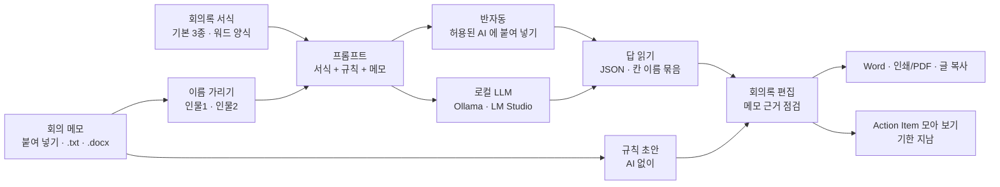

# AI 기반 회의록 요약 도우미 — 프로젝트 기획서

| 항목 | 내용 |
|---|---|
| 리포 | data10-10 |
| 제출자 | 나선준 |
| 직무·소속 | 제품검증팀 (회사명 생략) |
| 과정 | 현장 데이터 디지털화 전문가과정 2차수 |
| 작성일 | 2026-10-20 |
| 문서 상태 | 초안 v0.1 — 수강생 제출 자료 기반 |

---

## 1. 추진 배경과 현안

- 회의가 끝나면 메모장이나 워드에 적어 둔 메모가 남지만, 정리되지 않은 상태라 회의록으로 옮기는 데 시간이 듭니다.
- 메모에는 논의 · 결정 · 할 일이 한데 섞여 있어, 무엇이 정해졌고 누가 언제까지 무엇을 하는지가 잘 드러나지 않습니다(가정).
- 팀에서 쓰는 회의록 서식이 있어, 메모를 그 서식의 칸에 맞춰 넣어야 합니다(제출 원문).
- 회의 내용은 사내 문서라 외부 AI 에 그대로 넣기 어려울 수 있어, 필요하면 로컬 LLM 을 쓰고자 합니다(제출 원문 「필요 시 로컬 llm 활용」).

## 2. 목표

### 2.1 최종 목표

- 회의 직후 메모(메모장 · 워드)와 회의록 서식을 함께 넣으면, **서식의 칸에 맞춰 주요 내용을 정리한 회의록 초안**을 만드는 도구
- 결정 사항과 **Action Item(할 일 · 담당 · 기한)** 을 빠짐없이 뽑고, 회의가 쌓이면 할 일을 한곳에서 챙길 수 있게 함
- 사내 보안 기준에 맞춰 **외부 AI · 사내 AI · 로컬 LLM · AI 없이** 중에서 고를 수 있게 함

### 2.2 1차 개발 목표

- 설치 없이 브라우저에서 도는 도구(내 PC 에서 파일로 열어도 됨)
- 서식 관리 — 기본 서식 3종(일반 회의 · 시험·검증 결과 리뷰 · 일정 점검) + 우리 팀 워드 양식으로 서식 만들기
- 메모 넣기 — 붙여 넣기 · 메모장(.txt) · 워드(.docx)
- 정리 — 반자동 AI(프롬프트 복사 → 답 붙여 넣기), 로컬 LLM 자동 보내기(선택), AI 없는 규칙 초안
- 이름 가리기, 메모 근거 점검(메모에 없는 담당 · 기한 · 결정 표시)
- 결과 편집 · 내보내기(Word · 인쇄/PDF · 글 복사), 회의록 목록 · Action Item 모아 보기

## 3. 보유 데이터

| 데이터 | 형태 | 규모·주기 | 비고(민감도 등) |
|---|---|---|---|
| 회의 메모 | 텍스트 파일(.txt) · 워드 파일(.docx) (제출 원문) | 회의마다 1건(가정) | 사내 회의 내용 — 사람 이름 · 시료 · 일정 포함(가정). 외부 반출 기준 확인 필요(10장 4번) |
| 회의록 서식 | 워드 양식으로 가정 | 회의 종류별 1~3종(가정) | 서식 파일을 받으면 「서식 관리」에서 그대로 칸을 뽑습니다(10장 1번) |
| 완성 회의록 | 워드로 가정 | 미상 | 같은 회의의 메모와 짝이 있으면 정답 견본으로 규칙 · 프롬프트를 맞춥니다(10장 2번) |

제출 원문에 첨부 파일은 없습니다. 실제 메모 · 회의록은 사내 문서라 받더라도 리포에 넣지 않고, 같은 모양의 가상 예시로 바꿔 시험합니다.

## 4. 해결 방안 개요

| 단계 | 내용 |
|---|---|
| 수집 | 회의 메모(붙여 넣기 · 메모장 · 워드), 회의록 서식(기본 · 워드 양식에서 칸 뽑기) |
| 정리 | 사람 이름을 「인물N」 으로 가림(대응표는 이 PC 에만), 서식 칸 · 규칙 · 메모를 묶은 프롬프트 |
| 분석 | AI(반자동 · 로컬 LLM)가 서식 칸에 맞춰 요약, 또는 AI 없이 규칙(결정 · 할 일 · 담당 · 기한 낱말과 날짜 모양)으로 초안 |
| 점검 | AI 답에서 메모에 없는 담당 · 기한 · 결정 문장을 「확인 필요」로 표시 |
| 산출물 | 서식대로 정리된 회의록(Word · PDF · 글), 회의록 목록, Action Item 모아 보기 |

## 5. 주요 기능

| 기능 | 설명 | 우선순위 |
|---|---|---|
| 서식 관리 | 기본 서식 3종, 칸 이름 · 역할(결정 사항 · Action Item 등) · 모양 편집, 우리 팀 워드 양식(.docx)이나 양식 글로 새 서식 만들기 | MVP |
| 메모 넣기 | 붙여 넣기 · 메모장(.txt, 「ANSI」 저장 포함) · 워드(.docx). 작성 중 메모는 새로고침해도 남음 | MVP |
| 이름 가리기 | 참석자 줄 · 「○○○ 책임」 · @이름 · 담당: 이름에서 이름을 찾아 「인물N」 으로 바꿈, 보내기 전 남은 이름 점검, AI 답은 이름으로 되돌림 | MVP |
| 반자동 AI | 서식 + 규칙 + 메모 프롬프트 복사 → 허용된 AI 에 붙여 넣기 → 답 붙여 넣기 → 서식 채우기(JSON · 「칸 이름: 내용」 · 표 모두 읽음) | MVP |
| 로컬 LLM 자동 보내기 | OpenAI 호환 주소(Ollama `http://localhost:11434/v1` · LM Studio `http://localhost:1234/v1` · 사내 서버)로 버튼 한 번에 보내기, 모델 목록 불러오기 | MVP(선택) |
| 규칙 초안(AI 없이) | 결정 · 할 일 · 담당 · 기한 · 다음 회의 줄을 낱말과 날짜 모양(10/24 · 다음 주 금요일)으로 찾아 칸에 넣음 | MVP |
| 메모 근거 점검 | 메모에 없는 담당 · 기한, 메모와 많이 다른 결정 · 할 일 문장 표시 | MVP |
| 편집 · 내보내기 | 칸별 편집, Action Item 표(완료 체크), Word(.doc) · 인쇄/PDF · 글 복사 | MVP |
| 회의록 목록 · Action Item 모아 보기 | 저장한 회의록 찾기, 모든 회의의 할 일을 기한 순으로, 기한 지남 · 3일 안 표시, 담당자로 거르기 | MVP |
| 실제 서식 · 정답 견본으로 맞추기 | 받은 서식 · 메모 · 완성 회의록으로 규칙 · 프롬프트 보정 | 2단계 |
| 녹음 → 글(STT) | 회의 녹음을 글로 바꿔 메모 대신 넣기 | 확장 |
| 팀 공유 · 알림 | 회의록 · 할 일 공유 저장소, 기한 알림(메일 · 메신저) | 확장 |

## 6. 기대 산출물

1. **회의록 요약 도우미(브라우저)** — 서식 고르기 → 메모 넣기 → 정리 → 편집 · 내보내기
2. **서식대로 정리된 회의록** — Word(.doc) · 인쇄/PDF · 글
3. **Action Item 모아 보기** — 회의마다 흩어진 할 일을 기한 순으로
4. **회의록 정리 프롬프트** — 서식 칸과 「지어내지 말 것」 규칙이 들어간 프롬프트(사내 AI · 로컬 LLM 공용)
5. **가상 예시 메모 3건과 정답 견본** — 규칙 · 프롬프트를 시험하는 기준

## 7. 기술 구성

| 과정 도구 | 이 프로젝트에서 쓰는 곳 |
|---|---|
| DAY1 암묵지 자산화·전략기획 | 좋은 회의록의 기준(결정과 논의를 나누는 법, 할 일을 「누가 · 무엇을 · 언제까지」로 적는 법)을 꺼내 서식 · 규칙으로 적기 |
| DAY2 코랩(Python)·바이브코딩 | 메모를 칸으로 나누는 규칙, 날짜 표현 읽기, 브라우저 도구 제작 — 1단계의 중심 |
| DAY3 멀티모달 비정형 정보화 | 워드 · 메모장 메모에서 글 뽑기, (확장) 회의 녹음 → 글 |
| DAY4 RAG (Dify, NotebookLM) | 지난 회의록을 근거로 「지난번에 정한 것」 찾기 (2~3단계) |
| DAY5 Make 자동화 | 기한이 다가온 Action Item 알림 (확장, 보안 허용 시) |
| 생성형 AI · 로컬 LLM | 메모 → 서식 칸 요약. 1단계는 반자동 + 로컬 LLM 선택 |

**개발 형태(권장)**

- 1단계는 **설치 없이 브라우저에서 도는 정적 웹 도구**로 만듭니다. 메모 · 회의록은 이 브라우저 안에서만 읽고 저장하며 서버로 보내지 않습니다.
- AI 는 기본이 **반자동**(프롬프트 복사 → 회사가 허용한 AI 에 붙여 넣기)입니다. 외부 AI 가 막혀 있으면 **로컬 LLM**(내 PC 의 Ollama · LM Studio)으로 버튼 한 번에 보낼 수 있고, 메모가 PC 밖으로 나가지 않습니다. AI 를 아예 못 쓰는 경우를 위해 **규칙 초안**도 둡니다.
- 로컬 LLM 은 PC 사양(메모리 · 그래픽카드)에 따라 쓸 수 있는 모델 크기가 정해집니다. 10장 4번 답을 받아 권장 모델을 정합니다.

## 8. 개발 단계

### 1단계 — 지금 바로 개발 가능한 부분

서식 파일과 실제 메모를 받기 전이라도, **메모 글과 서식 칸 목록만 있으면** 돌아가는 부분을 먼저 만들었습니다. 실제 자료를 받으면 서식은 「서식 관리」에서 바로 만들고, 규칙 · 프롬프트만 보정합니다.

- 서식 관리 — 기본 3종(일반 회의 · 시험·검증 결과 리뷰 · 일정 점검), 칸 편집(이름 · 역할 · 모양), 워드 양식(.docx)이나 양식 글로 서식 만들기
- 메모 넣기 — 붙여 넣기 · .txt(UTF-8 · ANSI) · .docx
- 이름 가리기 — 이름 찾기 · 「인물N」 바꾸기 · 남은 이름 점검 · 답에서 되돌리기
- 정리 — 반자동 프롬프트 · 답 읽기(JSON · 칸 이름 묶음 · 표, 앞뒤 설명 · 코드 블록 · <think> 섞여도), 로컬 LLM 자동 보내기(선택), AI 없는 규칙 초안
- 메모 근거 점검 — 메모에 없는 담당 · 기한, 메모와 많이 다른 문장 「확인 필요」
- 편집 · 내보내기 — Word(.doc) · 인쇄/PDF · 글 복사
- 회의록 목록 · Action Item 모아 보기(기한 지남 · 3일 안 · 담당자별)
- 시험용 가상 메모 3건(정리 안 된 메모 + 정답 견본)에는 「결정 · 미정 섞임」 「표지 없는 할 일」 「다음 주 금요일 같은 상대 기한」 「메모장 ANSI · 워드 파일」을 일부러 넣어, 나누기 규칙과 파일 읽기가 제대로 되는지 테스트로 확인합니다.

### 2단계

- 실제 회의록 서식(10장 1번)으로 기본 서식 교체, 실제 메모 · 완성 회의록(10장 2번)으로 규칙 · 프롬프트 보정 — 정답 견본과 같은지 칸별로 비교하는 점검 추가
- 회의 종류별 필수 항목(10장 3번) 반영 — 빠진 필수 칸 경고
- 보안 기준(10장 4번)에 맞춰 기본 방법 정하기(로컬 LLM 만이면 반자동 외부 AI 안내 숨기기), PC 사양에 맞는 모델 권장
- 옛 워드(.doc) · 한글(.hwp) 메모 읽기
- 지난 회의록에서 같은 안건 · 끝나지 않은 할 일 이어 보기

### 3단계

- 회의 녹음 → 글(STT, 로컬 Whisper 등) → 메모 대신 넣기
- 팀 공유 저장소(회의록 · 할 일), 기한 알림
- 지난 회의록 기반 질의(「지난달 진동시험 관련 결정은?」)

## 9. 기대 효과

- **회의록 작성 시간 단축** — 메모를 서식 칸으로 옮기는 일을 초안에서 시작합니다.
- **할 일 누락 방지** — 담당 · 기한이 빠진 할 일을 표시하고, 회의가 쌓여도 기한 지난 할 일을 한곳에서 봅니다.
- **회의록 형식 통일** — 같은 서식 · 같은 규칙으로 정리해 팀 회의록이 같은 모양이 됩니다.
- **보안 기준 준수** — 이름 가리기와 로컬 LLM 으로 사내 문서가 밖으로 나가는 것을 줄입니다.

제출 자료에는 정량 수치가 없어 이 문서도 수치를 적지 않습니다.

## 10. 확인 필요 사항

> 아래 4가지는 패들릿 댓글로 이미 요청했습니다. 답을 받으면 2단계 범위를 확정하고 이 문서를 v0.2 로 올립니다.

**샘플 자료 (필수)**

1. 지금 쓰는 회의록 서식(워드 양식) — 칸 이름 · 순서, 회의 종류별로 서식이 다른지
2. 회의 직후 메모 원본 2~3건 + 같은 회의의 완성 회의록(정답 견본) — 이름 · 제품명은 가려도 됩니다

**분류·판정 기준**

3. 회의 종류(주간 회의 · 시험 결과 리뷰 · 일정 점검 외에 있는지)와 종류별 필수 항목(결정 사항 · 담당자 · 기한 등)

**보안·환경**

4. 사내 문서(회의 내용)를 외부 AI(ChatGPT 등)에 넣어도 되는지, 사내 허용 AI 가 있는지, 로컬 LLM 만 되는지 — 로컬 LLM 이면 쓰실 PC 사양(메모리 · 그래픽카드)과 프로그램 설치 가능 여부

## 부록. 제출 원문 요약

| 출처 | 파일·게시물 | 내용 |
|---|---|---|
| 패들릿 게시물 | 「AI기반 회의록 요약 프로그램/웹 개발」 — `docs/source/패들릿_접수_원문.md` | 직무·소속(제품검증팀, 회사명 생략), 현안(정리되지 않은 회의 내용의 요약 필요), 보유 데이터(텍스트 · 워드 파일 형식의 자연어 데이터), 기대 산출물(메모장 · 워드 회의 내용 + 회의록 서식 → 서식에 맞춰 주요 내용을 정리하는 회의록 요약 프로그램, 필요 시 로컬 LLM) |

첨부 파일은 제출되지 않았습니다.
