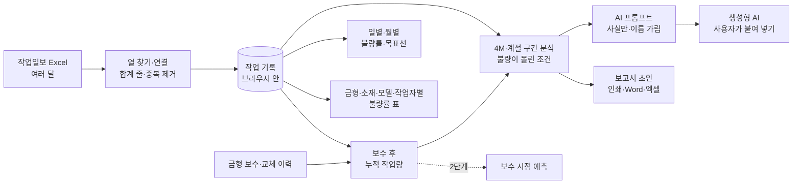

# Deep drawing press 제품 불량 최소화 — 프로젝트 기획서

| 항목 | 내용 |
|---|---|
| 리포 | data10-11 |
| 제출자 | 이성헌 |
| 직무·소속 | 구매팀 (소속 회사명은 공개 리포에 두지 않음) |
| 과정 | 현장 데이터 디지털화 전문가과정 2차수 |
| 작성일 | 2026-10-20 |
| 문서 상태 | v0.3 (2026-10-27) — 3차 요청(패들릿 10-25: 메이커·규격 결과 확인, 소재 lot, 모델별 압력 작업표준, 설비 수선 이력, 압력 저하 전파) 반영(11장). 실제 작업일보 견본은 확인 대기 |

---

## 1. 추진 배경과 현안

- Deep drawing press(Hydro press) 금형 작업에서 제품 불량(주로 Crack)이 생기고 있습니다.
- 이 공정의 소재는 **단가가 높은 수입 자재**라 불량 하나하나가 그대로 원가 손실이 됩니다.
- 현재 불량률은 **약 5%** 수준이고, 이를 **2% 수준으로 낮추는 것**을 목표로 정했습니다(제출 글).
- 작업일보에는 작업일자·작업자·Hydro press main 압력·쿠션 압력·금형·작업모델·소재 메이커·소재규격·작업수량·불량수량이 쌓이고 있지만, 이를 모아 「어떤 조건에서 불량이 늘어나는지」를 보는 일은 하지 못하고 있는 것으로 보입니다(가정).

제출자의 기대는 작업일보를 집계·분석해 Crack 의 원인을 **계절별 4M(사람·설비·소재·방법)** 에 근거해 추측하고, 소재 문제·프레스 압력 문제·금형 보수 시점을 가려 불량률을 낮추는 데 쓰는 것입니다.

## 2. 목표

### 2.1 최종 목표

- 작업일보를 한곳에 모아 **일별·월별·금형별·소재별 작업량 대비 불량률**을 늘 같은 기준으로 봅니다.
- **불량이 몰린 조건**(계절 × 소재 메이커, 쿠션 압력 구간, 금형 누적 작업량 등)을 근거 숫자와 함께 찾아, 소재·압력·금형 가운데 어디부터 볼지 정합니다.
- 금형 보수·교체 이력과 작업량을 이어 **보수 시점을 미리 알 수 있게** 합니다(이력이 쌓인 뒤).
- 불량률 **5% → 2%** 를 향한 개선을 데이터로 다시 재서 효과를 확인합니다.

### 2.2 1차 개발 목표

1차는 **작업일보 엑셀만 있으면 바로 쓸 수 있는 브라우저 도구**에 집중합니다.

- 작업일보 엑셀 여러 달 치 가져오기(열 이름이 조금 달라도 찾기, 중복 제거)
- 일별·월별·금형·소재·모델·작업자별 불량률 표(작업량 가중, 표본 적음 표시)
- 4M·계절로 나눈 구간 분석과 「불량이 몰린 조건」 찾기
- 금형 보수 이력을 넣으면 보수 전후 비교와 보수 후 누적 작업량별 불량률
- 계산된 사실만 담은 AI 프롬프트(이름 가림)와 보고서 초안

금형 보수 시점 **예측**은 보수 이력이 쌓인 뒤 2단계에서 다룹니다.

## 3. 보유 데이터

| 데이터 | 형태 | 규모·주기 | 비고(민감도 등) |
|---|---|---|---|
| 해당 공정 작업일보 | Excel (제출 글) | 미상 — 최근 6개월~1년 견본 요청 중 | 열: 작업일자·작업자·Hydro press main 압력·쿠션 압력·금형·작업모델·소재 메이커·소재규격·작업수량·불량수량 (제출 글). 1행 = 하루 한 금형 작업 1건으로 가정 |
| 불량 유형 | 미상 | 미상 | Crack 외 주름·찢어짐 등을 따로 적는지 확인 필요(10장 ②) |
| 금형 보수·교체 이력 | 미상 | 미상 | 작업일보와 별도인지 확인 필요(10장 ③) |
| 소재 로트·성적서 | 미상 | 미상 | 작업일보와 연결되는지 확인 필요(10장 ④) |
| 압력 정상 범위 | 미상 | — | 작업표준·설비 기준 확인 필요(10장 ⑤) |

제출 글에 첨부 파일은 없습니다. 작업자 이름은 개인정보이고 금형·모델·소재 메이커는 회사 정보이므로, 실제 파일을 받아도 리포에 넣지 않습니다. 샘플은 같은 항목의 가상 값으로 만듭니다.

## 4. 해결 방안 개요

| 단계 | 내용 |
|---|---|
| 수집 | 작업일보 Excel (이후 금형 보수 이력, 소재 로트·성적서) |
| 정리 | 머리행·열 찾기, 단위·표기 차이 맞추기, 합계 줄 빼기, 같은 행 중복 제거 |
| 분석 | 작업량 가중 불량률(불량 합계 ÷ 작업수량 합계), 4M·계절 구간, 두 조건 조합, 보수 전후 비교 |
| AI | 계산된 사실만 담은 프롬프트로 원인 「추정」과 현장 확인 사항 정리 (1단계는 반자동) |
| 산출물 | 불량률 분석표(일별·월별·금형·소재), 불량이 몰린 조건 목록, 보고서 초안 |

## 5. 주요 기능

| 기능 | 설명 | 우선순위 |
|---|---|---|
| 작업일보 가져오기 | 여러 파일·폴더째, 제목 줄 아래 머리행 자동 인식, 열 연결 화면, 합계 줄 제외, 중복 제거, 빠진 달 점검 | MVP |
| 일별·월별 불량률 | 작업량 대비 불량률 추이, 목표 2% 선, 목표까지 줄일 불량 수 | MVP |
| 금형·소재별 불량률 표 | 금형·소재 메이커·소재규격·작업모델·작업자별, 「표본 적음」 표시, 금형 × 소재 메이커 교차표, 엑셀 내보내기 | MVP |
| 4M·계절 분석 | Man(작업자)·Machine(금형·누적 작업량·Main/쿠션 압력)·Material(메이커·규격·로트)·Method(모델)·계절별 구간 | MVP |
| 불량이 몰린 조건 | 한 조건·두 조건 조합 가운데 표본이 충분하고 불량률이 뚜렷이 높은 것을 근거 숫자와 함께. 다른 조건과 겹치면 표시 | MVP |
| 금형 보수 전후 비교 | 보수·교체 이력을 넣으면 전후 N일 불량률, 보수 후 누적 작업량 구간별 불량률 | MVP(이력 입력 시) |
| AI 프롬프트 | 계산된 사실만, 금형·모델·메이커·작업자 이름 가림, 답 되돌리기 | MVP(반자동) |
| 보고서 초안 | 인쇄/PDF·Word·엑셀 | MVP |
| 금형 보수 시점 예측 | 누적 작업량·불량률 추세로 다음 보수 시점 제안 | 확장(이력 축적 후) |
| 소재 로트·성적서 연계 | 로트별 불량률, 성적서 값과 비교 | 확장 |
| 팀 공유 | 여러 사람이 같은 데이터를 보는 공유 저장소 | 확장 |
| 압력 작업표준 대비 (3차) | 모델·금형별 Main·쿠션 기준과 허용 폭, 행마다 「실제 − 기준」, 차이 구간별 불량률 | MVP(작업표준 입력 시) |
| 압력 저하 전파 목록 (3차) | 기준 − 허용보다 낮은 작업을 설비보전·공무팀에 보낼 글·엑셀로 | MVP(작업표준 입력 시) |
| 설비(Press) 수선 이력 (3차) | 수선·점검·부품교체 이력 입력(직접·붙여 넣기·엑셀 파일), 수선 전후 불량률·압력 저하 비교 | MVP(이력 입력 시) |

## 6. 기대 산출물

1. **작업 일별/월별 작업량 대비 불량률 분석표** (제출 글 기대 산출물 1)
2. **금형/소재별 작업량 대비 불량률 분석표** (제출 글 기대 산출물 2)
3. **계절별 4M 「불량이 몰린 조건」 목록** — Crack 원인 추정의 근거 숫자
4. **금형 보수 전후 비교** — 보수 시점 판단의 참고값
5. **AI 분석 프롬프트와 보고서 초안**
6. 금형 보수 시점 예측 — 2단계

## 7. 기술 구성

| 과정 도구 | 이 프로젝트에서 쓰는 곳 |
|---|---|
| 암묵지 자산화·전략기획 | 현장에서 Crack 원인을 판단하는 기준(소재·압력·금형), 정상 압력 범위, 금형 보수를 결정하는 기준을 꺼내 적기 |
| 코랩(Python)·바이브코딩 | 작업일보 정리, 불량률 집계·구간 분석 로직 시험, 브라우저 도구 제작 — 1단계의 중심 |
| 멀티모달 비정형 정보화 | 소재 성적서(PDF·사진)에서 값 뽑기, 불량 사진 기록 (2단계) |
| RAG | 작업표준·금형 보수 기록·소재 사양서를 근거로 한 원인 질의 (2단계) |
| Make 자동화 | 월간 불량률 보고 정기 발송, 목표 초과 알림 (확장, 보안 허용 시) |
| 생성형 AI | 원인 「추정」·현장 확인 사항 정리 (1단계는 프롬프트 생성 반자동) |

**개발 형태(권장)**

- 1단계는 **설치 없이 브라우저에서 도는 정적 웹 도구**로 만듭니다. 엑셀을 브라우저 안에서만 읽고 계산하므로 **작업일보가 외부로 나가지 않습니다.** 집계·구간 분석·조건 찾기는 규칙 계산이라 AI 서비스가 필요 없습니다.
- AI 는 도구가 직접 부르지 않고 **프롬프트만 만들어 복사**하는 것이 기본입니다. 금형·모델·소재 메이커·작업자 이름은 별칭으로 가립니다. 본인 키로 OpenAI 호환 서버를 쓰는 「자동 보내기」는 선택입니다.
- 불량률은 늘 **작업량 가중**(불량 합계 ÷ 작업수량 합계)으로 셉니다. 하루하루의 불량률을 평균 내면 작업량이 적은 날이 지나치게 크게 반영되기 때문입니다.
- 「불량이 몰린 조건」은 원인을 확정하는 통계 판정이 아니라 **먼저 볼 곳을 고르는 거름망**입니다. 표본 기준·배수 기준은 설정에서 바꿀 수 있습니다.

## 8. 개발 단계

### 1단계 — 지금 바로 개발 가능한 부분

정상 범위나 보수 이력이 없어도 **작업일보 엑셀 하나만 있으면** 쓸 수 있는 기능을 먼저 만듭니다. 견본을 받기 전에는 제출 글의 항목대로 만든 가상 작업일보로 만들고, 견본을 받으면 열 연결만 맞춥니다.

- 작업일보 가져오기(여러 파일, 머리행·열 자동 인식, 열 연결 화면, 합계 줄 제외, 중복 제거)
- 일별·월별 작업량 대비 불량률과 목표선
- 금형·소재 메이커·소재규격·작업모델·작업자별 불량률 표(표본 적음 표시)와 교차표
- 4M·계절 구간 분석 — Main·쿠션 압력은 같은 폭 구간으로 나누고, 정상 범위를 넣으면 아래·안·위로도 봄
- 「불량이 몰린 조건」 찾기 — 근거 숫자(작업수량·불량수량·불량률·전체 대비 배수·기대보다 많은 불량), 다른 조건과 겹침 표시
- 금형 보수·교체 이력 입력(직접·엑셀 붙여 넣기)과 보수 전후 비교, 보수 후 누적 작업량별 불량률
- AI 프롬프트(사실만, 이름 가림)와 보고서 초안(인쇄·Word·엑셀)
- 시험용 가상 데이터에는 일부러 **금형 하나의 마모(보수 전 상승·보수 후 하락)**, **겨울에만 나빠지는 소재 메이커 하나**, **높은 쿠션 압력에서 Crack 증가**를 심고, **Main 압력은 관계없게** 만들어 찾을 것은 찾고 찾지 말 것은 찾지 않는지 확인합니다.

### 2단계

- 실제 작업일보 견본으로 열 연결·불량 유형·정상 압력 범위 맞추기
- 소재 로트·성적서 연계 — 로트별 불량률, 성적서 값(두께·경도 등)과 비교
- 금형 보수 이력이 쌓이면 누적 작업량·불량률 추세로 **보수 시점 예측**
- 개선 조치(압력 조정·소재 변경·보수)를 기록하고 전후 불량률로 효과 확인
- 월간 보고 정기 발송·목표 초과 알림(Make)

### 3단계

- 여러 사람이 함께 쓰는 공유 저장소
- 사내 허용 AI 와 직접 연결해 월간 원인 분석 초안 자동 작성
- 불량 사진과 작업 조건을 함께 보는 기록

## 9. 기대 효과

- **원가 손실 감소** — 수입 자재 불량을 줄이는 것이 바로 원가 절감입니다. 목표(5% → 2%)를 이루면 같은 작업량에서 불량이 약 60% 줄어듭니다(제출 글의 두 비율로 계산).
- **원인 범위 좁히기** — 소재·압력·금형 가운데 어디부터 볼지 숫자로 정해 현장 확인 시간을 줄입니다.
- **금형 보수 시기 판단** — 보수 전후 비교와 누적 작업량 곡선으로 보수 시기를 감이 아니라 기록으로 정합니다.
- **같은 기준의 반복 보고** — 매달 같은 방식(작업량 가중)으로 불량률을 냅니다.

## 10. 확인 필요 사항

> 패들릿 댓글로 요청했습니다(docs/source/패들릿_접수_원문.md). 1차 범위는 일별·월별·금형별·소재별 불량률 표 + 「불량이 몰린 조건」 찾기이고, 금형 보수 시점 예측은 이력이 쌓인 뒤로 둡니다.

**샘플 데이터 (필수)**

1. 작업일보 엑셀 견본(최근 6개월~1년) — 시트 구성, 한 행이 무엇인지(하루 한 금형 작업 1건인지), 제목·합계 줄 모양. 작업자 이름은 지워서 보내 주셔도 됩니다.

**분류·판정 기준**

2. 불량 판정 기준과 유형 — Crack 외에 주름·찢어짐 등이 있는지, 작업일보에 유형별로 따로 적는지(유형 칸이 있으면 도구가 유형별로도 봅니다)
3. 금형 보수·교체 이력 — 따로 관리하는 표가 있는지, 금형 이름이 작업일보의 금형 칸과 같은지, 보수와 교체를 구분하는지
4. 소재 메이커·로트가 작업일보와 연결되는지 — 로트 번호를 작업일보에 적는지, 소재 성적서와 이을 수 있는지
5. 정상 압력 범위 — Hydro press main 압력·쿠션 압력의 작업표준(모델·금형마다 다른지), 단위(bar·MPa·kgf/cm²)

**보안·환경 (견본을 받으며 함께 확인)**

- 작업일보를 외부 AI(ChatGPT 등)에 넣어도 되는지 — 도구는 기본으로 금형·모델·메이커·작업자 이름을 가리고 숫자만 보냅니다.
- 혼자 쓰는지, 팀(구매·생산·품질)이 함께 보는지(공유 저장소 필요 여부)

## 11. 3차 반영 (2026-10-27 — 패들릿 추가 요청 10-25)

수강생 요청: ① 「항목별 불량률 화면에서 소재 메이커와 소재규격 결과값이 바뀐 것 같다」 ② 샘플 작업일보에 「소재 lot」 칸(소재 메이커와 소재규격 사이) ③ 모델·금형마다 Main·쿠션 압력 기준이 다르니 기준과 실제를 비교 ④ 금형 보수 이력에 더해 설비(Press) 수선 이력 관리 ⑤ Main·쿠션 압력이 기준보다 떨어지면 설비보전·공무팀에 전파. 작업자(Man)는 그대로 둡니다.

### 11.1 「소재 메이커와 소재규격 결과값이 바뀐 것 같다」 — 확인 결과

- **샘플과 화면에서는 바뀌지 않았습니다.** 확인한 것:
  - 브라우저(headless Chromium)에서 ② 화면의 「소재 메이커」「소재규격」 탭을 실제로 눌러, 눌린 탭 · 그래프 제목 · 막대 이름 · 표 첫 칸을 읽었습니다. 메이커 탭은 소재사A~C, 규격 탭은 STS… 로 제자리였습니다.
  - 원본 행에서 메이커·규격·로트별로 따로 센 작업수량·불량수량이 ② 표와 같습니다(검사). `samples/*.xlsx` 를 다시 읽어도 칸마다 원본과 같습니다(검사, `make-samples.js` 도 매번 대조).
  - 엑셀 내보내기 · 보고서 · AI 프롬프트 · Word 기획서 생성 스크립트도 메이커와 규격을 바꿔 쓰는 곳이 없습니다.
- **그런데 바뀐 것처럼 보일 수 있는 것이 두 가지 있었습니다.**
  - ① **샘플의 소재규격 표 = 금형 표.** 샘플은 금형마다 소재규격이 하나로 정해져 있어(DIE-B01 = STS430 1.2t …) 소재규격 표의 숫자가 금형 표와 이름만 바꿔 똑같습니다. 소재 쪽에 심은 패턴(겨울 소재사B)은 메이커 표에, 금형 마모(DIE-B01)는 규격 표의 「STS430 1.2t」에 나타나서, 「소재 문제가 규격 표에 보여야 하는데 메이커 표에 있다」로 읽힐 수 있습니다. → ② 화면에서 두 기준이 1:1 로 짝지어지면 「이 표는 금형 · 작업모델 표와 숫자가 똑같습니다」 알림을 띄웁니다.
  - ② **실제 결함 — 두 줄 머리에서 「소재」 칸.** 윗줄에 「작업일자」「금형」(세로 병합)과 「소재」(가로 병합), 아랫줄에 「메이커」「규격」이 있는 작업일보는 윗줄만 머리행으로 읽혔습니다. 「소재」는 소재규격의 별칭이라 **메이커 칸의 값이 소재규격으로 들어가고**, 메이커·Main·쿠션 칸은 못 찾았습니다. 실제 파일이 이 모양이면 「소재규격」 표에 메이커 이름이 나옵니다. → 윗줄 아래에 글자만 있는 줄이 있으면 「윗줄 + 아랫줄」로 다시 맞춰 읽게 고쳤습니다(검사: 고치기 전 코드로 되돌리면 실패).
- 확인 부탁: 실제 작업일보의 머리 모양(한 줄인지 두 줄인지, 「소재」 칸 이름)과 어느 화면에서 바뀌어 보였는지.

### 11.2 소재 lot

- 샘플 작업일보에 **「소재 lot」 칸을 소재 메이커와 소재규격 사이**에 넣었습니다(뒤 6개월 파일은 「LOT No」). 메이커마다 달마다 새 로트(예: A-2607)라 12개월에 36개입니다.
- 소재사A 의 2026년 7월 로트(A-2607)만 Crack 이 늘게 심었습니다 — ③ 「불량이 몰린 조건」에 「소재 로트 A-2607」이 「이 조건 작업의 100%가 소재사A」 겹침과 함께 나옵니다. 겨울 소재사B 로트(B-2512·B-2601·B-2602)도 걸리는데, 겹침에 「100% 겨울 · 소재사B」가 붙어 로트 하나의 문제가 아니라 겨울 × 메이커 패턴임이 드러납니다.
- ② 탭 순서를 작업일보 순서(소재 메이커 · 소재 로트 · 소재규격)로 바꿨습니다. 로트 이름도 AI 프롬프트에서는 「로트1」처럼 가립니다.

### 11.3 모델 · 금형별 압력 작업표준과 기준 대비

- **설정 → 압력 작업표준** 표: 작업모델(또는 금형)마다 Main 기준 · Main 허용(±) · 쿠션 기준 · 쿠션 허용(±). 직접 넣기 · 표에서 바로 고치기 · 엑셀에서 붙여 넣기 · 엑셀 파일로 넣기 · **작업일보에서 초안 채우기**(모델별 압력 값의 가운데값).
- 행마다 **「실제 − 기준」** 을 계산합니다. 기준은 ① 작업일보의 기준 칸(「Main 압력 기준」「쿠션 압력 표준」 …)이 있으면 그 값, ② 없으면 작업표준 표. 「Main 압력 설정」「Main 압력 실제」처럼 두 칸이 있으면 실제를 압력 값, 설정을 기준으로 읽습니다(두 줄 머리 포함).
- **새 화면 ⑥ 압력 기준 · 설비**: 모델별 기준 대비 실제(평균 · 가장 낮음~높음 · 평균 차이 · 허용 밖 행 수) · 「허용 넘게 낮음 / 허용 안 / 허용 넘게 높음」별 불량률 · 「실제 − 기준」 구간별 불량률 · 모델별 차이 분포(행 수) · 모델 × 기준 대비 교차표. ③ 화면의 Machine 묶음과 「불량이 몰린 조건」에도 들어갑니다.
- **지금 작업일보에 기준(설정) 값을 적고 있어도 그대로 돕니다.** 차이가 모두 0 이면 전파는 0 건이고, 「압력 칸 값이 기준과 똑같습니다 — 실제 값을 적기 시작하면 바로 보입니다」라고 알립니다(화면 · 보고서 · AI 프롬프트). 실제 값이 쌓이면 같은 화면에서 차이가 보입니다.
- 1단계의 「정상 범위(전체 하나)」 설정은 그대로 둡니다(작업표준이 없을 때 쓰는 거친 기준).

### 11.4 설비(Press) 수선 이력

- **설정 → 설비(Press) 수선 이력**: 설비 · 일자 · 구분(수선 · 부품교체 · 점검) · 내용. 금형 보수 이력과 같은 방식(직접 넣기 · 붙여 넣기 · 엑셀 파일로 넣기 — 금형 보수 이력에도 엑셀 파일로 넣기를 더함).
- ⑥ 화면에서 수선 전후 N일(설정, 기본 30일)의 불량률 · 유형별(Crack · 주름 …) 불량률 · 압력 저하 행 수 · 평균 「실제 − 기준」을 비교합니다. 작업일보에 설비(호기) 칸이 있으면 같은 설비의 작업만, 없으면(프레스 한 대) 모든 작업으로 봅니다.
- 보고서 6절 · 엑셀 · AI 프롬프트에 들어갑니다. 수선 「내용」은 자유 글이라 AI 프롬프트에는 넣지 않습니다.

### 11.5 압력 저하 전파 목록 (설비보전 · 공무팀)

- Main 또는 쿠션 압력이 그 모델의 **「기준 − 허용」보다 낮았던 작업**을 목록으로 만듭니다(허용 폭과 같은 만큼 낮은 것은 넣지 않음).
- **전파 글**: 「[설비보전·공무팀 전파] Hydro press 압력 저하 n건 (기간)」 아래 항목(Main · 쿠션)마다 이어진 날짜를 묶고(예: 2026-05-11~2026-05-21), 작업마다 모델(금형) · 실제 · 기준 ± 허용 · 낮은 폭 · 작업 · 불량을 적습니다. 끝에 점검 요청과 「조치 후 설비 수선 이력에 적어 주세요」.
- 복사 버튼(메신저 · 메일에 붙여 넣기)과 엑셀 내려받기. **도구가 직접 메시지를 보내지는 않습니다.** 자동 알림(메일 · 메신저)은 Make 자동화로 2단계 후보입니다(7장).

### 11.6 가상 샘플 · 검사

- 샘플에 더한 것(전부 가짜 값): 소재 lot 칸, 모델별 압력 작업표준(Main ±15 · 쿠션 ±8), 설비 수선 이력 3건, 그리고 수선과 맞물린 압력 저하 두 번 — 2026-05-11~05-21 쿠션 −12(주름 증가) → 05-22 쿠션 실린더 씰 교체, 2026-08-03~08-07 Main −22(불량 변화 없음, Main 은 계속 대조군) → 08-10 메인 유압 펌프 수선. 로트·저하는 난수를 더 쓰지 않게 만들어 1차 패턴(금형 마모 · 겨울 소재사B · 높은 쿠션)은 그대로입니다.
- 샘플 파일: `samples/작업일보_샘플_*.xlsx`(lot 칸 추가) · `samples/압력_작업표준_샘플.xlsx` · `samples/설비_수선이력_샘플.xlsx`.
- 샘플에서 보이는 것(전체 불량률 5.49%): 쿠션을 기준보다 허용 넘게 높게 친 작업 9.59% · 허용 안 4.78% · 허용 넘게 낮게 친 작업 6.82%. 압력 저하 전파 65건(Main 25 · 쿠션 40). 05-22 수선 전후 30일: 불량률 5.69% → 4.85%, 주름 2.59% → 1.51%, 압력 저하 31행 → 2행.
- 로직 검사 35 → **46개**. 일부러 깨뜨려 확인 12가지 모두 검사가 실패하는 것을 보고 원복(개발일지 2026-10-27).

### 11.7 확인 필요 사항 (3차)

1. 실제 작업일보 머리 모양 — 한 줄인지 두 줄(병합)인지, 소재 칸 이름(「소재」「소재 메이커」「소재사」 …), 「바뀐 것 같다」가 보인 화면
2. 압력 작업표준 — 기준을 작업모델별로 두는지 금형별로 두는지, 허용 폭(±)과 단위, 기준 표(엑셀)가 따로 있는지
3. 실제 압력(act) 값을 언제부터 · 어느 칸에 적을지 — 지금 칸에 실제 값을 적는지, 「실제」 칸을 따로 두는지
4. 프레스가 한 대인지 여러 대인지(여러 대면 작업일보에 설비 · 호기 칸), 설비 수선 이력을 어디서 관리하는지
5. 전파 기준 — 한 번만 낮아도 전파하는지, 며칠 이어질 때만인지, 받는 사람(설비보전 · 공무팀)과 보내는 방법

## 부록. 제출 원문 요약

- 현안: Deep drawing press 금형 작업 제품 불량 최소화 — 높은 단가의 수입 자재, 불량률 약 5% → 2% 목표
- 데이터: 작업일보(excel) — 작업일자 / 작업자 / Hydro press main 압력 / 쿠션 압력 / 금형 / 작업모델 / 소재 메이커 / 소재규격 / 작업수량 / 불량수량
- 기대 산출물: 일별/월별 작업량 대비 불량률 분석표, 금형/소재별 작업량 대비 불량률 분석표, 계절별 4M 근거 Crack 원인 추측(소재 문제 / 프레스 압력 문제 / 금형 보수 시점 예측)
- 원문: [docs/source/패들릿_접수_원문.md](source/패들릿_접수_원문.md)
