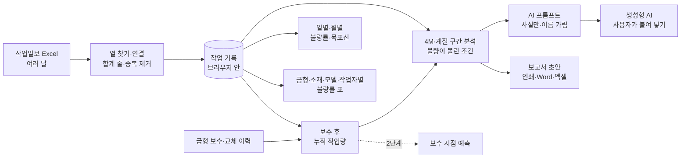

# Deep drawing press 제품 불량 최소화 — 프로젝트 기획서

| 항목 | 내용 |
|---|---|
| 리포 | data10-11 |
| 제출자 | 이성헌 |
| 직무·소속 | 구매팀 (소속 회사명은 공개 리포에 두지 않음) |
| 과정 | 현장 데이터 디지털화 전문가과정 2차수 |
| 작성일 | 2026-10-20 |
| 문서 상태 | 초안 v0.1 — 수강생 제출 자료 기반 |

---

## 1. 추진 배경과 현안

- Deep drawing press(Hydro press) 금형 작업에서 제품 불량(주로 Crack)이 생기고 있습니다.
- 이 공정의 소재는 **단가가 높은 수입 자재**라 불량 하나하나가 그대로 원가 손실이 됩니다.
- 현재 불량률은 **약 5%** 수준이고, 이를 **2% 수준으로 낮추는 것**을 목표로 정했습니다(제출 글).
- 작업일보에는 작업일자·작업자·Hydro press main 압력·쿠션 압력·금형·작업모델·소재 메이커·소재규격·작업수량·불량수량이 쌓이고 있지만, 이를 모아 「어떤 조건에서 불량이 늘어나는지」를 보는 일은 하지 못하고 있는 것으로 보입니다(가정).

제출자의 기대는 작업일보를 집계·분석해 Crack 의 원인을 **계절별 4M(사람·설비·소재·방법)** 에 근거해 추측하고, 소재 문제·프레스 압력 문제·금형 보수 시점을 가려 불량률을 낮추는 데 쓰는 것입니다.

## 2. 목표

### 2.1 최종 목표

- 작업일보를 한곳에 모아 **일별·월별·금형별·소재별 작업량 대비 불량률**을 늘 같은 기준으로 봅니다.
- **불량이 몰린 조건**(계절 × 소재 메이커, 쿠션 압력 구간, 금형 누적 작업량 등)을 근거 숫자와 함께 찾아, 소재·압력·금형 가운데 어디부터 볼지 정합니다.
- 금형 보수·교체 이력과 작업량을 이어 **보수 시점을 미리 알 수 있게** 합니다(이력이 쌓인 뒤).
- 불량률 **5% → 2%** 를 향한 개선을 데이터로 다시 재서 효과를 확인합니다.

### 2.2 1차 개발 목표

1차는 **작업일보 엑셀만 있으면 바로 쓸 수 있는 브라우저 도구**에 집중합니다.

- 작업일보 엑셀 여러 달 치 가져오기(열 이름이 조금 달라도 찾기, 중복 제거)
- 일별·월별·금형·소재·모델·작업자별 불량률 표(작업량 가중, 표본 적음 표시)
- 4M·계절로 나눈 구간 분석과 「불량이 몰린 조건」 찾기
- 금형 보수 이력을 넣으면 보수 전후 비교와 보수 후 누적 작업량별 불량률
- 계산된 사실만 담은 AI 프롬프트(이름 가림)와 보고서 초안

금형 보수 시점 **예측**은 보수 이력이 쌓인 뒤 2단계에서 다룹니다.

## 3. 보유 데이터

| 데이터 | 형태 | 규모·주기 | 비고(민감도 등) |
|---|---|---|---|
| 해당 공정 작업일보 | Excel (제출 글) | 미상 — 최근 6개월~1년 견본 요청 중 | 열: 작업일자·작업자·Hydro press main 압력·쿠션 압력·금형·작업모델·소재 메이커·소재규격·작업수량·불량수량 (제출 글). 1행 = 하루 한 금형 작업 1건으로 가정 |
| 불량 유형 | 미상 | 미상 | Crack 외 주름·찢어짐 등을 따로 적는지 확인 필요(10장 ②) |
| 금형 보수·교체 이력 | 미상 | 미상 | 작업일보와 별도인지 확인 필요(10장 ③) |
| 소재 로트·성적서 | 미상 | 미상 | 작업일보와 연결되는지 확인 필요(10장 ④) |
| 압력 정상 범위 | 미상 | — | 작업표준·설비 기준 확인 필요(10장 ⑤) |

제출 글에 첨부 파일은 없습니다. 작업자 이름은 개인정보이고 금형·모델·소재 메이커는 회사 정보이므로, 실제 파일을 받아도 리포에 넣지 않습니다. 샘플은 같은 항목의 가상 값으로 만듭니다.

## 4. 해결 방안 개요

| 단계 | 내용 |
|---|---|
| 수집 | 작업일보 Excel (이후 금형 보수 이력, 소재 로트·성적서) |
| 정리 | 머리행·열 찾기, 단위·표기 차이 맞추기, 합계 줄 빼기, 같은 행 중복 제거 |
| 분석 | 작업량 가중 불량률(불량 합계 ÷ 작업수량 합계), 4M·계절 구간, 두 조건 조합, 보수 전후 비교 |
| AI | 계산된 사실만 담은 프롬프트로 원인 「추정」과 현장 확인 사항 정리 (1단계는 반자동) |
| 산출물 | 불량률 분석표(일별·월별·금형·소재), 불량이 몰린 조건 목록, 보고서 초안 |

## 5. 주요 기능

| 기능 | 설명 | 우선순위 |
|---|---|---|
| 작업일보 가져오기 | 여러 파일·폴더째, 제목 줄 아래 머리행 자동 인식, 열 연결 화면, 합계 줄 제외, 중복 제거, 빠진 달 점검 | MVP |
| 일별·월별 불량률 | 작업량 대비 불량률 추이, 목표 2% 선, 목표까지 줄일 불량 수 | MVP |
| 금형·소재별 불량률 표 | 금형·소재 메이커·소재규격·작업모델·작업자별, 「표본 적음」 표시, 금형 × 소재 메이커 교차표, 엑셀 내보내기 | MVP |
| 4M·계절 분석 | Man(작업자)·Machine(금형·누적 작업량·Main/쿠션 압력)·Material(메이커·규격·로트)·Method(모델)·계절별 구간 | MVP |
| 불량이 몰린 조건 | 한 조건·두 조건 조합 가운데 표본이 충분하고 불량률이 뚜렷이 높은 것을 근거 숫자와 함께. 다른 조건과 겹치면 표시 | MVP |
| 금형 보수 전후 비교 | 보수·교체 이력을 넣으면 전후 N일 불량률, 보수 후 누적 작업량 구간별 불량률 | MVP(이력 입력 시) |
| AI 프롬프트 | 계산된 사실만, 금형·모델·메이커·작업자 이름 가림, 답 되돌리기 | MVP(반자동) |
| 보고서 초안 | 인쇄/PDF·Word·엑셀 | MVP |
| 금형 보수 시점 예측 | 누적 작업량·불량률 추세로 다음 보수 시점 제안 | 확장(이력 축적 후) |
| 소재 로트·성적서 연계 | 로트별 불량률, 성적서 값과 비교 | 확장 |
| 팀 공유 | 여러 사람이 같은 데이터를 보는 공유 저장소 | 확장 |

## 6. 기대 산출물

1. **작업 일별/월별 작업량 대비 불량률 분석표** (제출 글 기대 산출물 1)
2. **금형/소재별 작업량 대비 불량률 분석표** (제출 글 기대 산출물 2)
3. **계절별 4M 「불량이 몰린 조건」 목록** — Crack 원인 추정의 근거 숫자
4. **금형 보수 전후 비교** — 보수 시점 판단의 참고값
5. **AI 분석 프롬프트와 보고서 초안**
6. 금형 보수 시점 예측 — 2단계

## 7. 기술 구성

| 과정 도구 | 이 프로젝트에서 쓰는 곳 |
|---|---|
| 암묵지 자산화·전략기획 | 현장에서 Crack 원인을 판단하는 기준(소재·압력·금형), 정상 압력 범위, 금형 보수를 결정하는 기준을 꺼내 적기 |
| 코랩(Python)·바이브코딩 | 작업일보 정리, 불량률 집계·구간 분석 로직 시험, 브라우저 도구 제작 — 1단계의 중심 |
| 멀티모달 비정형 정보화 | 소재 성적서(PDF·사진)에서 값 뽑기, 불량 사진 기록 (2단계) |
| RAG | 작업표준·금형 보수 기록·소재 사양서를 근거로 한 원인 질의 (2단계) |
| Make 자동화 | 월간 불량률 보고 정기 발송, 목표 초과 알림 (확장, 보안 허용 시) |
| 생성형 AI | 원인 「추정」·현장 확인 사항 정리 (1단계는 프롬프트 생성 반자동) |

**개발 형태(권장)**

- 1단계는 **설치 없이 브라우저에서 도는 정적 웹 도구**로 만듭니다. 엑셀을 브라우저 안에서만 읽고 계산하므로 **작업일보가 외부로 나가지 않습니다.** 집계·구간 분석·조건 찾기는 규칙 계산이라 AI 서비스가 필요 없습니다.
- AI 는 도구가 직접 부르지 않고 **프롬프트만 만들어 복사**하는 것이 기본입니다. 금형·모델·소재 메이커·작업자 이름은 별칭으로 가립니다. 본인 키로 OpenAI 호환 서버를 쓰는 「자동 보내기」는 선택입니다.
- 불량률은 늘 **작업량 가중**(불량 합계 ÷ 작업수량 합계)으로 셉니다. 하루하루의 불량률을 평균 내면 작업량이 적은 날이 지나치게 크게 반영되기 때문입니다.
- 「불량이 몰린 조건」은 원인을 확정하는 통계 판정이 아니라 **먼저 볼 곳을 고르는 거름망**입니다. 표본 기준·배수 기준은 설정에서 바꿀 수 있습니다.

## 8. 개발 단계

### 1단계 — 지금 바로 개발 가능한 부분

정상 범위나 보수 이력이 없어도 **작업일보 엑셀 하나만 있으면** 쓸 수 있는 기능을 먼저 만듭니다. 견본을 받기 전에는 제출 글의 항목대로 만든 가상 작업일보로 만들고, 견본을 받으면 열 연결만 맞춥니다.

- 작업일보 가져오기(여러 파일, 머리행·열 자동 인식, 열 연결 화면, 합계 줄 제외, 중복 제거)
- 일별·월별 작업량 대비 불량률과 목표선
- 금형·소재 메이커·소재규격·작업모델·작업자별 불량률 표(표본 적음 표시)와 교차표
- 4M·계절 구간 분석 — Main·쿠션 압력은 같은 폭 구간으로 나누고, 정상 범위를 넣으면 아래·안·위로도 봄
- 「불량이 몰린 조건」 찾기 — 근거 숫자(작업수량·불량수량·불량률·전체 대비 배수·기대보다 많은 불량), 다른 조건과 겹침 표시
- 금형 보수·교체 이력 입력(직접·엑셀 붙여 넣기)과 보수 전후 비교, 보수 후 누적 작업량별 불량률
- AI 프롬프트(사실만, 이름 가림)와 보고서 초안(인쇄·Word·엑셀)
- 시험용 가상 데이터에는 일부러 **금형 하나의 마모(보수 전 상승·보수 후 하락)**, **겨울에만 나빠지는 소재 메이커 하나**, **높은 쿠션 압력에서 Crack 증가**를 심고, **Main 압력은 관계없게** 만들어 찾을 것은 찾고 찾지 말 것은 찾지 않는지 확인합니다.

### 2단계

- 실제 작업일보 견본으로 열 연결·불량 유형·정상 압력 범위 맞추기
- 소재 로트·성적서 연계 — 로트별 불량률, 성적서 값(두께·경도 등)과 비교
- 금형 보수 이력이 쌓이면 누적 작업량·불량률 추세로 **보수 시점 예측**
- 개선 조치(압력 조정·소재 변경·보수)를 기록하고 전후 불량률로 효과 확인
- 월간 보고 정기 발송·목표 초과 알림(Make)

### 3단계

- 여러 사람이 함께 쓰는 공유 저장소
- 사내 허용 AI 와 직접 연결해 월간 원인 분석 초안 자동 작성
- 불량 사진과 작업 조건을 함께 보는 기록

## 9. 기대 효과

- **원가 손실 감소** — 수입 자재 불량을 줄이는 것이 바로 원가 절감입니다. 목표(5% → 2%)를 이루면 같은 작업량에서 불량이 약 60% 줄어듭니다(제출 글의 두 비율로 계산).
- **원인 범위 좁히기** — 소재·압력·금형 가운데 어디부터 볼지 숫자로 정해 현장 확인 시간을 줄입니다.
- **금형 보수 시기 판단** — 보수 전후 비교와 누적 작업량 곡선으로 보수 시기를 감이 아니라 기록으로 정합니다.
- **같은 기준의 반복 보고** — 매달 같은 방식(작업량 가중)으로 불량률을 냅니다.

## 10. 확인 필요 사항

> 패들릿 댓글로 요청했습니다(docs/source/패들릿_접수_원문.md). 1차 범위는 일별·월별·금형별·소재별 불량률 표 + 「불량이 몰린 조건」 찾기이고, 금형 보수 시점 예측은 이력이 쌓인 뒤로 둡니다.

**샘플 데이터 (필수)**

1. 작업일보 엑셀 견본(최근 6개월~1년) — 시트 구성, 한 행이 무엇인지(하루 한 금형 작업 1건인지), 제목·합계 줄 모양. 작업자 이름은 지워서 보내 주셔도 됩니다.

**분류·판정 기준**

2. 불량 판정 기준과 유형 — Crack 외에 주름·찢어짐 등이 있는지, 작업일보에 유형별로 따로 적는지(유형 칸이 있으면 도구가 유형별로도 봅니다)
3. 금형 보수·교체 이력 — 따로 관리하는 표가 있는지, 금형 이름이 작업일보의 금형 칸과 같은지, 보수와 교체를 구분하는지
4. 소재 메이커·로트가 작업일보와 연결되는지 — 로트 번호를 작업일보에 적는지, 소재 성적서와 이을 수 있는지
5. 정상 압력 범위 — Hydro press main 압력·쿠션 압력의 작업표준(모델·금형마다 다른지), 단위(bar·MPa·kgf/cm²)

**보안·환경 (견본을 받으며 함께 확인)**

- 작업일보를 외부 AI(ChatGPT 등)에 넣어도 되는지 — 도구는 기본으로 금형·모델·메이커·작업자 이름을 가리고 숫자만 보냅니다.
- 혼자 쓰는지, 팀(구매·생산·품질)이 함께 보는지(공유 저장소 필요 여부)

## 부록. 제출 원문 요약

- 현안: Deep drawing press 금형 작업 제품 불량 최소화 — 높은 단가의 수입 자재, 불량률 약 5% → 2% 목표
- 데이터: 작업일보(excel) — 작업일자 / 작업자 / Hydro press main 압력 / 쿠션 압력 / 금형 / 작업모델 / 소재 메이커 / 소재규격 / 작업수량 / 불량수량
- 기대 산출물: 일별/월별 작업량 대비 불량률 분석표, 금형/소재별 작업량 대비 불량률 분석표, 계절별 4M 근거 Crack 원인 추측(소재 문제 / 프레스 압력 문제 / 금형 보수 시점 예측)
- 원문: [docs/source/패들릿_접수_원문.md](source/패들릿_접수_원문.md)
