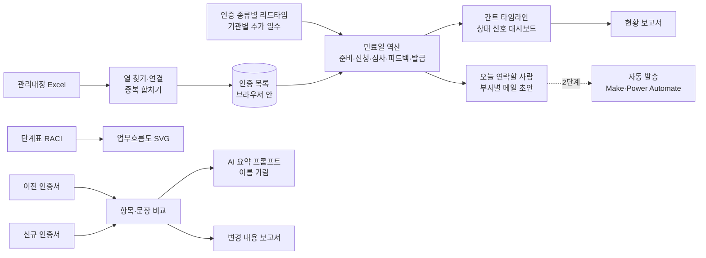

# 각종 Certification(선급 Type Approval) 관리방안 개선 — 프로젝트 기획서

| 항목 | 내용 |
|---|---|
| 리포 | data10-12 |
| 제출자 | 윤한산 |
| 직무·소속 | 품질부서 (소속 회사명은 공개 리포에 두지 않음) |
| 과정 | 현장 데이터 디지털화 전문가과정 2차수 |
| 작성일 | 2026-10-21 (v0.2: 2026-10-27) |
| 문서 상태 | v0.2 — 2차 요청(10-27: 과거 이력 · 중지된 인증 이력 · 인증서 PDF · 모델-형식 묶음) 반영 |

---

## 1. 추진 배경과 현안

- 품질부서는 각종 Certification, 특히 **선급 Type Approval(형식승인)** 을 관리합니다. 인증마다 유효기간이 있어 만료 전에 갱신해야 합니다.
- 갱신에는 **준비(서류·시험) → 인증기관 신청 → 기관 심사 → 피드백(보완 요청) 대응 → 발급**이 이어지고, 인증기관의 피드백 때문에 전체 기간(Lead-Time)이 길고 들쭉날쭉합니다.
- 지금은 갱신 주기 점검·사전 준비와, 새 인증서를 **영업·품질·개발 등 내외부 관련인에게 배포·공유하는 일**을 제때 하지 못하고 있습니다(제출 글).
- 자료는 인증서 문서, 별도의 **관리대장 엑셀**, 담당자들이 주고받은 **e-Mail** 에 흩어져 있어, 언제 무엇을 해야 하는지 한눈에 보기 어려운 것으로 보입니다(가정).

제출자의 기대는 이 부문을 **상시·시각적으로 관리**하는 것입니다.

## 2. 목표

### 2.1 최종 목표

- 관리대장을 한곳에 모아 인증마다 **만료일에서 거꾸로 센 갱신 일정**(준비·신청·기관 심사·피드백·발급)을 늘 같은 기준으로 봅니다.
- 늦어지는 인증을 **상태 신호(정상·준비 예정·준비 시작·임박·지연·만료·배포 필요)** 로 먼저 알아챕니다.
- 할 일이 생기면 **영업·품질·개발 관련인에게 제때 알림**이 가게 합니다.
- 새 인증서를 받으면 **이전 인증서와 무엇이 바뀌었는지** 요약해 보고·배포합니다.
- 갱신 업무의 **흐름과 부서별 역할(R/R)** 을 문서로 남겨 담당자가 바뀌어도 같은 방식으로 일합니다.

### 2.2 1차 개발 목표

1차는 **관리대장 엑셀만 있으면 바로 쓸 수 있는 브라우저 도구**에 집중합니다.

- 관리대장 엑셀 가져오기(열 이름이 조금 달라도 찾기, 열 연결 화면)
- 인증 종류별 리드타임으로 갱신 일정을 역산하는 **간트형 타임라인**과 상태 신호 대시보드
- 「오늘 연락할 사람」 목록과 **부서별 메일 초안**(메일 앱으로 열기·복사) — 실제 자동 발송은 2단계
- 단계표(RACI)를 고치면 그려지는 **업무흐름도(부서별 줄)**
- 이전/신규 인증서 **변경 비교**(항목·문장)와 AI 요약 프롬프트(반자동), 보고서(인쇄·Word·엑셀)

## 3. 보유 데이터

| 데이터 | 형태 | 규모·주기 | 비고(민감도 등) |
|---|---|---|---|
| 인증 관리대장 | Excel (제출 글) | 미상 — 견본 요청 중 | 열은 미확인(10장 ①). 인증기관·인증 종류·제품·인증서 번호·발급일·만료일·담당 정도로 가정 |
| 인증서 문서 | PDF 등 (제출 글) | 인증마다 이전·신규 | 글자층이 있는 PDF 인지 스캔본인지 확인 필요(10장 ②) |
| 담당자 e-Mail | 메일 (제출 글) | 미상 | 진행 기록·피드백 이력. 개인정보·회사 정보가 섞여 1단계에서는 다루지 않음 |
| 인증 종류별 소요 기간 | 담당자 경험 | — | 준비·기관 심사·피드백 기간을 꺼내 적어야 함(10장 ③) |

제출 글에 첨부 파일은 없습니다. 인증서 번호·고객명·담당자 이름은 회사·개인 정보이므로, 실제 파일을 받아도 리포에 넣지 않습니다. 샘플은 공개된 선급 이름(DNV·ABS·LR·KR·BV·CCS·RINA·ClassNK)과 지어낸 제품·번호로 만듭니다.

## 4. 해결 방안 개요

| 단계 | 내용 |
|---|---|
| 수집 | 관리대장 Excel, 인증서(PDF 글자층·붙여 넣기) |
| 정리 | 머리행·열 찾기, 날짜 표기 맞추기(2027.3.15 · 15-Mar-2027 · 15.03.2027 …), 같은 인증 합치기 |
| 분석 | 만료일 역산 일정, 상태 판정(단계 기한 대비 진행 단계), 알림 대상 고르기, 인증서 항목 비교 |
| AI | 비교 사실만 담은 프롬프트로 변경 요약·부서별 확인 사항 초안 (1단계는 반자동) |
| 산출물 | 업무흐름도·R/R 표, 타임라인·대시보드, 메일 초안, 변경 내용 보고서 |

## 5. 주요 기능

| 기능 | 설명 | 우선순위 |
|---|---|---|
| 관리대장 가져오기 | 여러 파일, 머리행 자동 인식, 열 이름 별칭, 열 연결 화면, 같은 인증은 한 행(도구에서 바꾼 진행 단계·배포일 유지) | MVP |
| 갱신 일정 역산 | 만료일 − 여유 − 발급 처리 − 피드백 − 기관 심사 − 준비. 인증 종류별 값, 기관별 추가 일수, 대장의 리드타임 값 우선 | MVP |
| 상태 신호 · 대시보드 | 만료·지연·임박·배포 필요·준비 시작·준비 예정·정상·완료, 지금 할 일, 12개월 만료 예정 | MVP |
| 간트 타임라인 | 인증별 단계 막대, 만료일, 오늘 선, 상태·기관 거르기 | MVP |
| 관리대장 화면 | 진행 단계·신청일·배포일 바꾸기, 한 건 추가·고치기, 다음 주기로 넘기기(이력 보관), 엑셀 내보내기 | MVP |
| 알림 | 오늘 연락할 것(인증마다 가장 최근 일 하나), 부서별 메일 초안(mailto·복사), 90일 안 다가오는 일 | MVP(초안까지) |
| 업무흐름 · R/R | 단계표(RACI) 편집 → 부서별 줄 흐름도 SVG, RACI 규칙 점검(단계마다 R 하나 이상·A 하나) | MVP |
| 인증서 변경 비교 | 「항목: 값」 맞대기(내용 / 번호·날짜 구분), 항목이 아닌 문장 차이, 낱말 단위 표시, PDF 글자층 읽기 | MVP |
| AI 요약 | 비교 사실만, 회사명·메일·전화·인증서 번호 가림, 답 되돌리기 | MVP(반자동) |
| 보고서 | 현황 보고·변경 내용 보고 — 인쇄/PDF·Word·엑셀 | MVP |
| 자동 알림 발송 | 정해진 날 부서 메일·메신저로 보내기 | 확장(2단계) |
| e-Mail 진행 기록 연결 | 담당자 메일에서 신청·피드백 날짜를 뽑아 대장에 반영 | 확장 |
| 스캔본 인증서 OCR | 글자층 없는 인증서 읽기 | 확장 |
| 팀 공유 | 여러 사람이 같은 대장을 보는 공유 저장소 | 확장 |

## 6. 기대 산출물

1. **업무흐름도(관련 부서 R/R 포함)** — 부서별 줄 흐름도 SVG와 RACI 표 (제출 글 1)
2. **실시간 관리대장의 비주얼화** — 준비·인증기관 피드백을 감안한 전체 Lead-Time 간트와 상태 신호 대시보드 (제출 글 2)
3. **관련인(영업·품질·개발) Alert** — 1단계는 오늘 연락할 목록과 부서별 메일 초안, 자동 발송은 2단계 (제출 글 3)
4. **이전/신규 인증서 변경 내용 요약과 보고서** — 항목·문장 비교, AI 요약 초안, Word·엑셀 보고서 (제출 글 4)

## 7. 기술 구성

| 과정 도구 | 이 프로젝트에서 쓰는 곳 |
|---|---|
| 암묵지 자산화·전략기획 | 인증 종류·기관별 실제 소요 기간, 갱신 착수 판단 기준, 부서별 역할을 꺼내 적기 |
| 코랩(Python)·바이브코딩 | 관리대장 정리, 일정 역산·상태 판정·비교 로직 시험, 브라우저 도구 제작 — 1단계의 중심 |
| 멀티모달 비정형 정보화 | 인증서 PDF 글자층 읽기(1단계), 스캔본 OCR·메일에서 날짜 뽑기(2단계) |
| RAG | 선급 규칙·인증서 조건을 근거로 한 질의 (확장) |
| Make 자동화 | 알림 메일 정기 발송, 배포 공유 (2단계, 회사 메일 정책 확인 후) |
| 생성형 AI | 변경 내용 요약·부서별 확인 사항 초안 (1단계는 프롬프트 생성 반자동) |

**개발 형태(권장)**

- 1단계는 **설치 없이 브라우저에서 도는 정적 웹 도구**입니다. 관리대장·인증서를 브라우저 안에서만 읽고 계산하므로 **회사 자료가 외부로 나가지 않습니다.** 일정 역산·상태·비교는 규칙 계산이라 AI 서비스가 필요 없습니다.
- 알림은 1단계에서 **메일 초안까지만** 만듭니다(사용자가 메일 앱에서 확인하고 보냄). 자동 발송은 회사 메일 시스템 정책을 확인한 뒤 Make·Power Automate 로 붙입니다.
- AI 는 도구가 직접 부르지 않고 **프롬프트만 만들어 복사**하는 것이 기본입니다. 회사명·메일·전화·인증서 번호는 별칭으로 가립니다. 본인 키로 OpenAI 호환 서버를 쓰는 「자동 보내기」는 선택입니다.
- 「지연」은 **단계 기한 대비 진행 단계**로 판정합니다. 예를 들어 신청 기한이 유예 일수(기본 7일)를 넘게 지났는데 관리대장의 진행 단계가 「준비 중」이면 지연입니다. 그래서 진행 단계를 제때 바꿔 적는 것이 이 도구의 전제입니다.

## 8. 개발 단계

### 1단계 — 지금 바로 개발 가능한 부분

견본이 없어도 **관리대장의 기본 열(인증기관·인증 종류·만료일)만 있으면** 쓸 수 있는 기능을 먼저 만들었습니다. 견본을 받기 전에는 가상 관리대장 22건과 가상 인증서 2장으로 만들고 검사했고, 견본을 받으면 열 연결과 리드타임 값만 맞춥니다.

- 관리대장 가져오기(머리행·열 자동 인식, 열 연결 화면, 여러 날짜 표기, 같은 인증 합치기)
- 인증 종류별 리드타임(기본: Type Approval 179일 = 준비 60 + 기관 심사 45 + 피드백 30 + 발급 14 + 여유 30, Works Approval 139일, ISO 93일 — **가상 기본값**, 10장 ③)으로 일정 역산
- 상태 신호·대시보드·간트 타임라인, 관리대장 화면(진행 단계·신청일·배포일, 다음 주기로)
- 오늘 연락할 사람과 부서별 메일 초안(mailto·복사), 알림 받는 부서 규칙 설정
- 단계표(RACI) → 업무흐름도 SVG, RACI 규칙 점검
- 이전/신규 인증서 비교(PDF 글자층·붙여 넣기), AI 요약 프롬프트(이름 가림), 보고서(인쇄·Word·엑셀)
- 시험용 가상 데이터에는 만료 2 · 지연 2 · 임박 3 · 배포 필요 1 · 준비 시작/진행 4 · 준비 예정 1 · 정상 8 · 완료 1 이 기준일과 함께 고루 나오게 하고, 인증서 비교에는 정격압력·시험압력·적용 범위·규칙 판·조건 문장 변경을 심었습니다.

### 2단계

- 실제 관리대장 견본으로 열 연결·진행 단계 표기 맞추기, 인증 종류·기관별 실제 리드타임 반영
- **자동 알림 발송** — Make·Power Automate 로 매일 아침 알림 목록을 부서 메일(또는 메신저)로 보내기
- 담당자 e-Mail 에서 신청·피드백 날짜를 뽑아 진행 단계를 갱신(반자동)
- 지난 갱신 이력(신청일 → 발급일)이 쌓이면 **실제 리드타임**으로 기본값 다시 잡기
- 스캔본 인증서 OCR, 인증서 원본 보관 위치 연결

### 3단계

- 여러 사람이 함께 쓰는 공유 저장소(부서별 보기 권한)
- 고객·프로젝트 요구 인증과 연결(영업이 수주 전에 인증 유효 여부 확인)
- 선급 규칙 개정 공지와 연결해 영향 받는 인증 찾기

## 9. 기대 효과

- **만료 공백 예방** — 만료일에서 거꾸로 센 일정과 지연 신호로 준비를 늦게 시작하는 일을 줄입니다.
- **제때 공유** — 새 인증서를 받으면 「배포 필요」가 떠서 영업·품질·개발에 빠짐없이 알립니다.
- **변경 내용 확인 시간 단축** — 이전/신규 인증서를 맞대어 바뀐 사양·조건을 바로 찾고 보고서 초안을 만듭니다.
- **업무 표준화** — 흐름도와 R/R 표로 담당자가 바뀌어도 같은 순서·역할로 일합니다.

## 10. 확인 필요 사항

> 패들릿 댓글로 요청할 목록입니다. 답을 받으면 기획서를 v0.2 로 고치고 도구의 열 연결·기본값을 맞춥니다.

**샘플 데이터 (필수)**

1. 인증 관리대장 엑셀 견본 — 실제 열 이름과 순서, 한 행이 무엇인지(인증서 한 장인지, 제품별인지), 진행 상황을 어떻게 적는지. 인증서 번호·담당자 이름은 지워서 보내 주셔도 됩니다.
2. 이전/신규 인증서 한 쌍(가능하면 PDF) — 글자를 복사할 수 있는 PDF 인지 스캔본인지, 주로 바뀌는 항목이 무엇인지

**기준**

3. 인증 종류·인증기관별 실제 소요 기간 — 준비·신청 뒤 기관 심사·피드백 대응·발급까지 각각 며칠쯤 걸리는지, 피드백이 특히 늦은 기관이 있는지
4. 부서별 역할과 알림 시점 — 영업·품질·개발(그 밖의 부서)이 단계마다 하는 일(R/R), 누구에게 언제(만료 몇 일 전 등) 알려야 하는지, 받을 메일은 부서 공용 주소인지

**보안·환경**

5. 메일 시스템과 외부 서비스 허용 여부 — 회사 메일(Outlook·사내 메일)에서 자동 발송(Make·Power Automate)을 쓸 수 있는지, 인증서 내용을 외부 AI 에 넣어도 되는지(도구는 기본으로 회사명·메일·인증서 번호를 가림), 혼자 쓰는지 부서가 함께 보는지

## 11. 2차 반영 (2026-10-27 — 인증 이력 · 중지된 인증 · 인증서 PDF · 모델-형식 묶음)

**받은 요청**(10-27): 「현재는 런닝 중인 22건을 관리대장으로 추가하였습니다. ① 현재 런닝 중인 인증건에 과거 이력을 추가하고 싶습니다. ② 런닝되지 않은(어떠한 사유로 중지된) 인증건에 대해서도 이력을 추가하고 싶습니다. ③ 현재의 인증서 PDF 를 업로드하여 클릭 시 내용을 볼 수 있으면 합니다. ④ DB 의 필드명 「모델-형식」을 Key 로 동일 인증건이 그룹핑되어 구분되었으면 합니다.」
수강생이 브라우저에 넣은 22건은 그 PC 에만 있어 받지 않았습니다. 그래서 **그 22건이 그대로 남도록** 저장 모양을 옮기는 방식(지우지 않음)으로 만들고, 1단계 모양의 22건으로 옮기기를 검사했습니다.

### 11.1 저장 모양 — 인증 한 건 = 지금의 인증서, 지난 인증서 = 그 인증의 이력

| 칸 | 뜻 | 1단계 저장(v1)에서 옮길 때 |
|---|---|---|
| 운영 상태 | **운영 중**(런닝) · **중지** · **만료 종료**(갱신하지 않음) · **폐기** | 없으면 「운영 중」 — 22건 모두 운영 중으로 그대로 |
| 중지 사유 · 중지일 | 중지·만료 종료·폐기일 때 남김(중지일을 비우면 기준일) | 빈칸 |
| 인증서 PDF | 지금 인증서에 붙인 PDF 한 장({ 이름 · 크기 · 붙인 날 }, 파일은 브라우저의 IndexedDB) | 없음 |
| 이력(지난 인증서 여러 줄) | 인증서 번호 · 발급일 · 만료일 · 이력 상태(**갱신됨** · 중지 · 만료 종료 · 폐기) · 사유 · 중지일 · 비고 · PDF | 1단계 「다음 주기로」로 남긴 이력은 값 그대로 두고 「갱신됨」과 이력 id 만 붙임 |

- 옮기기는 화면을 처음 여는 순간 한 번(저장 모양 v1 → v2). 값을 지우거나 줄을 합치지 않습니다. 진행 단계·배포일·상태 신호는 옮기기 전과 같습니다(검사로 확인).
- **운영 중이 아닌 인증은 갱신 알림·타임라인·대시보드 건수에서 빠지고**, 모델별 이력과 관리대장(「중지·종료」 거르기)에는 남습니다. 만료일이 지난 중지 인증이 「만료」 신호로 잡히지 않습니다.
- 「다음 주기로」로 넘기면 지금 인증서와 **그 PDF 가 함께 이력으로** 내려갑니다.

### 11.2 「모델-형식」 묶음 (요청 ④)

- 관리대장의 「모델·형식」 칸이 묶음 키입니다. 열 이름은 「모델-형식」 「모델·형식」 「모델/형식」 「Model Type」 「모델」 모두 이 칸으로 읽습니다(1단계는 「모델-형식」 을 못 읽었습니다 — 같이 고침).
- 묶음 키 = 띄어쓰기·하이픈 모양(- ‐ – — − －)·밑줄·가운뎃점을 지우고 대문자로 바꾼 글자. 「HC-100 계열」 「hc100계열」 「HC–100 계열」은 모두 `HC100계열` 입니다. 빈칸·「-」·「없음」은 묶지 않고 「모델·형식 미기재」에 따로 모읍니다.
- 새 화면 **③-2 모델별 이력**: 묶음마다 ① 인증(기관·종류별 한 줄, 지금 인증서·상태·PDF) ② 인증서 이력(지금 + 지난 인증서를 최근 것부터 한 줄로). 같은 묶음으로 본 표기가 여럿이면 함께 보여 줍니다(오타·표기 차이 찾기). 거르기: 운영 중이 있는 묶음 · 중지·종료가 있는 묶음 · 지난 이력이 있는 묶음, 찾기(모델 · 기관 · 인증서 번호).
- 관리대장 화면에 「모델-형식 순」 정렬과 묶음 키 표시, 줄마다 「이력」 바로가기를 더했습니다.

### 11.3 과거 이력 · 중지된 인증 넣기 (요청 ①②)

| 방법 | 쓰는 때 |
|---|---|
| ③-2 화면 「과거 이력 추가」 | 몇 줄 — 붙일 인증 · 인증서 번호 · 발급일 · 만료일 · 이력 상태 · 사유 · 중지일 · 비고 · PDF(선택). 같은 번호·날짜가 이미 있거나 지금 인증서와 같으면 막음 |
| ③-2 화면 「중지·종료로」 / 관리대장 「고치기」의 운영 상태 | 지금 운영 중인 인증을 멈출 때 — 상태 · 사유 · 중지일. 다시 「운영 중」으로 두면 알림이 돌아옴 |
| 엑셀 — 이름에 「이력」이 든 시트(예: 「인증 이력」) | 여러 줄 — 관리대장과 같은 열(모델-형식 · 인증기관 · 인증 종류 · 인증서 번호 · 발급일 · 만료일)에 **이력 상태 · 중지 사유 · 중지일**. 관리대장 시트와 함께 한 파일에 두면 같이 읽음 |
| 엑셀 — 관리대장 시트의 「운영 상태」 열 | 관리대장 줄에 「중지」 「만료 종료」 「폐기」 → 그 상태의 인증, 「갱신됨」 → 지난 인증서(이력). 운영 상태 열이 없으면 진행 단계 칸의 분명한 말(중지·폐기·갱신됨)만 봄 — 「만료」 한 단어는 갱신 진행으로 보고 상태로 읽지 않음 |

- 이력 줄은 **같은 모델-형식 · 인증기관 · 인증 종류**의 인증에 붙습니다(모델 표기가 달라도 묶음 키로 맞춤). 붙일 인증이 없으면(중지돼 관리대장에 없는 인증) 그 줄들 가운데 가장 늦은 것을 인증 한 건으로 세우고 나머지는 그 이력으로 둡니다 — 이력 상태가 「갱신됨」뿐이면 「만료 종료」.
- 같은 파일을 다시 넣어도 이력이 늘지 않습니다(번호 · 발급일 · 만료일이 같은 줄은 한 번만). 도구에서 정한 운영 상태·사유·PDF 는 파일에 운영 상태가 없으면 지킵니다.
- ③ 관리대장 「엑셀로 내려받기」는 **관리대장 시트 + 「인증 이력」 시트**를 씁니다. 이 파일을 그대로 다시 넣어도 같은 인증 · 같은 이력 · 같은 운영 상태로 읽힙니다(검사로 확인). 그러려고 내보내는 열 이름 「상태」를 「상태 신호」로 바꾸고, 「신청일」 같은 정확한 열 이름이 「신청 기한」 같은 비슷한 이름보다 먼저 연결되게 했습니다.

### 11.4 인증서 PDF (요청 ③)

- 인증(지금 인증서)과 이력 한 줄마다 PDF 한 장. 「PDF 붙이기」 → 「PDF 보기」(화면 안 보기 창) · 「새 탭에서 열기」 · 「내려받기」 · 「바꾸기」 · 「PDF 빼기」.
- **서버로 보내지 않습니다.** 파일은 이 브라우저의 IndexedDB 에, 관리대장에는 이름·크기만. 한 장 **15MB** 까지(넘으면 크기와 함께 안내), 파일 첫머리가 `%PDF-` 가 아니면 거절. 인증을 지우면 그 인증과 이력의 PDF 도 지웁니다.
- 백업: 설정의 **「JSON 백업(PDF 포함)」**(PDF 를 base64 로 넣어 파일이 PDF 합계의 약 1.4배)과 **「JSON 백업(PDF 빼고)」**(빠진 장 수만 적음). 다른 PC 로 옮길 때는 PDF 포함을 씁니다. 불러오면 PDF 도 IndexedDB 에 되살립니다.
- 사생활 보호 창처럼 IndexedDB 를 못 쓰는 브라우저에서는 그 창을 닫으면 PDF 가 사라진다고 알립니다.

### 11.5 가상 샘플 · 검사

- 샘플 관리대장(22건, 모두 운영 중)에 **「인증 이력」 시트**를 더했습니다(값은 전부 가짜): 지난 인증서 7줄(HC-100 계열 DNV 두 주기 · DV-20 · PV-45 · HM-30 의 일시 중지 이력 등)과 중지·종료 인증 3건 — BV 「hc-100계열」 중지(고객 요구 없음) · RINA 「DV20」 만료 종료(수출 지역 변경) · KR GP-25 폐기(모델 단종). 모델 표기를 일부러 다르게 적어 같은 묶음으로 모이는지 봅니다. 가상 인증서 PDF 6장(글자층 있는 1쪽)은 샘플을 열 때 만들어 붙입니다.
- 1단계의 상태 분포(만료 2 · 지연 2 · 임박 3 · 배포 필요 1 · 준비 시작/진행 4 · 준비 예정 1 · 정상 8 · 완료 1)는 운영 중 22건에서 그대로입니다.
- 로직 검사 41 → **55개**. 일부러 깨뜨려 확인 12가지 모두 검사가 실패하는 것을 보고 원복. 브라우저 점검 35 → **67개**(1단계 저장 22건 옮기기 · 모델별 이력 · PDF 보기/새 탭/붙이기/거절/바꾸기/빼기 · 과거 이력 · 중지 · 백업과 되살리기 · 10개 화면 × 1280·390px 넘침 0 · JS 오류 0).

### 11.6 확인 부탁드리는 것

1. **22건을 넣으신 방법** — 화면에서 한 건씩(「인증 한 건 직접 추가」)인지, 엑셀 가져오기인지. 어느 쪽이든 그대로 남지만, 엑셀이면 그 파일에 「인증 이력」 시트를 더해 다시 넣는 것이 가장 빠릅니다.
2. **「모델-형식」 칸에 여러 모델을 한 칸에 적은 줄**(예: 「HC-100/200」)이 있는지 — 지금은 한 묶음으로 봅니다. 모델마다 나눠야 하면 알려 주세요.
3. **같은 모델에 기관·종류가 같은 인증이 둘 이상 동시에 운영**되는 경우가 있는지(예: 제품군이 달라 인증서가 따로) — 있으면 이력 붙이는 기준에 제품을 더합니다.
4. **중지 사유의 정해진 목록**이 있는지(고객 요구 없음 · 단종 · 설계 변경 · 수출 지역 변경 …) — 있으면 고르기로 바꿉니다.
5. **인증서 PDF 크기** — 스캔본이 15MB 를 넘는 경우가 있는지, 한 인증에 여러 장(본문 + 부속서)을 붙여야 하는지.

## 부록. 제출 원문 요약

- 현안: 각종 Certification(특히 선급 Type Approval)의 갱신 주기 점검·사전 준비와 내외부 관련인 배포 공유를 제때 하지 못함 → 상시·시각적 관리
- 데이터: Certification 문서, 별도 관리대장 엑셀, 담당자 e-Mail
- 기대 산출물: 업무흐름도(R/R), 실시간 관리대장 비주얼화(준비·피드백 감안 Lead-Time), 영업·품질·개발 Alert, 이전/신규 인증서 변경 요약·보고서
- 원문: [docs/source/패들릿_접수_원문.md](source/패들릿_접수_원문.md)
