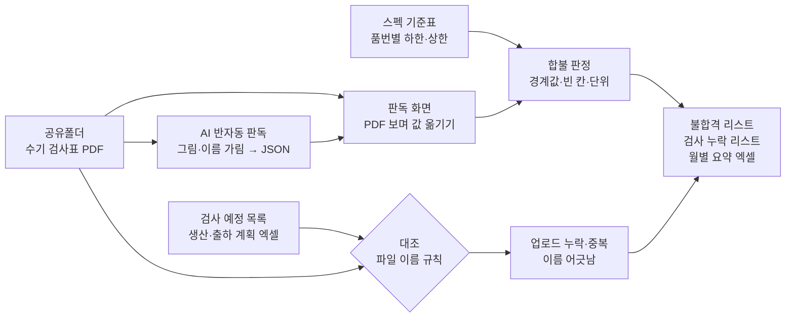

# 불량 제품 파악 — 프로젝트 기획서

| 항목 | 내용 |
|---|---|
| 리포 | data10-13 |
| 제출자 | 구민채 |
| 직무·소속 | 품질경영팀 (소속 회사명은 공개 리포에 두지 않음) |
| 과정 | 현장 데이터 디지털화 전문가과정 2차수 |
| 작성일 | 2026-10-21 |
| 문서 상태 | 초안 v0.1 — 수강생 제출 자료 기반 |

---

## 1. 추진 배경과 현안

- 현장에서 제품 스펙(측정값)을 **검사표에 손으로 적고**, 그 검사표를 PDF 로 만들어 **공유폴더에 올립니다**(제출 글 1).
- 품질경영팀은 올라온 수기 PDF 를 하나씩 열어 값을 보고(제출 글 2), **합격·불합격을 엑셀 리스트로 다시 정리**합니다(제출 글 3).
- 이 과정에서 두 가지가 빠지기 쉽습니다. 하나는 **검사표가 아예 올라오지 않은 로트**(업로드 누락)이고, 다른 하나는 **검사표에 빈 칸이 있거나 값을 옮기다 빠뜨린 것**(검사 누락)입니다. 손으로 적은 값을 다시 옮겨 적는 일이라 시간이 들고, 옮기는 중 실수도 생길 수 있습니다(가정).

제출자의 기대 산출물은 **업로드·검사 누락 리스트**와 **불합격 제품 리스트**입니다.

## 2. 목표

### 2.1 최종 목표

- 「검사해야 할 로트」와 「올라온 검사표」를 늘 대조해 **업로드 누락을 바로** 알아냅니다.
- 수기 검사표의 값을 **한 번만 옮기면** 스펙 기준표로 합불이 자동으로 판정되고, 불합격·검사 누락 리스트와 월별 불량률이 함께 나오게 합니다.
- 옮겨 적는 일은 AI 판독(그림 → 값)으로 줄이되, **사람이 확인한 값만** 판정에 씁니다.
- 장기적으로는 현장 입력 자체를 종이 대신 태블릿·엑셀 양식으로 바꿔 「옮겨 적기」를 없애는 방향을 검토합니다.

### 2.2 1차 개발 목표

1차는 **손글씨를 자동으로 읽지 못하더라도 바로 쓸 수 있는 부분**에 집중합니다.

- 검사 예정 목록(엑셀) ↔ 공유폴더 PDF 파일 이름 대조 — 업로드 누락·중복·이름 규칙 어긋남·예정에 없는 파일
- PDF 를 보며 값을 빠르게 옮기는 판독 화면 — 적는 즉시 항목·로트 합불 표시
- AI 반자동 판독 — 검사표 그림(이름·서명 칸은 가림)과 프롬프트를 사용자의 AI 에 보내 JSON 으로 값을 받고, 사람이 대조
- 스펙 기준표로 합불 판정(경계값·빈 칸·단위), 불합격 리스트·검사 누락 리스트·월별 요약 엑셀

## 3. 보유 데이터

| 데이터 | 형태 | 규모·주기 | 비고(민감도 등) |
|---|---|---|---|
| 수기 검사표 | 손으로 적은 양식을 PDF 로 만든 것 (제출 글) | 미상 — 견본 요청 중 | 스캔(그림)인지, 태블릿 필기인지 확인 필요(10장 ①). 검사자 이름·서명이 들어 있을 수 있음 |
| 검사 예정 목록 | 미상 — 생산·출하 계획 엑셀로 가정 | 미상 | 「업로드 누락」을 세려면 무엇을 검사해야 했는지 목록이 필요(10장 ②) |
| 스펙 기준표 | 미상 — 품번별 검사 항목·하한·상한으로 가정 | 미상 | 도면·검사기준서에 흩어져 있을 수 있음(10장 ③) |
| 파일 이름 | 공유폴더 PDF 이름 | — | 품번·로트·날짜가 이름에 들어가는지, 규칙이 있는지 확인 필요(10장 ②) |
| 합불 엑셀 리스트 | Excel (지금 손으로 정리하는 결과) | 미상 | 이 도구의 결과와 대조할 정답으로 쓸 수 있음 |

제출 글에 첨부 파일은 없습니다. 검사표의 품번·로트·값과 검사자 이름은 회사 정보·개인정보이므로, 실제 파일을 받아도 리포에 넣지 않습니다. 샘플은 같은 모양의 **가상 검사표**로 만듭니다.

## 4. 해결 방안 개요

| 단계 | 내용 |
|---|---|
| 수집 | 공유폴더 PDF(여러 개·폴더째, 또는 파일 이름 목록만), 검사 예정 목록 엑셀, 스펙 기준표 엑셀 |
| 정리 | 파일 이름에서 품번·로트·날짜 읽기(규칙 설정), 예정 로트와 짝 짓기(규칙이 어긋나도 이름 안의 로트로) |
| 판독 | 사람이 옮기거나, AI 가 그림에서 읽은 값을 사람이 대조 — 값은 「적힌 그대로」 저장 |
| 판정 | 항목별 하한·상한 비교 → 한 항목이라도 벗어나면 불합격, 빈 칸·못 읽은 칸은 보류 |
| 산출물 | 불합격 제품 리스트, 업로드·검사 누락 리스트, 월별·품번별·항목별 요약, 엑셀 |

## 5. 주요 기능

| 기능 | 설명 | 우선순위 |
|---|---|---|
| 자료 넣기 | 검사 예정 목록·스펙 기준표 엑셀(머리행·열 자동 인식, 열 연결 화면), PDF 여러 개·폴더째, 파일 이름 목록만 넣기 | MVP |
| 업로드 점검 | 예정 로트별 상태, 업로드 누락·중복·이름 규칙 어긋남·예정에 없는 파일, 파일 이름 규칙 설정 | MVP |
| 판독 화면 | 왼쪽 검사표 그림(pdf.js), 오른쪽 항목 칸 — 적는 즉시 합불, Enter 로 다음 칸, 판독 완료 → 다음 대기 파일 | MVP |
| AI 반자동 판독 | 가릴 영역(서명 등)을 흰색으로 덮은 그림 + 프롬프트 → 답(JSON) 붙여 넣기 → 칸 채우기, 확신 낮은 칸 표시. 선택: 본인 키로 그림과 함께 자동 보내기 | MVP(반자동) |
| 합불 판정 | 하한·상한·상한만·OK/NG, 경계값 포함 여부, 빈 칸 처리, 단위 바꾸기(길이·무게), 경계 근처 표시 | MVP |
| 결과·엑셀 | 불합격 리스트, 검사 누락 리스트, 월별 요약(불합격률·업로드율), 품번별·항목별, 판독값 전체 | MVP |
| AI 요약 | 계산된 숫자만, 품번은 「제품1」로 가린 보고용 요약 프롬프트 | MVP(반자동) |
| 손글씨 자동 인식 | 브라우저 안에서 손글씨를 직접 읽기(OCR) | 확장 — 견본으로 정확도 확인 뒤 |
| 공유폴더 자동 훑기 | 정해진 시각에 폴더를 읽어 누락 알림 | 확장(사내 환경 확인 뒤) |
| 현장 입력 전환 | 종이 대신 태블릿·엑셀 양식으로 처음부터 값 입력 | 확장(3단계 검토) |

## 6. 기대 산출물

1. **불합격 제품 리스트** — 로트·품번·벗어난 항목·기준·적힌 값 (제출 글 기대 산출물)
2. **업로드·검사 누락 리스트** — 업로드 누락, 판독 대기, 검사표 빈 칸, 판독 확인 필요 (제출 글 기대 산출물)
3. 월별·품번별·항목별 합불 요약(엑셀)
4. 수기 값을 옮긴 기록(누가·언제·사람/AI) — 나중에 정답으로 쓰거나 현장 입력 전환의 근거

## 7. 기술 구성

| 과정 도구 | 이 프로젝트에서 쓰는 곳 |
|---|---|
| 암묵지 자산화·전략기획 | 품번별 검사 항목·기준, 「불합격」으로 보는 규칙(경계값·빈 칸·재검사), 파일 이름 규칙을 꺼내 적기 |
| 코랩(Python)·바이브코딩 | 판정·대조 로직 시험, 가상 검사표 만들기, 브라우저 도구 제작 — 1단계의 중심 |
| 멀티모달 비정형 정보화 | 수기 검사표 그림에서 값 읽기(AI 반자동 판독) — 1단계는 사람 확인 필수 |
| RAG | 검사기준서·도면을 근거로 한 기준표 만들기·질의 (2단계) |
| Make 자동화 | 공유폴더 새 파일 → 누락 점검 알림, 월간 불량 보고 (확장, 보안 허용 시) |
| 생성형 AI | 손글씨 판독(그림 입력), 보고용 요약 (반자동) |

**개발 형태(권장)**

- 1단계는 **설치 없이 브라우저에서 도는 정적 웹 도구**입니다. 엑셀·PDF 를 브라우저 안에서만 읽으므로 **검사표가 외부로 나가지 않습니다.** 대조·판정은 규칙 계산이라 AI 가 필요 없습니다.
- 손글씨는 이 도구가 직접 읽지 못합니다. 그래서 **사람이 옮기는 화면을 먼저 빠르게** 만들고, AI 판독은 그 화면의 칸을 미리 채워 주는 보조로 둡니다. AI 가 읽은 값은 **반드시 사람이 검사표와 대조**한 뒤 「판독 완료」로 저장합니다.
- AI 에 보내는 그림은 **가릴 영역(검사자 이름·서명 칸)을 흰색으로 덮고**, 프롬프트에는 품번 없이 항목 이름·단위만 넣습니다. 외부 AI 사용 여부는 회사 기준을 먼저 확인합니다(10장 ⑤).
- 판정은 **「적힌 그대로의 값」을 저장해 두고 매번 다시 계산**합니다. 기준표나 규칙(경계값 등)을 고치면 지난 판정도 새 기준으로 바뀝니다.

## 8. 개발 단계

### 1단계 — 지금 바로 개발 가능한 부분

- 검사 예정 목록·스펙 기준표 엑셀 읽기(머리행·열 자동 인식, 품번이 첫 줄에만 있는 기준표, 기준값 ± 공차 → 하한·상한)
- 파일 이름 규칙(`{품번}_{로트}_{날짜}` 처럼 설정) → 예정 로트와 짝, 업로드 누락·중복·이름 어긋남·예정에 없는 파일
- 판독 화면(pdf.js) — 적는 즉시 항목·로트 합불, 품번·로트·검사일 고치기(스캔 기본 이름처럼 이름에 로트가 없을 때)
- AI 반자동 판독(그림 받기·복사, 프롬프트, 답 읽기, 확신 낮은 칸 표시, 선택: 그림과 함께 자동 보내기)
- 합불 판정 규칙(경계값 포함, 빈 칸 보류, 못 읽은 칸 보류, 단위 바꾸기, 경계 근처)과 결과 화면·엑셀
- 시험용 가상 샘플: 손글씨처럼 그린 검사표 PDF 32장(글자 층이 없는 「그림」), 검사 예정 33로트, 기준표 3품번 13항목. 업로드 누락 3건, 스캔 기본 이름 1건, 같은 로트 두 번 1건, 이름 규칙 어긋남 1건, 예정 밖 1건, 불합격(상한 초과·하한 미달·외관 NG·단위를 붙여 적은 값), 경계값과 같은 값, 빈 칸, 번진 글씨를 일부러 넣어 찾을 것을 찾는지 확인합니다.

### 2단계

- 실제 검사표 견본으로 양식 확인 — 시료 수(n=5 등)·여러 쪽·한 PDF 에 여러 로트인 경우 맞추기
- 손글씨 인식 정확도 측정: 지금 손으로 정리한 합불 엑셀을 정답으로 AI 판독 일치율을 재고, 쓸 수 있는 수준인지 판단
- 사내 허용 AI(또는 사내 LLM)와 직접 연결해 대기 파일을 차례로 판독(사람 확인은 유지)
- 공유폴더 정기 점검·누락 알림(Make 등, 보안 허용 시)

### 3단계

- 현장 입력 전환 — 태블릿·엑셀 양식으로 처음부터 값을 받아 「옮겨 적기」 없애기
- 여러 사람이 함께 쓰는 공유 저장소, 불합격 조치(재검사·특채) 기록

## 9. 기대 효과

- **업로드 누락을 바로 발견** — 예정 목록과 대조해 「올라오지 않은 검사표」를 날마다 확인할 수 있습니다.
- **옮겨 적기 한 번으로 끝** — 값을 한 번 옮기면 합불 판정·불합격 리스트·월별 요약이 함께 나옵니다. 합불 엑셀을 따로 만들지 않아도 됩니다.
- **판정 기준이 같아짐** — 경계값·빈 칸·단위를 늘 같은 규칙으로 판정합니다.
- **검사 기록 누락 줄이기** — 빈 칸·번진 글씨가 「보류」로 드러나 현장에 바로 되물을 수 있습니다.

## 10. 확인 필요 사항

> 패들릿 댓글로 요청합니다(docs/source/패들릿_접수_원문.md). 1차 범위는 「업로드 누락 대조 + 빠른 판독 화면 + 합불 판정」이고, 손글씨 자동 인식은 견본으로 정확도를 잰 뒤 정합니다.

**샘플 데이터 (필수)**

1. 수기 검사표 PDF 견본 2~3장 — 값·이름은 가린 사본이어도 됩니다. 스캔(그림)인지, 한 PDF 에 한 로트인지 여러 로트인지, 시료를 몇 개(n) 재는지 알려 주세요. 지금 정리한 합불 엑셀 몇 줄도 함께 주시면 정답으로 쓰겠습니다.
2. 공유폴더 파일 이름 규칙과 「검사해야 할 목록」 — 이름에 품번·로트·날짜가 들어가는지, 업로드 누락을 무엇과 대조해 찾는지(생산 계획·출하 계획·작업지시 등).

**분류·판정 기준**

3. 스펙 기준표 형태 — 품번별 검사 항목·하한·상한(또는 기준값 ± 공차)·단위가 한 표로 있는지, 도면·검사기준서에만 있는지
4. 합불 판정 규칙 — 한 항목이라도 벗어나면 불합격인지, 경계값(기준과 같은 값)은 합격인지, 빈 칸은 어떻게 보는지, 재검사·특채는 어떻게 적는지

**보안·환경**

5. 외부 AI 사용 허용 여부 — 검사표 그림을 외부 AI(ChatGPT 등)에 보내도 되는지, 사내 허용 AI 가 있는지. 도구는 서명 칸을 가리고 품번을 빼고 보내지만, 회사 기준이 먼저입니다.

## 부록. 제출 원문 요약

- 현안: 수기로 작성된 PDF 제품 합불 판정 — 1) 현장에서 제품 스펙 수기 작성 후 공유폴더에 업로드 2) 수기로 작성된 PDF 분석 3) 합불 엑셀 리스트 정리
- 데이터: 수기로 작성된 PDF
- 기대 산출물: 업로드/검사 누락, 불합격 제품 리스트
- 원문: [docs/source/패들릿_접수_원문.md](source/패들릿_접수_원문.md)
