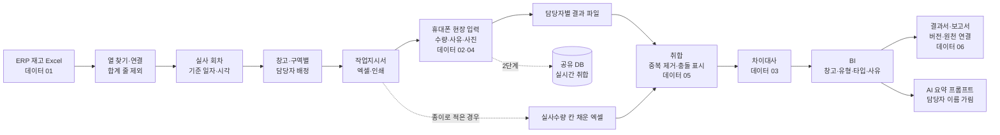

# 재고실사 비효율 개선 (재고실사 Start-End) — 프로젝트 기획서

| 항목 | 내용 |
|---|---|
| 리포 | data10-14 |
| 제출자 | 이미란 |
| 직무·소속 | 경영관리팀 (소속 회사명은 공개 리포에 두지 않음) |
| 과정 | 현장 데이터 디지털화 전문가과정 2차수 |
| 작성일 | 2026-10-21 |
| 문서 상태 | v0.3 (2026-10-27) — 3차 반영: 보고서(pptx) 견본 · 차이수량 방향 · 실사인원 0 창고 답 반영(12장). v0.2(2026-10-21): 엑셀 견본 반영(11장) |

---

## 1. 추진 배경과 현안

- 제출자는 회계감사를 위해 재고실사에 참여했다가, 자재관리팀이 현장에서 하는 재고실사가 비효율적이라는 것을 보았습니다.
- 재고실사는 **월 1회**, 「작업 배정 → 재고 시스템 수량과 현장 확인 → 차이 확인 → 사유 확인 → 취합 → 보고서 작성」 순서로 진행됩니다(제출 글).
- 지금은 ERP 에서 창고별 재고를 엑셀로 내려받아 **종이로 인쇄해 나눠 주고**, 창고 담당자가 종이에 수량을 적고, 실사 담당자가 다음 날쯤 엑셀로 **다시 옮겨 취합**하고, 그 뒤 이틀쯤 지나 **PPT 보고서**를 만듭니다(인벤토리 01~06). 실사부터 보고까지 3~4일이 걸립니다.
- 데이터 인벤토리에서 제출자가 직접 찾은 빈칸은 다음과 같습니다.
  - 작업지시서에 **기준 일자·시각**이 없음(01)
  - 수량 기록에 **수량 근거 사진·특이사항·작성자 확인란·확인 시각**이 없음(02)
  - 수치를 일부러 잘못 적어도 알아채기 어려움(03)
  - 차이 사유를 **카테고리로 나누지 않아** 그래프로 보려면 다시 손이 감(04)
  - 보고서에 **버전**과 **원천 기록 연결**(상세 내역이 어느 기록에서 왔는지)이 없음(06)

제출자의 기대는 ERP 엑셀을 올리는 것에서 작업지시가 출발하고, 휴대폰으로 현장에서 편하게 실사 기록을 남기고, 취합이 실시간으로 되고, 창고별·자재유형별·자재타입별 BI 와 최종 보고서까지 이어지는 「재고실사 Start-End 시스템」입니다.

## 2. 목표

### 2.1 최종 목표

- ERP 재고 엑셀 업로드 한 번으로 **기준 일자·시각이 박힌 작업지시서**와 담당자 배정을 만듭니다.
- 창고 담당자는 **휴대폰으로** 재고번호를 찾아 실사 수량·사유·특이사항·사진을 남기고, 확인 시각·작성자는 자동으로 붙습니다.
- 현장 기록이 **실시간으로 한곳에 모여** 차이대사·진행률이 바로 보입니다.
- **창고별·자재유형별·자재타입별·사유별 BI** 와 **버전·원천 기록 연결이 있는 결과 보고서**를 실사 당일에 냅니다(지금 3~4일 → 당일 목표, 가정).

### 2.2 1차 개발 목표

1차는 **설치 없이 브라우저에서 도는 도구**로 Start-End 흐름을 한 번 끝까지 잇습니다.

- ERP 재고 엑셀 올리기(열 이름이 조금 달라도 찾기) → 기준 일자·시각 필수 → 창고·구역별 담당자 배정 → 작업지시서 엑셀·인쇄
- 휴대폰 현장 입력(재고번호 찾기, 수량·사유 카테고리·특이사항·사진, 확인 시각·작성자 자동)
- 담당자별 결과 파일을 사무실에서 **합치기**(같은 기록은 한 번만, 두 사람의 수량이 다르면 충돌 표시)
- 차이대사(수량·금액 차이, 차이율, 허용 기준), 창고별·자재유형별·자재타입별·담당자별·사유별 분석
- 버전·기준 시각·원천 기록 연결이 들어간 결과서(엑셀)와 인쇄용 보고서, AI 요약 프롬프트(반자동)

**실시간 공유**는 1단계에서 하지 않습니다. 1단계 도구는 서버 없이 기기마다 저장하므로 휴대폰끼리 바로 섞이지 않습니다. 그래서 1단계는 「결과 파일 내보내기 → 사무실에서 합치기」로 취합하고, 2차 반영에서 지금 쓰는 SharePoint 취합 파일 방식에 맞췄습니다(11.4). 실시간 공유는 SharePoint 목록 + Power Automate 또는 회사가 허용하는 공유 DB 를 정한 뒤 2단계에서 붙입니다. 2단계용 DB 초안은 `supabase/schema.sql` 에 두었습니다(앱과는 아직 연결하지 않음).

## 3. 보유 데이터

| 데이터 | 형태 | 규모·주기 | 비고(민감도 등) |
|---|---|---|---|
| [01] 작업지시서 | ERP 에서 내려받은 .xlsx → 인쇄 | 월 1회 | 빠진 항목: 기준 일자·시각. 실제 열: 자재코드 · 자재내역 · 저장위치 · 저장위치명 · 창고위치 · 단가 · 금액 · Location · 수량(11장, 필드가 추가될 수 있음) |
| [02] 재고수량확인 기록서 | 인쇄한 작업지시서에 수기 | 월 1회, 창고별 | 빠진 항목: 수량 근거 사진, 특이사항, 작성자 확인란, 확인 시각 |
| [03] 차이대사표 | 같은 종이에서 시스템 수량과 비교 | 월 1회 | 부족하면 실물을 찾고, 초과면 ERP 수량이 적은 이유를 추적 |
| [04] 재고실사 차이기록서 | 담당자 메모·현장 사진 | 월 1회 | 사유 카테고리 없음 → 예시: 입출고 누락 / 위치 이동·분산 / 라벨·식별 오류 / 파손·폐기 미반영 / 조사 오류 / 기타 |
| [05] 재고실사 작업결과서 | .xlsx | 실사 다음 날쯤 | 실사 담당자가 종이 기록을 옮겨 취합 |
| [06] 재고실사 보고서 | .pptx | 실사 후 3~4일 | 사업부 보고·회계감사 결과서. 빠진 항목: 보고서 버전, 원천 기록 연결 |

우선순위(제출자 평가): **1순위 01**(가치 상·난이도 하) → **2순위 02·03·04**(가치 상·난이도 상, 수기·종이 기반) → **3순위 05·06**(이미 전산 자료).

ERP 재고 엑셀 견본(값 가린 사본) · 창고 배정표 · 기록서 견본을 받았습니다(11장). 자재코드·자재명·창고명·사람 이름·수량·단가는 회사 정보이므로 리포에 넣지 않고, 샘플은 같은 모양의 **가상 값**으로 만듭니다.

## 4. 해결 방안 개요

| 단계 | 내용 |
|---|---|
| 수집 | ERP 재고 엑셀(01), 휴대폰 현장 기록(02·04), 종이 기록을 옮긴 엑셀 |
| 정리 | 머리행·열 찾기, 합계 줄 빼기, 재고번호가 없으면 자재코드@창고/위치로 열쇠, 같은 열쇠는 수량 합침 |
| 대사 | 시스템 수량 vs 실사 수량 → 수량 차이·금액 차이(× 단가)·차이율, 허용 기준(차이율 또는 금액) 판정 |
| 취합 | 기록마다 고유 ID — 같은 기록은 한 번만. 같은 사람이 다시 센 것은 정정, 다른 사람끼리 다르면 충돌 |
| 산출물 | 작업지시서, 차이대사표, 작업결과서(엑셀), 보고서(인쇄·Word), AI 요약 초안 |

## 5. 주요 기능

| 기능 | 설명 | 우선순위 |
|---|---|---|
| ERP 엑셀 올리기 | 제목 줄 아래 머리행 찾기, 재고번호·자재코드·창고·저장위치·자재유형·자재타입·재고수량·단가·금액 별칭, 열 연결 화면, 합계 줄 제외 | MVP (01) |
| 기준 일자·시각 | 작업지시를 만들 때 필수. 작업지시서·결과서·보고서에 함께 찍힘 | MVP (01) |
| 담당자 배정 | 창고별 또는 창고·구역별, 이름 목록으로 자동 배정(품목 수 고르게), 지시서 버전 | MVP (01) |
| 작업지시서 | 엑셀(지시정보·전체·담당자별 시트), 인쇄본(담당자별 쪽·서명 칸) | MVP (01) |
| 휴대폰 현장 입력 | 재고번호·자재명·위치로 찾기, 미확인만 보기, 수량 +/−, 차이 즉시 표시, 차이 있으면 사유 필수, 특이사항, 사진(축소 저장), 확인 시각·작성자 자동, 저장 후 다음 미확인 품목 | MVP (02·04) |
| 목록에 없는 자재 | 현장에서 발견한 미등록 자재를 시스템 0 으로 기록 | MVP |
| 취합 | 결과 파일(JSON)·종이 기록 엑셀 합치기, 다른 회차 파일 거절, 중복 제거, 충돌 고르기 | MVP (05) |
| 차이대사 | 수량·금액 차이, 차이율, 허용 기준, 미실사·사유 미입력·충돌 보기 | MVP (03) |
| BI | 창고별·자재유형별·자재타입별·담당자별 진행률·정확도·증가/감소 금액, 사유별 분포, 시간대별 진행 | MVP (05) |
| 보고서 | 발행 버전, 기준 시각, 원천 기록 연결(기록 ID → 기록 이력), 결과서 엑셀·인쇄·Word, AI 요약(반자동) | MVP (06) |
| 실시간 공유 | 휴대폰 기록이 바로 공유 DB 에 쌓이고 사무실 화면이 실시간으로 바뀜 | 2단계 |
| 보고서 PPT | 직전 보고서(pptx)를 올리면 디자인은 두고 1장 개요 · 실사 현황, 2장 창고별 차이 표, 3장 이슈 초안만 바꿈. 없으면 기본 양식 | **3차 반영(12장)** |
| 바코드·QR | 라벨을 찍어 재고번호 찾기 | 확장 |

## 6. 기대 산출물

1. **작업지시서** — 기준 일자·시각·지시서 버전이 있는 엑셀·인쇄본 (데이터 01)
2. **현장 실사 기록** — 수량·사유 카테고리·특이사항·사진·확인 시각·작성자 (데이터 02·04)
3. **차이대사표** — 수량·금액 차이, 차이율, 허용 기준 판정 (데이터 03)
4. **작업결과서(엑셀)** — 창고별·자재유형별·자재타입별·담당자별·사유별, 차이 상세, 전체 대사표, 기록 이력 (데이터 05)
5. **재고실사 보고서** — 버전·원천 기록 연결이 있는 인쇄·Word 보고서와 AI 요약 초안 (데이터 06)
6. 실시간 취합 — 2단계

## 7. 기술 구성

| 과정 도구 | 이 프로젝트에서 쓰는 곳 |
|---|---|
| 암묵지 자산화·전략기획 | 창고 담당자가 차이를 찾아가는 방법(어디부터 다시 보는지), 사유를 가르는 기준, 허용 기준을 꺼내 적기 |
| 코랩(Python)·바이브코딩 | ERP 엑셀 정리, 차이대사·집계 로직 시험, 브라우저 도구 제작 — 1단계의 중심 |
| 멀티모달 비정형 정보화 | 수량 근거 사진, 라벨 사진에서 재고번호 읽기 (2단계) |
| RAG | 재고관리 규정·회계감사 기준을 근거로 한 질의 (확장) |
| Make 자동화 | 실사 완료 알림, 보고서 정기 발송 (확장, 보안 허용 시) |
| 생성형 AI | 보고서 요약·개선 조치 초안 (1단계는 프롬프트 생성 반자동) |

**개발 형태(권장)**

- 1단계는 **설치 없이 브라우저에서 도는 정적 웹 도구**입니다. 엑셀은 브라우저 안에서만 읽고, 기록은 그 기기에만 저장합니다. 회사 서버 승인이 없어도 바로 써 볼 수 있습니다.
- 같은 주소를 휴대폰에서 열면 현장 입력 화면이 휴대폰 폭(360px)에 맞게 보입니다. 사무실에서 받은 작업지시서 엑셀을 휴대폰에서 그대로 넣으면 같은 실사 회차가 생깁니다.
- 기기끼리는 **결과 파일**로 합칩니다. 기록마다 고유 ID 가 있어 여러 번 보내도 한 번만 들어가고, 실사 회차(지시서 ID)가 다른 파일은 받지 않습니다.
- 현장 기록은 **고치지 않고 덧붙입니다.** 다시 세면 새 기록이 생기고 이전 기록은 「기록 이력」에 남습니다(인벤토리 03 「일부러 잘못 적으면 빠질 수 있음」에 대한 대응 — 누가 언제 무엇을 바꿨는지 남김).
- AI 는 도구가 직접 부르지 않고 **프롬프트만 만들어 복사**하는 것이 기본입니다. 담당자 이름은 별칭으로 가리고, 자재코드·자재명은 기본으로 넣지 않습니다.
- 2단계 실시간 공유는 Supabase(본인·회사 프로젝트)의 표 7개와 행 단위 권한(RLS)으로 초안을 잡았습니다(`supabase/schema.sql`, 로컬 PostgreSQL 에서 권한 검사 통과). 회사 서버만 허용되면 같은 구조를 사내 DB 로 옮깁니다.

## 8. 개발 단계

### 1단계 — 지금 바로 개발 가능한 부분

ERP 실제 파일이 없어도 **같은 모양의 가상 엑셀**로 Start-End 흐름을 끝까지 만들고, 실제 파일을 받으면 열 연결만 맞춥니다.

- ERP 엑셀 올리기·열 연결 → 기준 일자·시각 → 배정 → 작업지시서 엑셀·인쇄
- 휴대폰 현장 입력(사유 카테고리 6개, 사진 축소 저장, 확인 시각·작성자 자동, 목록에 없는 자재)
- 결과 파일·종이 기록 엑셀 합치기, 충돌 고르기
- 차이대사, 창고별·자재유형별·자재타입별·담당자별·사유별 분석
- 보고서 발행 버전, 원천 기록 연결, 결과서 엑셀·인쇄·Word, AI 요약 프롬프트
- 시험용 가상 데이터에는 **소모품창고 입출고 누락**, **부품창고 B 구역 위치 이동·분산**, **제품창고 라벨이 바뀐 짝**, **충돌 2건**, **같은 사람의 정정 2건**, **외주창고 진행 지연**, **목록에 없는 잔재 2건**을 심어 각각을 찾는지 검사합니다.

### 2단계

- 실제 ERP 파일로 열 연결·허용 기준 맞추기 — 2차 반영에서 완료(11장)
- **실시간 취합** — 회사가 이미 Microsoft 365(SharePoint)를 쓰므로 두 갈래 후보(11.4):
  ① SharePoint 목록(또는 Excel Online 표) + Power Automate — 사내 보안 승인 안에서 바로 가능
  ② 공유 DB(Supabase 본인·회사 프로젝트 또는 사내 DB) — 로그인·참여자 권한·실시간, 초안 `supabase/schema.sql`
- 사진을 DB 가 아닌 비공개 저장소에 두고 기록과 연결
- 회사 보고서(pptx) 양식에 맞춘 출력 — 3차 반영에서 1단계로 당김(12장)
- 지난 회차와 비교(같은 품목·같은 사유가 반복되는지)

### 3단계

- 라벨 바코드·QR 로 재고번호 찾기
- 실사 결과를 ERP 조정 전표 형식으로 내보내기
- 반복되는 차이 사유에 대한 개선 조치 기록과 효과 확인

## 9. 기대 효과

- **취합·보고 시간 단축** — 종이를 엑셀로 다시 옮기는 일(다음 날)과 보고서 작성(3~4일 뒤)이 실사 당일로 당겨집니다(목표, 실측은 2단계 적용 후).
- **감사 근거 강화** — 기준 일자·시각, 확인 시각·작성자, 사진, 기록 이력, 보고서 버전이 남아 「이 숫자가 어디서 왔는지」를 바로 보여 줄 수 있습니다.
- **원인 관리** — 사유를 6개 카테고리로 모아 창고·자재유형·자재타입별로 어디서 차이가 반복되는지 봅니다.
- **현장 부담 감소** — 휴대폰에서 미확인 품목만 보고, 같으면 버튼 한 번으로 저장합니다.

## 10. 확인 필요 사항

> 패들릿 댓글로 요청했고, 2026-10-21 에 ①②③⑤ 답과 엑셀 견본(시트 3개), 2026-10-26 에 ④ 보고서 견본(pptx)과 남은 확인 2 · 3 의 답을 받았습니다 — 반영 내용은 11장 · 12장.

| 번호 | 요청 | 상태 |
|---|---|---|
| ① | ERP 재고 엑셀 견본 | **받음** — 시트 1(값 가린 사본). 11.1 |
| ② | 창고 목록과 창고별 담당 인원 | **받음** — 시트 2(배정표). 11.2 |
| ③ | 차이 허용 기준 | **받음** — 「차이가 있으면 무조건 사유 필수, 사유는 목록에서 선택, 필요하면 현장 사진」. 11.3 |
| ④ | 재고실사 보고서(pptx) 목차 | **받음(10-26)** — 1장 개요 및 실사 현황 · 2장 차이 내용(창고별 표) · 3장 이슈사항 및 개선, 「직전 보고서를 올리면 내용만 바꿔 나오게」. 12장 |
| ⑤ | 여러 사람 결과 모으기 | **받음** — 「실사 뒤 MS SharePoint 에 취합 파일 1개를 올려 각자 엑셀로 작성」. 11.4 |

**남은 확인 (2차 → 3차에서 답 받음)**

1. 보고서(pptx) 목차 — 받음(12.1)
2. 차이수량 방향 — 답 「시스템 수량 - 실물 : 모자라면 - 로 표현되면 됩니다」. 글자 그대로의 식(시스템 − 실물)으로는 모자랄 때 + 가 되어 뒷말과 어긋나므로, **「모자라면 −」를 기준으로 실물 − 시스템**으로 맞췄습니다(12.2). 이 읽기가 맞는지 다시 확인을 요청합니다.
3. 실사인원 0 창고의 담당자 확인서 — 답 「불필요」. 지금처럼 제외 창고 · 품목 수 · 장부금액 · 비고만 남깁니다.

**3차에서 새로 생긴 확인 (다음 댓글로)**

1. 실사 현황 표의 행 — 견본은 머리가 「창고위치」인데 행 이름은 원자재 · 완제품 · 반제품 … (자재타입)입니다. 도구는 직전 표의 행 이름에 맞춰 고르고(자동), 창고 · 창고위치(사내/사외) · 자재타입 중에서 바꿀 수 있게 했습니다. 실제로 어느 기준인지
2. 빨간 글자 — 견본 메모 「차이수량, 차이금액이 0 이상인 경우 빨간색」을 **0 이 아닌 경우**로 읽었습니다(0 이상이면 차이 없는 0 도 빨강이 되므로). 모자란 것(−)만 빨강인지
3. 실사완료 수량 · 금액 — 「현장 입력이 된 건들의 수량과 금액 합」을 **전산 수량 · 금액**(실사를 마친 품목의 장부 기준)으로 셌습니다. 실물수량 기준이 맞는지

## 11. 2차 반영 (2026-10-21 — 수강생 답과 엑셀 견본)

### 11.1 ERP 재고 엑셀 견본 (답 ①, 시트 1)

- 모양: 첫 줄 안내(「필드가 추가될 수 있음」) · 빈 줄 2개 · 4번째 줄이 머리행. 합계 줄은 없음.
- 머리: **자재코드 · 자재내역 · 저장위치 · 저장위치명 · 창고위치 · 단가 · 금액 · Location · 수량** (재고번호 열 없음, 자재유형·자재타입 열 없음, 단위·규격 없음)
- 읽는 법을 바꿨습니다.
  - 「저장위치」는 창고 코드(SAP 의 저장위치)라 **창고**로, 「저장위치명」은 창고 이름, 「창고위치」는 **사내/사외**, 「Location」은 창고 안 보관 자리(팔레트·랙)로 읽습니다.
  - 1단계 모양(「창고」 열이 따로 있고 「저장위치」가 보관 자리)도 계속 읽습니다 — 창고 열과 저장위치 열이 함께 있고 보관 자리 열이 없으면 저장위치를 보관 자리로 돌립니다.
  - 재고번호가 없으므로 「자재코드@저장위치/Location」을 열쇠로 씁니다. 같은 자재·같은 자리 줄이 또 나오면 수량·금액을 합칩니다.
  - **모르는 열도 버리지 않습니다.** 「필드가 추가될 수 있음」에 맞춰, 연결하지 않은 열은 품목에 그대로 담아 기록서 엑셀에 원래 순서대로 싣습니다. 자재유형·자재타입 열이 붙으면 그 분석이 자동으로 보이고, 없으면 숨깁니다.
  - 창고위치(사내/사외)를 새 분석 기준으로 넣었습니다(창고위치별 집계·결과서 시트).
  - 엑셀 날짜는 일련번호로 받아 직접 바꿉니다(SheetJS 날짜 변환이 한국 시간에서 52초 어긋나 자정이 전날 23:59 가 되는 것을 실제 견본에서 확인).
- 실제 견본으로 작업지시가 만들어지는 것을 확인했습니다(값은 리포에 넣지 않고 임시 폴더에서만 대조).

### 11.2 창고 목록과 창고별 담당 인원 (답 ②, 시트 2)

- 모양: 안내 줄 · 제목 · 빈 줄 · 날짜와 「재고실사 배정표」 · 빈 줄 · 머리행.
- 머리: **저장위치 · 저장위치명 · 창고위치 · 실사인원 · 담당팀 · 담당자 · 실사자 · 비고**
- 배정 화면이 이 표를 그대로 읽습니다(① 작업지시 → 「창고 배정표 엑셀 올리기」, 또는 ERP 와 같은 파일의 다른 시트면 작업지시를 만들 때 자동 적용).
  - **실사인원 0** → 이번 실사에서 그 창고 품목을 뺍니다(비고 예: 담당자 확인서로 대신함). 제외 창고 · 품목 수 · 장부금액 · 비고는 지시정보 · 진행 현황 · 결과서에 남깁니다.
  - **실사자 「갑, 을」** → 그 창고 품목을 Location 순서로 사람 수만큼 이어서 나눕니다(「창고 #1」 「창고 #2」). 실사인원과 이름 수가 다르면 알리고 이름 수대로 나눕니다.
  - **담당자** → 창고 책임자로 기록서 「담당자」 칸과 인쇄본 서명 칸(담당자 (인) · 실사자 (인))에 들어갑니다. 실사자는 배정받아 세는 사람입니다(기록서 견본의 말과 같게 화면 용어도 「실사자」로 바꿈).
  - 배정표의 날짜는 기준 일자 칸 옆에 안내로 보여 줍니다(기준 시각은 ERP 를 내려받은 시각이라 직접 넣음).
  - 배정표에 없는 창고(ERP 에만 있음)는 미배정으로, ERP 에 품목이 없는 창고는 따로 알립니다.

### 11.3 차이 허용 기준 (답 ③)

- 「차이가 있으면 무조건 사유 필수」 → **기본값을 허용 0** 으로 바꿨습니다. 차이가 하나라도 있으면 「차이(사유 필수)」 확인 대상이고, 사유 없이는 현장 입력이 저장되지 않습니다(1단계부터).
- 1단계의 「차이율 2% 또는 10만 원」은 설정에서 **허용 범위를 고를 때만** 씁니다(「허용 초과」 표시와 집계만 바뀌고, 사유 필수는 그대로).
- 「사유 리스트에서 선택」 → 기본 6개(입출고 누락 · 위치 이동·분산 · 라벨·식별 오류 · 파손·폐기 미반영 · 조사 오류 · 기타). 기록서 견본 메모 「설정에서 사유 리스트를 작성할 수 있으면 함」에 맞춰 **설정에서 사유 목록을 고칠 수 있게** 했고, 고친 목록은 기록서 엑셀 「지시정보」에 실려 휴대폰에도 같이 갑니다.
- 「필요하면 현장 사진」 → 사진은 선택 그대로(「현장 사진(필요할 때만)」).

### 11.4 여러 사람 결과 모으기 (답 ⑤ — SharePoint 취합 파일)

지금 방식(실사 뒤 SharePoint 에 취합 파일 1개를 올려 각자 엑셀로 작성)을 1차 기본 경로로 삼았습니다.

- **재고실사 기록서 엑셀 = 작업지시서 = SharePoint 취합 파일** 하나로 통일했습니다. 기록서 견본(시트 3)처럼 ERP 원래 열 뒤에 **담당자 · 실사자 · 실물수량 · 차이수량 · 사유 · 특이사항**, 끝에 확인자 · 확인시각(인벤토리 02 의 빈칸)을 붙입니다.
  - 시트: 「지시정보」(지시서 ID · 버전 · 기준 일자·시각 · 제외 창고 · 사유 구분 · 허용 기준 · 작성 방법) · 「재고실사기록서」(전체) · 실사자별 시트.
  - 차이수량은 **엑셀 수식**이라 SharePoint 에서 실물수량을 적으면 바로 보입니다(2차는 견본대로 수량 − 실물, 3차부터 실물 − 수량 — 12.2).
- 각자 **자기 이름 시트** 또는 **전체 시트의 자기 줄**에 적으면 됩니다. ③ 취합에 이 파일을 넣으면 모든 시트를 읽어 합칩니다.
  - 같은 파일을 하루에 여러 번 넣어도 같은 내용은 한 번만, 고친 줄은 정정으로 들어갑니다(기록 ID 를 내용으로 만듦).
  - 같은 사람이 전체 시트와 자기 시트에 다르게 적으면 자기 시트 값을 쓰고 알립니다. 다른 사람끼리 수량이 다르면 1단계처럼 충돌로 보여 고르게 합니다.
- 휴대폰으로 적은 사람은 「결과 엑셀 받기(기록서 양식, 내 줄만)」로 보내거나 그 줄을 SharePoint 파일에 붙이면 됩니다. 휴대폰 기록을 엑셀로 냈다가 다시 넣어도 두 번 들어가지 않습니다. 사진까지 보내려면 결과 파일(JSON)을 씁니다.

**실시간 공유는 2단계** — 회사가 Microsoft 365 를 쓰므로 후보를 둘로 적습니다.

| 후보 | 방식 | 좋은 점 | 확인할 점 |
|---|---|---|---|
| ① SharePoint 목록 / Excel Online + Power Automate | 기록서 한 줄 = 목록 항목 하나. 휴대폰은 SharePoint 앱·Forms·Power Apps 로 입력, Power Automate 가 차이 · 사유 미입력 알림과 마감 뒤 취합 파일 만들기 | 사내 계정·권한 그대로, 별도 서버 승인이 필요 없을 가능성이 큼, 지금 쓰는 취합 파일과 같은 자리 | Power Apps · Power Automate 사용 권한(라이선스), 목록 항목 수 · 동시 편집, 이 도구와는 목록을 내려받은 엑셀로 이어 붙임 |
| ② 공유 DB (Supabase 본인·회사 프로젝트 또는 사내 DB) | 이 도구가 직접 기록을 올리고 사무실 화면이 실시간으로 바뀜(초안 `supabase/schema.sql` — 2차에서 배정표 표 · 허용 0 · 사유 목록 칸을 더함, 로컬 PostgreSQL 검사 통과) | 화면 그대로 실시간, 기록은 덧붙이기만(감사 근거) | 외부 클라우드 허용 여부(보안), 로그인 방식(사내 계정 연동) |

### 11.5 가상 샘플 · 검사

- 샘플을 실제 양식과 같은 모양으로 다시 만들었습니다(값은 전부 가짜): ERP 재고 엑셀(견본 9칸 + 추가 열 예시로 자재유형 · 자재타입) 248품목 · 창고 배정표(6곳, 그중 시험실창고는 실사인원 0, 부품창고는 실사자 2명) · SharePoint 취합 파일(실사자E 자기 시트 40줄 + 실사자C 전체 시트 2줄).
- 로직 검사 35 → **50개**. 일부러 깨뜨려 확인 10가지(배정표 「실사인원」 머리 읽기 · 저장위치 돌리기 · 허용 0 기본 · 자기 시트 우선 · 내용 같은 기록 거르기 · 제외 창고 · 실사자 나누기 · ERP 시트 고르기 · 사유 목록 · 차이수량 방향) 모두 검사가 실패하는 것을 보고 원복.
- 브라우저 점검 `scripts/check-browser.mjs` 48개(ERP · 배정표 올리기 → 기록서 엑셀 → 휴대폰 360px 입력 → 결과 엑셀 합치기 → 샘플 SharePoint 합치기 · 충돌 → 설정 → 보고서, 8개 화면 × 360 · 1280px 넘침 0, JS 오류 0). 넘침 점검기는 일부러 넓은 상자를 넣으면 16곳을 잡음.

## 12. 3차 반영 (2026-10-27 — 보고서 견본과 차이수량 방향)

### 12.1 보고서(pptx) — 직전 보고서를 올리면 내용만 바꿈 (답 ④ · ①)

받은 견본은 슬라이드 4장, 와이드(16:9) 한 레이아웃, 표는 모두 PowerPoint **표 개체**(그림이 아님)입니다. 회사 양식 파일과 값은 리포에 넣지 않고 임시 폴더에서만 대조한 뒤 지웠습니다.

| 견본 슬라이드 | 짜임 | 도구가 하는 일 |
|---|---|---|
| 1 재고실사 개요 · 실사 현황 | 개요 표(7행 × 2열: 실사 시행일 · 집계 기준 시점 · 실사방법(가로 합침) · 사내 및 사외창고 · 협력사재고(세로 합침, 직접 입력)) + 실사 현황 표(11행 × 9열, 머리 2줄: 창고위치 / 전체재고 수량·금액 / 실사완료 수량·%·금액·% / 미실시 수량·금액, 끝 줄 합계) + 「(단위 : 천 EA, 백만원)」 | 실사 시행일 = 첫 ~ 마지막 확인 시각, 집계 기준 시점 = ERP 기준 일자·시각. 실사방법 칸은 직전 내용 그대로 두고 화면에서 고침. 실사 현황은 행을 다시 만들고(행 기준은 12.3) 단위 글자를 읽어 천 EA · 백만원으로 나눔. 실사인원 0 창고는 모든 칸 「-」, 합계에서 뺌 |
| 2 · 3 차이 내용 : 창고 위치명 | 표(9열: 자재코드 · 자재내역 · 저장위치 · 전산수량 · 실물수량 · 차이수량 · 단가 · 차이금액 · 차이 사유 및 조치사항) + 합계 줄 + 「(단위 : EA, 원)」 | 첫 차이 슬라이드를 본떠 **창고마다 한 장**(선택: 창고위치 사내/사외마다). 한 장 줄 수는 직전 표의 줄 높이로 자동(견본은 9줄), 넘치면 「(2/3)」 이어지는 장. 합계 줄은 창고의 마지막 장에만, 차이수량 · 차이금액만. 0 이 아니면 빨간 글자. 사유 칸 = 사유 — 특이사항 |
| 4 이슈사항 및 개선 | 「이슈 사항」 · 「개선 및 협의사항」 머리 상자, 줄마다 주제 상자 · 이슈 글상자 · 개선 글상자(2줄) | 사유별(절대 차이 금액 순) 초안 — 주제 · 「n품목 · 순차이 · 주로 어느 창고」 · 사유별 개선 문구. 화면에서 「주제 | 이슈 | 개선」 으로 고친 뒤 넣고, PPT 에서도 그대로 고칠 수 있는 글상자 |

- 견본 곳곳의 「(계산로직) …」 · 「AI가 초안 작성해주면 …」 상자는 만드는 사람에게 남긴 메모라 기본으로 지웁니다(끌 수 있음). 표 칸의 빨간 테두리(실사완료 · 차이수량~차이금액 강조)는 표의 일부라 그대로 둡니다.
- 마스터 · 레이아웃 · 테마 · 글꼴 · think-cell 개체 · 태그는 손대지 않습니다. 차이 슬라이드를 복제할 때 발표자 노트는 붙이지 않고, 지운 차이 슬라이드의 노트는 함께 지웁니다.
- 만든 보고서를 다음 달에 다시 「직전 보고서」로 올려도 같은 모양으로 다시 만들어집니다(차이 슬라이드를 모두 지우고 다시 만듦).
- 직전 보고서가 없으면 같은 짜임의 **기본 양식**(도구에 들어 있음)으로 만듭니다. 시험용 가상 양식: `samples/재고실사_결과보고_직전양식_샘플.pptx`(회사명 가상).
- 방식: pptx 는 zip 안의 XML 이라 JSZip(`vendor/jszip.min.js` 3.10.1)으로 열어 표 칸의 글자만 바꾸고, 슬라이드를 복제하면서 `[Content_Types].xml` · `presentation.xml`(슬라이드 목록 · 구역) · 관계 파일 · `docProps/app.xml` 슬라이드 수를 함께 고칩니다(`js/pptx-report.js`). 서버로 보내지 않습니다.

### 12.2 차이수량 방향 (답 「모자라면 −」)

- 기록서 엑셀(SharePoint 취합 파일)의 차이수량 수식을 **실물수량 − 수량**으로 바꿨습니다(모자라면 −, 남으면 +). 화면 차이대사 · 분석 · 결과서 · 보고서 PPT 가 모두 같은 방향입니다.
- 2차에서 받은 기록서 엑셀을 다시 넣어도 됩니다 — 합칠 때는 실물수량만 읽고 차이수량 칸은 다시 계산하므로 값이 바뀌지 않습니다.

### 12.3 실사 현황 표의 행 기준

- 견본 표는 머리가 「창고위치」인데 행 이름이 자재타입(원자재 · 완제품 · 반제품 · 상품 · 재공품 · 미착품 · 저장품 · 사급원재료)입니다. 그래서 **자동**은 직전 표의 행 이름이 어느 기준의 값과 맞는지 세어 고릅니다 — 자재타입 이름이 맞으면 자재타입, 창고명이면 창고, 사내/사외면 창고위치. 맞는 것이 없으면 창고.
- 직전 표에 있던 이름은 이번에 품목이 없어도 그 자리에 「-」로 남기고(예: 상품), 새로 생긴 값은 뒤에 붙입니다.
- 견본 ERP 에는 자재타입 열이 없어, 실제 파일로는 지금 창고 기준이 됩니다(확인 1).

### 12.4 검사

- 보고서 PPT 검사 `test/pptx.test.mjs` **22개** — 양식 읽기 · 꾸러미(XML 짝 · 관계 대상 · Content_Types · 슬라이드 id · 노트 · app.xml) · 메모 지우기 · 개요 · 실사 현황(자재타입 · 창고 · 제외 창고 「-」 · 합계 · %) · 2장(창고마다 · 이어지는 장 · 모든 차이 품목 한 번 · 실물 − 전산 · 빨간 글자 · 합계는 마지막 장) · 3장 초안 · 고친 칸 · 줄 수 · 사내/사외 · 긴 글 줄임 · 다시 넣기 · 기본 양식 · 차이 0 · pptx 아님.
- 일부러 깨뜨려 확인 12가지(차이 방향 · 빨간 글자 · 노트 복제 · Content_Types · 남은 차이 슬라이드 · 메모 알아보기 · 제외 창고 「-」 · 쪽 나누기 · 넘치는 이슈 줄 · 합계 위치 · 엑셀 수식 방향 · 엑셀 값 방향) 모두 검사가 실패.
- 받은 견본으로 확인(임시 폴더): 만든 파일을 풀어 모든 XML 을 파서로 읽음 · 관계 대상 · Content_Types 점검 0건, python-pptx 로 7장 · 표 모양 확인, LibreOffice 로 PDF 를 만들어 쪽마다 눈으로 확인, 만든 파일을 다시 올려 같은 결과.
- 로직 검사 50개 · 브라우저 점검 55개(보고서 PPT: 기본 양식으로 만들기 → 가상 양식 올리기 → 구조 안내 → 개요 칸 고치기 → 만들기 → 내려받은 파일 확인).

## 부록. 제출 원문 요약

- 직무·소속: 경영관리팀
- 현안: 재고실사 Start-End 시스템 — 작업 배정 → 재고 시스템 수량 및 현장 확인 → 차이 확인 → 사유 확인 → 취합 → 보고서 작성. ERP 엑셀(데이터 01) 업로드로 작업지시 출발, 휴대폰으로 현장 기록, 실시간 취합, 창고별·자재유형별·자재타입별 BI, 최종 보고서(데이터 06)
- 보유 데이터: ERP 에서 내려받은 재고 Data(Excel)
- 기대 산출물: 작업배정 시스템화, 현장 실시간 재고수량 및 사유 입력을 통한 재고 …(원문이 여기서 잘림)
- 첨부: 재고실사 자재 데이터 인벤토리(데이터 01~06, 우선순위 매트릭스)
- 원문: [docs/source/패들릿_접수_원문.md](source/패들릿_접수_원문.md)
