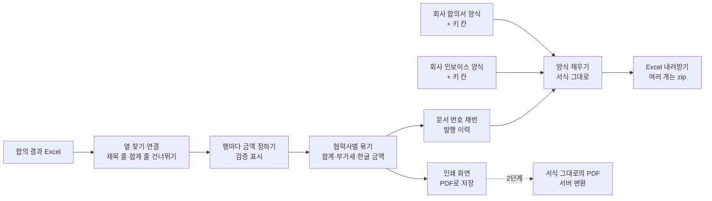

# 협력사 클레임 보상 합의서·인보이스 작성 자동화 — 프로젝트 기획서

| 항목 | 내용 |
|---|---|
| 리포 | data10-15 |
| 제출자 | 안민준 |
| 직무·소속 | 품질보증팀 보상파트 (소속 회사명은 공개 리포에 두지 않음) |
| 과정 | 현장 데이터 디지털화 전문가과정 2차수 |
| 작성일 | 2026-10-21 |
| 문서 상태 | 초안 v0.1 — 수강생 제출 자료 기반 |

---

## 1. 추진 배경과 현안

- 보상파트는 협력사와 **클레임 보상 합의**를 마치면, 그 결과로 **합의서**와 **인보이스**를 각각 작성합니다(제출 글).
- 합의 결과는 협력사별 Excel 파일로 있고, 합의서·인보이스는 회사가 정한 Excel 양식이 있습니다(제출 글).
- 한 협력사에 클레임이 여러 건이면 클레임 번호·품번·금액을 양식에 옮겨 적고 합계·한글 금액·문서 번호를 다시 맞추는 일이 협력사마다 두 번(합의서·인보이스) 되풀이되는 것으로 보입니다(가정).
- 손으로 옮기는 과정에서 금액·번호를 잘못 적거나, 합의서와 인보이스 금액이 서로 어긋날 위험이 있습니다(가정).

제출자의 기대는 **합의 Excel 을 올리면 기존 양식에 맞춰 두 문서가 자동으로 작성되고, Excel 과 PDF 로 받는 것**입니다. 최종 목표는 반복 작성 시간 단축과 수작업 입력 오류 최소화입니다.

## 2. 목표

### 2.1 최종 목표

- 합의 결과 Excel 하나로 **협력사마다 합의서·인보이스 한 쌍**을 만듭니다.
- 문서는 **회사가 쓰던 양식 그대로**(서식·병합·로고·직인 자리) 나오고, 값만 채워집니다.
- 금액은 한 곳(합의 결과)에서만 계산해, 합의서와 인보이스의 **합계·부가세·한글 금액이 늘 같게** 합니다.
- 문서 번호를 규칙대로 **자동 채번**하고, 무엇을 언제 냈는지 **발행 이력**으로 남깁니다.
- Excel 과 PDF 를 협력사 여러 곳에 대해 **한 번에** 받습니다.

### 2.2 1차 개발 목표

1차는 **설치 없이 브라우저에서 도는 도구**로, 합의 결과 Excel 과 양식 Excel 만 있으면 바로 쓰게 합니다.

- 합의 결과 Excel 가져오기(열 이름이 조금 달라도 찾기, 열 연결 화면) → 협력사별로 묶기
- 금액 검증(합의 > 청구, 비율 계산과 다름, 금액 없음, 클레임 번호 겹침·없음, 0원, 통화 섞임)과 반올림·부가세·한글 금액
- **양식 템플릿**: 회사 양식의 값 칸에 `{{협력사명}}` `{{총액}}` 같은 키를 적어 올리면 서식을 그대로 두고 채우기, 클레임 목록은 `{{행.…}}` 줄을 건수만큼 반복
- 문서 번호 자동 채번(연-월-일련)과 발행 이력
- Excel 내려받기(여러 개는 zip 한 파일)와 인쇄 화면(PDF 로 저장)

## 3. 보유 데이터

| 데이터 | 형태 | 규모·주기 | 비고(민감도 등) |
|---|---|---|---|
| 협력사별 클레임 보상 합의 결과 | Excel (제출 글) | 미상 — 견본 요청 중 | 열은 미확인(10장 ①). 협력사·클레임 번호·발생일·품번·건수·청구금액·부담 비율·합의금액 정도로 가정 |
| 기존 합의서 양식 + 작성 완료 샘플 | Excel (제출 글) | — | 칸 위치·조항 문구·서명란 확인 필요(10장 ②) |
| 기존 인보이스 양식 + 작성 완료 샘플 | Excel (제출 글) | — | 통화·부가세·입금 계좌 표기 확인 필요(10장 ②③) |

제출 글에 첨부 파일은 없습니다. 협력사 이름·금액·계좌는 회사 정보이므로 실제 파일을 받아도 리포에 넣지 않습니다. 샘플은 「A정밀(가상)」처럼 지어낸 협력사 6곳과 지어낸 클레임 번호·품번·금액으로 만들었습니다.

## 4. 해결 방안 개요

| 단계 | 내용 |
|---|---|
| 수집 | 합의 결과 Excel(여러 파일·여러 시트), 회사 양식 Excel 두 종 |
| 정리 | 머리행·열 찾기, 금액·비율·날짜 표기 맞추기(₩1,200,000 · 60% · 0.6 · 2026.9.3 …), 합계 줄 건너뛰기 |
| 검증 | 합의금액 칸 우선, 비어 있으면 청구금액 × 부담 비율. 이상 표시와 협력사별 판정 |
| 문서 | 양식의 `{{키}}` 칸을 값으로, `{{행.키}}` 줄을 클레임 수만큼 반복. 번호는 확정할 때 이력에 기록 |
| 산출물 | 합의서·인보이스 Excel(양식 서식 그대로), 인쇄용 기본 양식 PDF, 검토표·발행 이력 Excel |

## 5. 주요 기능

| 기능 | 설명 | 우선순위 |
|---|---|---|
| 합의 결과 가져오기 | 여러 파일, 머리행 자동 인식, 열 이름 별칭(업체명·거래처·보상금액·귀책률 …), 열 연결 화면, 합계 줄 건너뛰기 | MVP |
| 협력사별 묶기 | 협력사 코드(없으면 이름)로 묶기, 건수·수량·청구합계·합의합계·부가세·총액·부담 비율 | MVP |
| 금액 검증 | 확인 필요(합의 > 청구 · 금액 없음 · 비율 0~100% 밖 · 통화 섞임) / 주의(비율 계산과 다름 · 번호 겹침/없음 · 0원) / 참고(비율로 계산함) | MVP |
| 반올림·부가세·한글 금액 | 반올림·버림·올림, 1·10·100·1,000원 단위, 부가세 없음/10% 별도, 「금 일백이십만원정(₩1,200,000)」 | MVP |
| 양식 템플릿 | 회사 양식에 키를 적어 올리기, 키 칸·반복 줄 살펴보기, 모르는 키 알림, 기본 양식 2종(가상) | MVP |
| 반복 줄 | 양식에 미리 그린 빈 표 줄을 먼저 쓰고, 모자라면 줄을 끼워 넣으며 합계 줄·병합·SUM 범위·인쇄 영역·그림 위치를 함께 내림 | MVP |
| 문서 번호·발행 이력 | `{접두}-{YYYY}-{MM}-{NNN}`(형식 바꿀 수 있음), 종류·달마다 일련, 같은 내용은 같은 번호(재발행), 바뀌면 새 번호와 「대체됨」, 취소 표시 | MVP |
| Excel 내려받기 | 협력사 × 문서 종류마다 한 파일, 여러 개는 zip 한 파일(한글 파일 이름) | MVP |
| 인쇄 · PDF | 인쇄용 기본 양식(한 문서 한 쪽), 여러 협력사 한 번에, 브라우저 「PDF로 저장」 | MVP |
| 서식 그대로의 PDF | 올린 Excel 양식 모양 그대로 PDF 변환 | 확장(2단계) |
| 전자 결재·메일 발송 | 합의서 결재, 협력사에 PDF 메일 보내기 | 확장 |
| 팀 공유 | 발행 이력·양식을 팀이 함께 쓰기 | 확장 |

## 6. 기대 산출물

1. **웹 기반 합의서·인보이스 자동 생성 도구** — 합의 Excel 업로드 → 협력사·클레임별 합의금액 자동 추출 → 기존 양식에 맞춰 작성 (제출 글 ④)
2. **합의서·인보이스 Excel** — 회사 양식의 서식을 그대로 둔 채 값만 채운 파일, 여러 협력사는 zip 한 번에 (제출 글 ④)
3. **합의서·인보이스 PDF** — 1단계는 인쇄용 기본 양식으로 브라우저에서 PDF 저장, 양식 그대로의 PDF 는 Excel 에서 「PDF로 저장」(2단계에서 자동 변환) (제출 글 ④)
4. **금액 검토표·발행 이력** — 입력 오류를 문서 작성 전에 걸러 내는 검토표, 문서 번호 대장 (제출 글의 「수작업 입력 오류 최소화」)

## 7. 기술 구성

| 과정 도구 | 이 프로젝트에서 쓰는 곳 |
|---|---|
| 암묵지 자산화·전략기획 | 합의금액을 정하는 기준(부담 비율·면책·운송비 포함 여부), 문서 번호 규칙, 결재 순서를 꺼내 적기 |
| 코랩(Python)·바이브코딩 | 합의 결과 정리, 금액 검증 규칙 시험, 브라우저 도구 제작 — 1단계의 중심 |
| 멀티모달 비정형 정보화 | (확장) 스캔본 합의서·메일로 받은 합의 내용을 표로 바꾸기 |
| RAG | (확장) 지난 합의서·보상 기준 문서를 근거로 한 질의 |
| Make 자동화 | (2단계) PDF 를 협력사 메일로 보내기, 결재 시스템 연결 |
| 생성형 AI | 1단계는 쓰지 않음 — 문서 작성은 규칙 계산이라 AI 가 필요 없습니다. 조항 문구 다듬기·영문 인보이스 문구는 확장 후보 |

**개발 형태(권장)**

- 1단계는 **설치 없이 브라우저에서 도는 정적 웹 도구**입니다. 합의 결과와 양식을 브라우저 안에서만 읽고 채우므로 **회사 자료가 외부로 나가지 않습니다.**
- **양식 서식을 지키는 방법**: 무료 엑셀 라이브러리(SheetJS 무료판)는 파일을 다시 쓸 때 글꼴·테두리·채우기 색을 버립니다(유료판만 서식 쓰기 지원). 그래서 이 도구는 라이브러리로 「읽고 다시 쓰지」 않고, xlsx 파일(zip) 안의 시트 XML 에서 `{{키}}` 가 적힌 칸의 값만 바꿉니다. 글꼴·테두리·색·병합·열 너비·행 높이·인쇄 설정·로고·직인 그림이 그대로 남습니다. 기본 양식을 채운 결과를 LibreOffice 로 PDF 변환해 서식이 그대로인 것을 눈으로 확인했습니다.
- **반복 줄**: 양식에 미리 그려 둔 빈 표 줄을 먼저 쓰고, 모자라면 줄을 끼워 넣습니다. 이때 아래의 합계 줄·병합·조건부 서식 범위·인쇄 영역·그림 위치를 함께 내리고, 표 끝에 닿은 `=SUM(I14:I21)` 은 끼운 줄까지 범위를 늘립니다. 수식은 엑셀이 열 때 다시 계산하게 합니다.
- **PDF**: 브라우저만으로는 엑셀 서식을 그대로 PDF 로 만들 수 없습니다. 1단계는 ① 도구가 그리는 **인쇄용 기본 양식**(합의서·인보이스)을 브라우저 「PDF로 저장」으로 받고, ② 회사 양식 그대로의 PDF 가 필요하면 내려받은 Excel 에서 「PDF로 저장」합니다. 2단계에서 사내 서버에 변환기(LibreOffice 등)를 두면 양식 그대로의 PDF 를 자동으로 만들 수 있습니다.
- **금액은 한 곳에서**: 합의서와 인보이스는 같은 협력사 묶음의 같은 계산값을 씁니다. 그래서 두 문서의 합계가 어긋날 수 없습니다.

## 8. 개발 단계

### 1단계 — 지금 바로 개발 가능한 부분

견본이 없어도 **합의 결과의 기본 열(협력사·합의금액 또는 청구금액·부담 비율)만 있으면** 쓰도록 만들었습니다. 가상 합의 결과 22행(협력사 6곳, 원화 5 · 달러 1)과 가상 기본 양식 2종으로 만들고 검사했고, 견본을 받으면 열 연결과 양식의 키 칸만 맞춥니다.

- 합의 결과 가져오기(머리행·열 자동 인식, 열 연결 화면, 합계 줄 건너뛰기) → 협력사별 묶기
- 금액 검증과 반올림·부가세·한글 금액, 검토표 Excel
- 양식 템플릿(키 칸·반복 줄), 기본 양식 2종, 회사 양식 올리기와 살펴보기
- 문서 번호 채번·발행 이력, Excel 내려받기(zip), 인쇄·PDF
- 시험용 가상 데이터에는 합의금액 없음 1 · 합의 > 청구 1 · 비율 계산과 다름 2 · 비율로 계산(원 단위 반올림) 1 · 같은 클레임 번호 2행 · 번호 없음 1 · 0원(면책) 1 · 달러 협력사 1곳 · 맨 아래 합계 줄을 심었습니다.

### 2단계

- 실제 합의 결과 견본으로 열 연결·금액 기준 맞추기, 회사 양식 두 종에 키 칸 적기
- **양식 그대로의 PDF 자동 변환**(사내 서버의 변환기)과 협력사별 PDF 묶음
- 합의서 결재·서명 상태 관리, 협력사에 PDF 메일 보내기(Make·Power Automate, 회사 메일 정책 확인 후)
- 영문 인보이스(금액 영문 표기), 통화별 환율·입금 확인

### 3단계

- 팀이 함께 쓰는 저장소(발행 이력·양식 공유, 번호 중복 방지)
- 클레임 관리 시스템과 연결해 합의 결과 Excel 없이 바로 가져오기

## 9. 기대 효과

- **반복 작성 시간 단축** — 협력사마다 두 문서를 손으로 채우던 일을, 파일 하나 올리고 내려받는 일로 바꿉니다.
- **입력 오류 최소화** — 금액·번호를 옮겨 적지 않고, 합의 > 청구 같은 이상을 문서 만들기 전에 걸러 냅니다.
- **합의서·인보이스 일치** — 같은 계산값을 쓰므로 두 문서의 합계·한글 금액이 늘 같습니다.
- **번호 관리** — 문서 번호가 규칙대로 붙고, 재발행·대체·취소가 이력에 남습니다.

## 10. 확인 필요 사항

> 패들릿 댓글로 요청할 목록입니다. 답을 받으면 기획서를 v0.2 로 고치고 도구의 열 연결·양식·기본값을 맞춥니다.

**샘플 데이터 (필수)**

1. 합의 결과 Excel 견본(값을 가린 사본) — 실제 열 이름과 순서, 한 행이 클레임 한 건인지, 협력사 여러 곳이 한 파일에 있는지, 합의금액을 적는 방식(금액 직접 / 부담 비율로 계산)
2. 합의서·인보이스 양식과 작성 완료 샘플(값을 가린 사본) — 칸 위치, 클레임 목록 표의 줄 수, 조항 문구, 그림(로고·직인)이 있는지

**기준**

3. 인보이스의 통화와 부가세 — 원화만인지 외화 협력사도 있는지, 보상금에 부가세를 붙이는지, 금액 반올림 기준(원 단위·버림 등)
4. 문서 번호 규칙과 결재·서명 칸 — 합의서·인보이스 번호를 어떻게 매기는지(접두·연월·일련), 결재란·서명(날인)란이 몇 칸인지, 합의서와 인보이스를 같은 날 내는지

**보안·환경**

5. PDF 와 직인 — PDF 에 회사 직인 이미지가 들어가야 하는지(들어가면 파일을 어디에 두는지), 양식 그대로의 PDF 가 꼭 필요한지(그렇다면 사내 변환 서버를 둘 수 있는지), 이 도구를 혼자 쓰는지 팀이 함께 쓰는지

## 부록. 제출 원문 요약

- 현안: 협력사와 클레임 보상 합의가 끝나면 합의서와 인보이스를 각각 작성해야 함 → 합의 Excel 을 올리면 기존 지정 양식에 맞춰 자동 작성
- 데이터: 협력사별 클레임 보상 합의 결과 Excel, 기존 합의서·인보이스 Excel 양식과 작성 완료 샘플
- 기대 산출물: 웹 기반 합의서·인보이스 자동 생성(업로드 → 협력사·클레임별 합의금액 추출 → 양식대로 작성 → Excel·PDF 다운로드), 반복 작성 시간 단축·수작업 입력 오류 최소화
- 원문: [docs/source/패들릿_접수_원문.md](source/패들릿_접수_원문.md)
