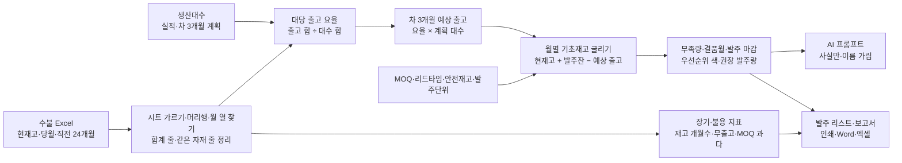

# 원/부자재 미결 방지 사전 관리 — 프로젝트 기획서

| 항목 | 내용 |
|---|---|
| 리포 | data10-16 |
| 제출자 | 이성헌 |
| 직무·소속 | 구매팀 (소속 회사명은 리포에 두지 않음) |
| 과정 | 현장 데이터 디지털화 전문가과정 2차수 |
| 작성일 | 2026-10-27 |
| 문서 상태 | 초안 v0.1 — 수강생 제출 자료 기반 |

---

## 1. 추진 배경과 현안

- 원/부자재는 이론적으로 **자재 원단위 기준 MRP** 로 수급하면 되지만, 실제로는 **특정 규격 자재가 미결(결품)** 되는 일이 종종 생깁니다(제출 글).
- 원인은 두 가지로 적혀 있습니다. 첫째, **규격이 많은 자재 종수**(강종 × 두께·폭·길이). 둘째, 생산에서 **lot 단위로 절단**하기 때문에 한 규격의 출고가 한 번에 몰려 나가는 것입니다(제출 글).
- 지금은 입출고 수불 엑셀로 이 일을 하고 있고, 이를 **자동·디지털화** 하고 싶어 합니다(제출 글).
- 원단위(대당 소요량)만으로 계산하면 평균은 맞아도 몰려 나가는 달을 놓치기 쉽습니다. 그래서 **실제 출고 기록과 생산대수로 낸 「출고 요율」** 로 차 3개월을 내다보는 방식을 택한 것으로 보입니다(가정).

제출자의 기대는 생산 대수 대비 규격별 자재 투입 요율로 **차 3개월 예상 출고량**을 내고, 달마다 기초재고를 감안해 **부족 강재량**과 **발주 우선순위(색 구분)** 를 만들고, **MOQ·리드타임을 감안한 발주 시점**과 **장기·불용재를 미리 막는 지표**까지 얻는 것입니다.

## 2. 목표

### 2.1 최종 목표

- 수불 엑셀을 넣으면 **규격별 차 3개월 예상 출고 → 월별 기초재고 → 부족량 → 발주 리스트**가 늘 같은 기준으로 나오게 합니다.
- **발주 우선순위를 색으로** 나눠(긴급 · 이번 달 · 예정 · 충분) 이번 달 무엇부터 발주할지 바로 보이게 합니다.
- **MOQ·리드타임·발주단위·안전재고**를 자재마다 반영해 발주 마감과 권장 발주량을 냅니다.
- **장기재고·불용재 지표**(재고 개월수, 무출고 개월수, 출고 감소, MOQ 과다)로 미결과 반대쪽 위험도 함께 봅니다.

### 2.2 1차 개발 목표

1차는 **수불 엑셀만 있으면 바로 쓸 수 있는 브라우저 도구**에 집중합니다.

- 수불 엑셀 가져오기 — 수불 현황 · 생산대수 · 발주 기준 시트를 알아서 가르고, 머리행·월 열을 찾기
- 자재별 평균 출고(분기·반기·년간)와 대당 출고 요율, 차 3개월 예상 출고
- 월별 기초재고 굴리기, 안전재고 대비 부족량, 결품 예상월, 발주 마감, 우선순위 색, MOQ·발주단위 반영 권장량
- 장기·불용 재고 지표
- 계산된 사실만 담은 AI 프롬프트(이름 가림)와 보고서 초안(인쇄·Word·엑셀)

ERP 연동·자동 발주서 발행은 실제 양식과 발주 기준을 확인한 뒤 2단계에서 다룹니다.

## 3. 보유 데이터

| 데이터 | 형태 | 규모·주기 | 비고(민감도 등) |
|---|---|---|---|
| 입출고 수불 | Excel (제출 글) | 월 1회 마감으로 가정 — 견본 요청 중 | 강종별 현재고 · 당월 입고 · 당월 출고 · 직전 1~24개월 입고(참고)/출고 · 평균 출고(분기·반기·년간) · 대당 평균 출고 요율 (제출 글). 1행 = 자재(강종·규격) 하나로 가정 |
| 월별 생산대수 | 미상 | 월 | 실적(요율 계산용)과 차 3개월 계획(예상 출고용)이 필요. 수불 엑셀 안에 있는지 따로인지 확인 필요(10장 ②) |
| MOQ · 리드타임 · 발주단위 | 미상 | — | 자재(규격)·공급사마다 다른지 확인 필요(10장 ③) |
| 안전재고 · 현재 발주 기준 | 미상 | — | 지금 몇 개월분을 기준으로 발주하는지(10장 ④) |
| 발주잔량(입고 예정) | 미상 | — | 수불에 미입고 발주가 있는지, 언제 들어오는지(10장 ①) |
| 불용재 기준 | 미상 | — | 몇 개월 무출고를 불용으로 보는지(10장 ⑤) |

제출 글에 첨부 파일은 없습니다. 공급사·단가·자재코드는 회사 정보이므로 실제 파일을 받아도 리포에 넣지 않습니다. 샘플은 같은 항목의 **가상 값**(가짜 자재코드 RM-1xx, 공급사A~D)으로 만듭니다.

## 4. 해결 방안 개요

| 단계 | 내용 |
|---|---|
| 수집 | 입출고 수불 Excel, 생산대수 실적·계획, 자재별 발주 기준 |
| 정리 | 머리행·월 열 찾기(두 줄 머리·상대 월 「M-1」 포함), 기준월 찾기, 합계 줄 빼기, 같은 자재 줄 합치기 |
| 분석 | 대당 출고 요율(대수 가중), 예상 출고, 월별 굴리기, 안전재고·리드타임으로 우선순위, MOQ·발주단위로 권장량, 장기·불용 지표 |
| AI | 계산된 사실만 담은 프롬프트로 발주 판단 검토·장기재고 대책 정리 (1단계는 반자동) |
| 산출물 | 발주 리스트(색 구분), 월별 부족량, 강종별 부족량, 장기·불용 지표, 보고서 초안 |

## 5. 주요 기능

| 기능 | 설명 | 우선순위 |
|---|---|---|
| 수불 가져오기 | 시트 종류 자동 가름, 제목 줄 아래 머리행 자동 인식, 월 열(「2026-09」「25.10 출고」「M-1」 · 윗줄 「출고 실적」 묶음), 열 연결 화면, 기준월 확인 | MVP |
| 출고 요율·예상 출고 | 분기·반기·년간 평균 출고, 대당 요율(기간 선택), 차 3개월 예상 출고, 변동(로트 절단 의심)·요율 변화 표시 | MVP |
| 월별 굴리기·부족량 | 기초 → 예상 출고 → 기말, 안전재고 대비 부족량, 결품량, 강종별 부족량 | MVP |
| 발주 리스트 | 우선순위 색(빨강 긴급 · 주황 이번 달 · 노랑 예정 · 초록 충분), 발주 마감월, MOQ·발주단위 반영 권장량, 엑셀 내보내기 | MVP |
| 자재별 발주 기준 | MOQ·리드타임·안전재고(개월분 또는 수량)·발주단위 — 시트로 가져오기 · 화면에서 고치기 · 엑셀 붙여 넣기 | MVP |
| 장기·불용 지표 | 재고 개월수, 마지막 출고, 출고 감소, MOQ 과다, 재고 금액(단가가 있으면) | MVP |
| AI 프롬프트 | 계산된 사실만, 공급사·자재코드 가림, 답 되돌리기 | MVP(반자동) |
| 보고서 | 인쇄/PDF·Word·엑셀 | MVP |
| 발주서 양식 출력 | 회사 발주서·구매요청서 양식으로 채워 내기 | 확장(양식 확인 뒤) |
| 로트 절단 계획 반영 | 절단 계획(어느 달 몇 lot)을 받아 예상 출고에 직접 반영 | 확장 |
| ERP 연동·공유 | 수불·발주잔을 ERP 에서 바로 받기, 팀 공유 | 확장 |

## 6. 기대 산출물

1. **차 3개월 생산대수 기반 예상 출고량** — 자재(규격)별·월별 (제출 글)
2. **월별 기초재고를 감안한 부족 강재량** — 자재별·강종별 (제출 글)
3. **발주 우선순위 색 구분 발주 리스트** — 발주 마감월, MOQ·리드타임 반영 권장량 (제출 글)
4. **장기·불용재 사전 방지 지표** — 재고 개월수·무출고·출고 감소·MOQ 과다 (제출 글)
5. AI 검토 프롬프트와 보고서 초안

## 7. 기술 구성

| 과정 도구 | 이 프로젝트에서 쓰는 곳 |
|---|---|
| 암묵지 자산화·전략기획 | 지금 발주를 결정하는 기준(몇 개월분을 두는지, 어느 자재를 먼저 넣는지, lot 절단을 어떻게 잡는지)을 꺼내 적기 |
| 코랩(Python)·바이브코딩 | 수불 정리, 요율·굴리기 로직 시험, 브라우저 도구 제작 — 1단계의 중심 |
| 멀티모달 비정형 정보화 | 공급사 견적·납기 회신(메일·PDF)에서 MOQ·리드타임 뽑기 (2단계) |
| RAG | 구매 규정·공급사 계약 조건을 근거로 한 발주 질의 (2단계) |
| Make 자동화 | 월 마감 뒤 발주 리스트 정기 발송, 빨강 자재 알림 (확장, 보안 허용 시) |
| 생성형 AI | 발주 판단 검토·장기재고 대책 정리 (1단계는 프롬프트 생성 반자동) |

**개발 형태(권장)**

- 1단계는 **설치 없이 브라우저에서 도는 정적 웹 도구**로 만듭니다. 엑셀을 브라우저 안에서만 읽고 계산하므로 **수불 자료가 외부로 나가지 않습니다.** 요율·굴리기·우선순위는 규칙 계산이라 AI 서비스가 필요 없습니다.
- **대당 요율은 「출고 합 ÷ 생산대수 합」** 으로 셉니다. 달마다의 요율을 평균 내면 생산이 적은 달이 지나치게 크게 반영되기 때문입니다.
- **리드타임은 보수적으로** 봅니다 — 지금(기준월 말) 발주하면 리드타임 개월 수(일 ÷ 30 올림) 뒤 달 말에 들어와 그다음 달부터 쓴다고 봅니다. 미결을 막는 것이 목적이라 늦게 들어오는 쪽으로 잡았습니다.
- **lot 절단으로 출고가 몰리는 자재**는 월별 대당 출고의 변동계수로 찾아 표시하고, 안전재고를 따로 올리도록 권합니다(자재별 안전재고 칸).
- AI 는 도구가 직접 부르지 않고 **프롬프트만 만들어 복사**하는 것이 기본입니다. 공급사·자재코드는 별칭으로 가립니다. 강종·규격(SS400 6t 같은 표준 표기)과 수량은 분석에 필요해 그대로 둡니다.

## 8. 개발 단계

### 1단계 — 지금 바로 개발 가능한 부분

**수불 엑셀 하나만 있으면** 쓸 수 있는 기능을 먼저 만듭니다. 견본을 받기 전에는 제출 글의 항목대로 만든 가상 수불(자재 20종 × 24개월)로 만들고, 견본을 받으면 열 연결만 맞춥니다.

- 수불 가져오기(시트 가르기, 머리행·월 열 자동 인식, 열 연결 화면, 기준월 확인, 합계 줄 제외, 같은 자재 줄 합치기)
- 분기·반기·년간 평균 출고와 대당 출고 요율, 차 3개월 예상 출고(계획이 없는 달은 직전 평균 대수)
- 월별 기초재고 굴리기, 안전재고 대비 부족량, 결품량, 강종별 부족량
- 우선순위 색과 발주 마감월, MOQ·발주단위 반영 권장 발주량
- 장기·불용 재고 지표
- 자재별 MOQ·리드타임·안전재고·발주단위(시트·화면·붙여 넣기), 기본값은 설정에서
- AI 프롬프트(사실만, 이름 가림)와 보고서 초안(인쇄·Word·엑셀)
- 시험용 가상 데이터에는 일부러 **lot 절단으로 출고가 몰리는 자재**, **리드타임이 긴 자재**, **최근 대당 출고가 늘어난 자재**, **MOQ 가 사용량보다 훨씬 큰 자재**, **14개월 무출고 자재**를 심고, 재고가 넉넉한 **대조군**도 두어 찾을 것은 찾고 찾지 말 것은 찾지 않는지 확인합니다.

### 2단계

- 실제 수불 견본으로 열 연결·기준월·단위 맞추기, 실제 발주 기준(MOQ·리드타임·안전재고) 넣기
- 회사 발주서·구매요청서 양식으로 채워 내기
- 발주잔량의 입고 예정월 반영(지금은 다음 달 기초에 모두 더함)
- 로트 절단 계획을 받아 예상 출고에 직접 반영, 대체 가능한 규격 묶음
- 발주한 뒤 실제 입고·출고와 비교해 요율·안전재고 다시 맞추기

### 3단계

- ERP 에서 수불·발주잔을 바로 받기, 팀 공유 저장소
- 사내 허용 AI 와 직접 연결해 월간 발주 검토 초안 자동 작성
- 월 마감 뒤 발주 리스트 자동 발송·빨강 자재 알림

## 9. 기대 효과

- **미결(결품) 예방** — 리드타임 안에 결품이 날 자재를 기준월 마감과 동시에 빨강으로 알아 긴급 조달·대체를 먼저 할 수 있습니다.
- **발주 판단 시간 단축** — 규격 수십 종의 차 3개월 부족량과 발주 마감이 한 표로 나와, 엑셀을 손으로 이어 붙이는 일을 줄입니다.
- **장기·불용재 감소** — MOQ 과다·무출고·출고 감소를 발주 전에 보여 줘, 필요 없는 재고를 더 만들지 않게 합니다.
- **같은 기준의 반복** — 매달 같은 방식(대수 가중 요율, 보수적 리드타임)으로 계산해 담당자가 바뀌어도 결과가 같습니다.

## 10. 확인 필요 사항 — 확인 부탁

> 패들릿 댓글로 요청할 목록입니다. 답을 받으면 기획서를 v0.2 로 고치고 도구의 열 연결·기준값을 맞춥니다. 1차 범위는 예상 출고 → 월별 부족량 → 색 구분 발주 리스트 + 장기·불용 지표이고, 발주서 양식 출력·ERP 연동은 확인 뒤로 둡니다.

**샘플 데이터 (필수)**

1. **입출고 수불 엑셀 견본**(최근 기준월 하나, 값을 가린 사본) — 시트 구성, 한 행이 자재(강종·규격) 하나인지, 직전 1~24개월 출고 열의 머리 모양(「2026-09」 / 「9월」 / 「M-1」), 기준월(당월)을 어디에 적는지, 단위(kg·톤·매), 발주잔량(미입고 발주)이 있는지
2. **생산계획 양식** — 월별 생산대수 실적과 차 3개월 계획이 어디에 어떤 모양으로 있는지(수불 엑셀 안 / 따로 / 생산팀 파일), 모델별로 나뉘어 있는지(모델마다 대당 소요가 다르면 모델별 요율이 필요)

**발주 기준**

3. **MOQ · 리드타임 표** — 자재(규격)별·공급사별 MOQ, 리드타임(일), 발주단위(코일·묶음), 같은 강종이라도 규격마다 다른지
4. **지금의 발주 기준** — 안전재고를 몇 개월분으로 두는지(자재마다 다른지), 발주를 언제(월 마감 뒤 / 수시) 넣는지, 우선순위를 무엇으로 정하는지, lot 절단 계획을 미리 알 수 있는지
5. **불용재 정의** — 몇 개월 무출고를 장기재고·불용재로 보는지, 재고 금액 기준이 있는지, 대체 사용(다른 규격으로 절단)을 허용하는지

**보안·환경 (견본을 받으며 함께 확인)**

- 수불 자료를 외부 AI(ChatGPT 등)에 넣어도 되는지 — 도구는 기본으로 공급사·자재코드를 가리고 숫자만 보냅니다.
- 혼자 쓰는지, 구매·생산관리가 함께 보는지(공유 저장소 필요 여부)

## 부록. 제출 원문 요약

- 현안: 원/부자재 미결 방지 사전 관리 — 규격이 많은 자재 종수와 lot 단위 절단으로 특정 규격이 미결됨 → 생산 대수 대비 규격별 투입 요율로 차 3개월 예상 출고량을 내고 부족 자재 발주 리스트 자동 생성(엑셀 업무의 디지털화)
- 데이터: 입출고 수불(excel) — 강종별 현재고 / 당월 입고 / 당월 출고 / 직전 1~24개월 입고(참고)·출고와 평균 출고(분기·반기·년간) / 해당 월 생산대수 기반 평균 출고 요율
- 기대 산출물: 차 3개월 생산대수 기반 예상 출고량, 월별 기초재고 감안 부족 강재량, 발주 우선순위 색 구분, 장기·불용재 사전 방지 지표(MOQ·Lead time 을 감안한 발주 시점)
- 원문: [docs/source/패들릿_접수_원문.md](source/패들릿_접수_원문.md)
